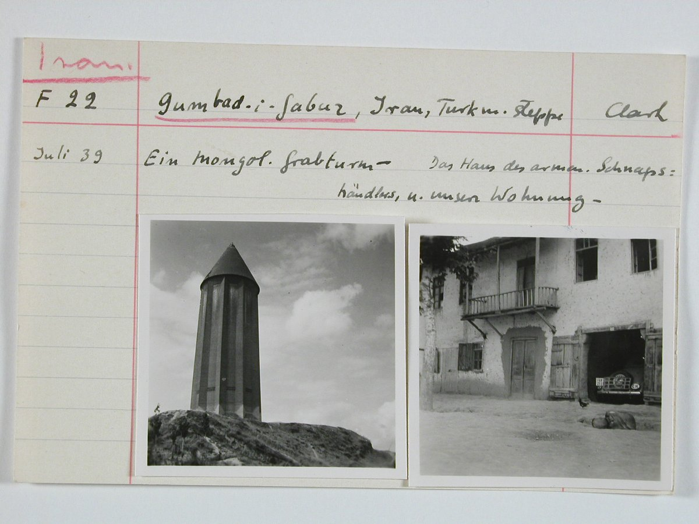

Across the windswept steppes of Turkmen Sahra, where wild winds ruffle the manes of purebred Akhal-Teke horses and the rhythmic strains of the dutar echo inside circular felt yurts (*Qara-Oy*), no folklore figure brings greater joy to nomadic gatherings than *Yarty-Qulaq* (literally meaning "Half-Ear" in Turkmen). According to tribal tradition, an elderly, childless nomad couple was miraculously blessed with a son no taller than a human thumb who possessed only half an ear. While diminutive in stature, Yarty-Qulaq harbored a heart of intrepid courage and a boundless sea of cleverness.

During that era, a greedy regional Khan taxed the nomads mercilessly, seizing their cattle and horses without pity. When the Khan's bailiffs confiscated the lone milking mare of Yarty-Qulaq's aging parents, the pint-sized hero set off to the palace compound. Thanks to his minute stature, he evaded every guard and slipped undetected directly into the ear of the Khan's prized battle stallion.

> As the ancient Turkmen proverb affirms: "Let your stature be a single palm-span, provided your intellect is as deep as an ocean; live boldly like Yarty-Qulaq."

The next morning, as the pompous Khan mounted his steed before the gathered tribal aristocracy, Yarty-Qulaq whispered ominous, booming warnings straight into the stallion's inner ear canal, pretending to be the ancestral guardian of the steppes: "Throw this wicked oppressor into the ditch, or the curse of the desert shall strike you down!" Terrified by what seemed to be supernatural speech from within its own head, the steed bucked furiously, casting the Khan headfirst into a foul mud pit. Thoroughly shaken and convinced that the desert spirits had turned against him, the Khan ordered his guards to retreat. That night, Yarty-Qulaq unlocked the palace granaries and returned the stolen livestock back to the nomad encampments. To this day, Yarty-Qulaq endures as an affectionate champion of grassroots justice in Turkmen folklore.

### Anthropological & Folklore Analysis
Yarty-Qulaq corresponds to the widespread migratory folktale motif of the clever thumb-sized trickster (Aarne-Thompson-Uther type 700), masterfully adapted to the socio-cultural realities of Turkmen nomadic life. Central motifs include equine reverence, subversive humor targeting feudal tyranny, and the celebration of pastoral intellect over brute force.

### Archival Sources & Attribution
- **Primary Source:** Avaye Tabeid Cultural Journal, Issue 36: Dedicated to Turkmen Literature and Oral Culture of Iran.
- **Source URL:** https://asre-nou.net/php/images/new/avaye-tabeid36.pdf
- **Original Language:** Turkmen & Persian
- **Image Attribution:** File:CH-NB - Iran, Gumbad-i-Gabus (Gonbad-e Qabus, Gonbad-e Kabood)- Grabturm - Annemarie Schwarzenbach - SLA-Schwarzenbach-A-5-19-092.jpg | Photographer: Annemarie Schwarzenbach | License: Public domain
