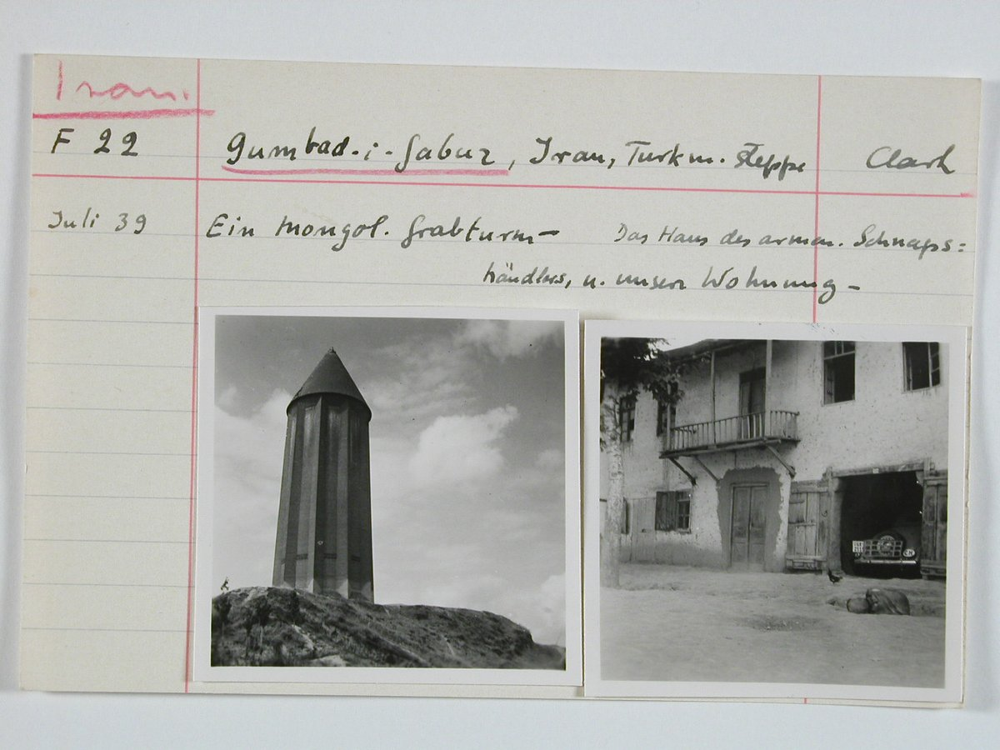

در گستره پهناور دشت‌های ترکمن‌صحرا، آنجا که بادهای وحشی یال اسبان اصیل را شانه می‌زنند و نغمه دوتار بخشی‌ها در آلاچیق‌های نمدی (قره‌اوی) طنین می‌اندازد، هیچ داستانی به اندازه ماجراهای «یارتی‌قولاق» (Yarty-Qulaq؛ در زبان ترکمنی به معنای نیم‌گوش) گلخند را بر لبان مردم صحرانشین نمی‌نشاند. افسانه‌ها می‌گویند پیری عابد و همسرش سال‌ها در آرزوی فرزندی بودند تا آنکه خداوند پسری به آنها بخشید که جثه‌اش بیش از یک بند انگشت نبود و تنها نیمی از یک گوش را بر سر داشت. اگرچه اندام او ذره‌ای بیش نبود، اما در سر کوچکش دریایی از هوش، ذکاوت و شجاعت موج می‌زد.

در آن سال‌ها، خان ظالمی بر منطقه حکومت می‌کرد که با مالیات‌های سنگین و غارت اسب‌ها و گوسفندان، روزگار را بر ایلات ترکمن سیاه کرده بود. هنگامی که داروغه خان آخرین مادیان پیرمرد کشاورز را غصب کرد، یارتی‌قولاق تصمیم گرفت با تکیه بر جثه نامرئی و تدبیر هوشمندانه‌اش، به مصاف کاخ خان برود. او در تاریکی شب، بی‌آنکه کسی متوجه شود، خود را به اصطبل اختصاصی خان رساند و درون گوش اسب اصیل و سرکش خان پنهان شد.

> ضرب‌المثل ترکمنی در ستایش خرد می‌گوید: «بویونگ بیر قاریش، عقلینگ بیر دنگیز بولسون، یارتی‌قولاق یالی یاشا.» (قامتت اگر یک وجب هم باشد، باید دانایی‌ات همچون دریا پهناور باشد، آن‌سان که یارتی‌قولاق زیست).

بامدادان هنگامی که خان متکبر بر زین اسب نشست تا در حضور بزرگان ایل خودنمایی کند، یارتی‌قولاق از اعماق گوش اسب با صدایی مرموز و هول‌انگیز نجوا کرد: «ای اسب باوفا، این حاکم ستمگر سزاوار سواری تو نیست؛ او را در لجنزار بیفکن وگرنه خشم ارواح صحرا تو را فرو خواهد بلعید!» اسب وحشت‌زده روی دو پا برخاست و خان را به درون گودال گل‌آلود حاشیه جویبار پرتاب کرد. خان که گمان می‌کرد اسبش به زبان غیب سخن می‌گوید، دچار وحشتی عمیق شد. یارتی‌قولاق سپس با نفوذ به انبار غله و خزانه خان، درهای مخفی را به روی بینوایان گشود و تمام اموال غارت‌شده را شبانه به چادرهای عشایر بازگرداند. نام یارتی‌قولاق در ادبیات عامیانه ترکمن نماد پیروزی حق بر باطل و توانمندی مستضعفان در برابر ستمکاران است.

### بن‌مایه‌ها و ویژگی‌های مردم‌شناختی
افسانه یارتی‌قولاق نماد تیپ جهانی «بندانگشتی» (Tom Thumb) است که با ویژگی‌های زیستی و بومی ایل‌های ترکمن درآمیخته است. اهمیت اسب در زیست‌بوم صحرا، نقد استبداد فئودالی خان‌ها از طریق شوخ‌طبعی و طنز گزنده، و بزرگداشت هوش ذاتی چادرنشینان در برابر قدرت مادی، از بارزترین لایه‌های معرفتی این داستان است.

### منابع و پژوهش
- **منبع اصلی:** نشریه آوای تبعید، شماره ۳۶، ویژه فرهنگ و ادبیات ترکمن‌های ایران (به کوشش رحیم کاکائی و محققان ترکمن‌صحرا).
- **پیوند مرجع:** https://asre-nou.net/php/images/new/avaye-tabeid36.pdf
- **زبان اصلی متن:** ترکمنی و فارسی
- **تصویر:** File:CH-NB - Iran, Gumbad-i-Gabus (Gonbad-e Qabus, Gonbad-e Kabood)- Grabturm - Annemarie Schwarzenbach - SLA-Schwarzenbach-A-5-19-092.jpg | عکاس: Annemarie Schwarzenbach | مجوز: Public domain
