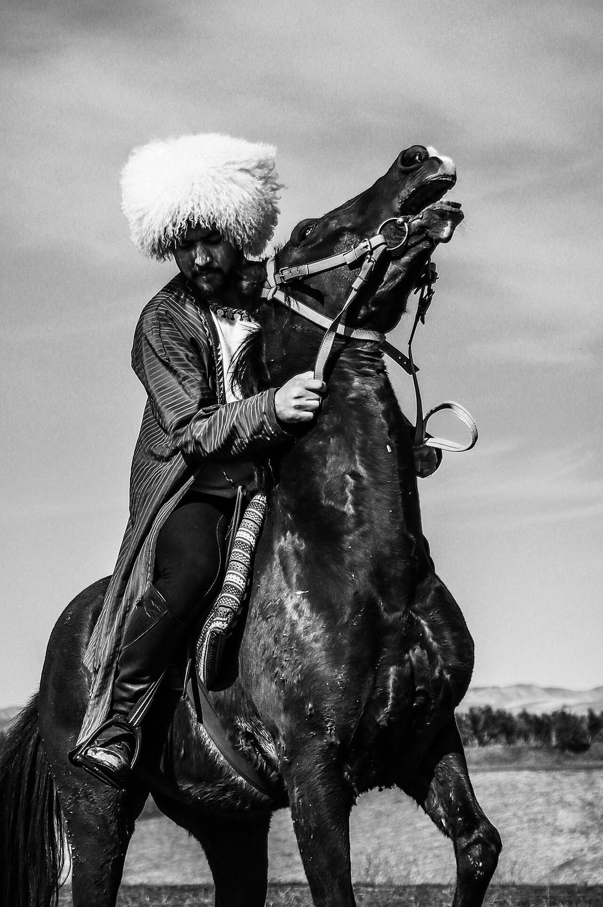

Across the boundless grasslands of the Turkmen Sahra in northeastern Iran, beneath the shadow of the monumental brick tower of Gonbad-e Qabus, the horse is not merely a noble companion; it is revered as a sacred bridge to the metaphysical plane. Among the pastoral Yomut and Goklen tribes, elders speak with quiet reverence of *Oghluk*—the phantom wind-rider stallion, sired by a celestial winged courser upon a terrestrial desert mare, who appears only to riders of unblemished courage.

Turkmen folklore holds that Oghluk is the eternal spectral protector of the steppes. Lacking iron shoes, it gallops across sea-like grasslands without bending a single blade, its midnight whinnying alerting felt yurts (*oy*) to approaching predatory wolf packs or seasonal flash floods. In heroic ballads, a mortally wounded tribal warrior stranded in the barren steppe was rescued when Oghluk materialized from the dust; breathing warm life into the hero’s wounds, the spectral steed carried him across hundreds of leagues in the span of a single heartbeat to the safety of his ancestral clan.

> "The Turkmen stallion is the concealed wings of the desert nomad; if Oghluk smiles upon you, the wind obeys your will, but if you rouse his wrath, you will chase his phantom hooves across the sands forever." — Oral maxim recited by Turkmen bards (*Bakhshis*).

Scholar Anna-Mohammad Bayat in *Legends and Lullabies of the Turkmen People* explains that this equine reverence stems from pre-Islamic steppe shamanism and centuries of dependence on the legendary Akhal-Teke breed. Pastoralists never struck an ancestral horse with a whip and offered the first ladle of mare’s milk to the soil to honor the spirit of Oghluk. The haunting notes of the two-stringed *dutar* playing under the starlit canopy of Golestan keep the legend of the phantom steed eternally vibrant.

### Sources & Image Attribution
- **Research Source:** Anna-Mohammad Bayat, *Legends and Lullabies of the Turkmen People*, Gorgan, pp. 87-94; Abdolrahman Diyahji, *Folklore of the Iranian Turkmen*, p. 152.
- **Image Attribution:** Documented on Wikimedia Commons by Soheil sargolzayi; License: [CC BY-SA 4.0](https://commons.wikimedia.org/wiki/File:Chaboksavar.jpg).
