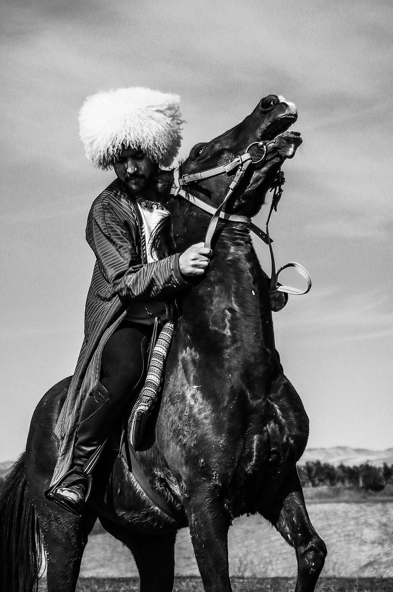

در افق‌های بی‌کران و دشت‌های علف‌پوش ترکمن‌صحرا، زیر سایه برج آجری و باستانی گنبد قابوس، اسب نه تنها یار و هم‌نفس چادرنشینان، بلکه دروازه‌ای به سوی جهان ارواح شمرده می‌شود. در میان طوایف کهن یموت و گوگلان، نام «اوغلوق» با احترام و رازی سرشار زمزمه می‌شود؛ اسبی شبح‌گون، بادپا و زرین‌یال که از جفت‌گیری مادیانی خاکی با اسب‌های اثیری و پرنده آسمان زاده شده است و تنها بر سوارکارانی با دل‌های پیراسته از طمع آشکار می‌گردد.

باور ترکمن‌ها بر این است که اوغلوق روحی پاسدار است که از نیاکان سوارکار در دل دشت برجای مانده است. او نعل ندارد، با سم‌های نامرئی‌اش بی آنکه خاری را خم کند از روی علفزارها پرواز می‌کند و شیهه‌اش در شب‌های طوفانی، چادرهای آلاچیق را از خطر هجوم سیلاب‌ها یا گرگ‌های گرسنه آگاه می‌سازد. در افسانه‌های حماسی قوم ترکمن، قهرمانی که در نبردی نابرابر زخمی شده و در تنهایی کویر در آستانه هلاکت قرار گرفته بود، با شیهه‌ی اوغلوق از مرگ نجات یافت؛ اسب شبح‌گون با وزیدن نفس گرم خویش بر زخم‌های پهلوان، او را بر گرده گرفت و در چشم بر هم زدنی، صدها فرسنگ دشت را تا کنار چادر یارش درنوردید.

> «اسب ترکمن بال‌های پنهان مرد صحراست؛ اگر اوغلوق بر تو لبخند زند، باد رام اراده‌ات خواهد شد و اگر خشمش برانگیزی، در وسعت دشت تا ابد پی رد پایش گم خواهی شد.» — کلام بخشی‌های نامدار در نغمه‌های دوتار ترکمن‌صحرا.

آنه‌محمد بیات در کتاب «افسانه‌ها و لالایی‌های قوم ترکمن» و عبدالرحمان دیه‌جی در پژوهش‌های خود پیرامون فولکلور اقوام دشت گرگان، بیان می‌کنند که تقدس اسب در فرهنگ ترکمن ریشه در باورهای شمنیستی دیرین و تاریخ پیوند اسب‌های تیزتک آخال‌تکه با حیات قبایل آسیای مرکزی دارد. ترکمن‌ها برای ادای احترام به روان اوغلوق، هرگز اسب را تازیانه نمی‌زدند و نخستین دوشش شیر مادیان را به نشانه شکرگزاری بر زمین دشت می‌ریختند.

آوای دلنشین ساز دوتار «بخشی‌ها» در شب‌های دشت، هنوز داستان یال‌های درخشان اوغلوق را می‌سراید؛ رمزی از سرعت، اصالت و پیوند ناگسستنی انسان و حیوان در گستره‌ی دشت ترکمن.

در میان سوارکاران برجسته ترکمن، اسب اصیل آخال‌تکه مظهر نجابت و پاکی است و شیهه اوغلوق، رمزی از آزادی مطلق دشت تلقی می‌شود. بخشی‌های ترکمن‌صحرا در منظومه‌های حماسی خود روایت می‌کنند که اوغلوق در شب‌های گرگ‌ومیش، بر فراز تپه‌های باستانی دشت ظاهر می‌شود و با سم‌کوبیدن، خاکستر آتش پهلوانان کهن را زنده می‌دارد تا شجاعت و جوانمردی هرگز در دل مردمان دشت خاموش نگردد.

### منابع و اعتبار تصویر
- **منبع پژوهشی افسانه:** آنه‌محمد بیات، «افسانه‌ها و لالایی‌های قوم ترکمن»، گرگان، ص ۸۷-۹۴؛ عبدالرحمان دیه‌جی، «فرهنگ عامه ترکمن‌های ایران»، ص ۱۵۲.
- **اعتبار تصویر:** ثبت‌شده در ویکی‌مدیا کامنز توسط Soheil sargolzayi؛ مجوز انتشار: [CC BY-SA 4.0](https://commons.wikimedia.org/wiki/File:Chaboksavar.jpg).
