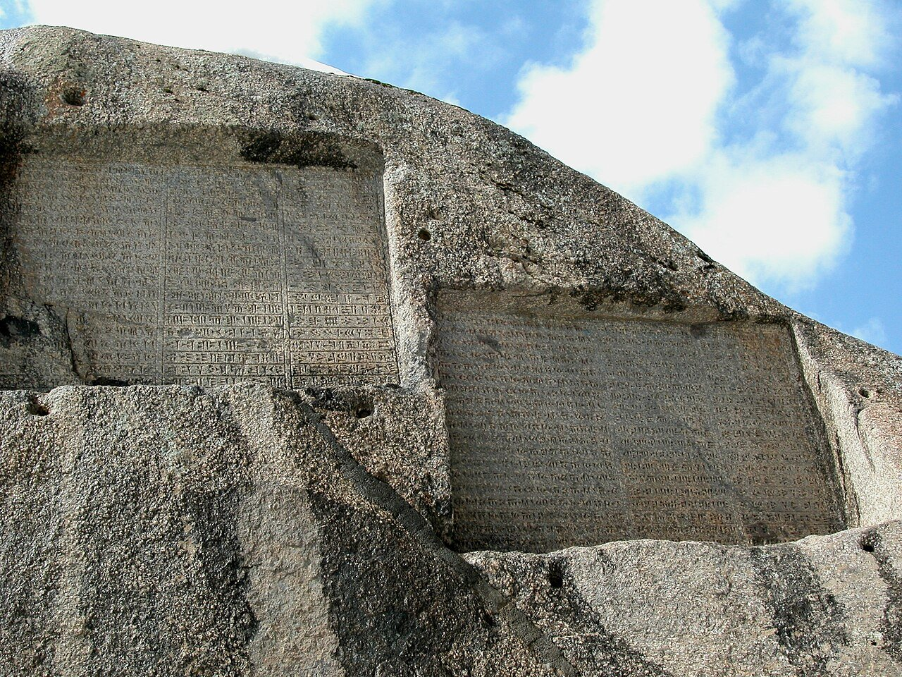

Upon the granite slopes and roaring meltwater falls of Mount Alvand in Hamadan, overlooking the cuneiform rock inscriptions of Darius and Xerxes at Ganjnameh, winds the steep chasm of *Tarik-Darreh* (The Dark Valley). In the oral tradition of ancient Ecbatana, this rugged pass is the sanctuary of the *Golden Bovine of Alvand*—a primeval entity clad in radiant gold leaf with turquoise eyes and silver horns that strike like mountain lightning against the cliffs.

Hamadani lore venerates this golden beast as the supernatural guardian of the Median royal treasures and secret cuneiform tablets sealed within Alvand’s unexplored caverns. In ancient myth, every strike of its polished hooves upon the basalt unleashed a subterranean spring of sweet mountain water to irrigate the orchards of Abbas-Abad. Shepherds believe that on summer nights, a pure-hearted soul meditating by the Ganjnameh cascade may glimpse the golden bull grazing on alpine thistles, showering sparks of gold dust upon the mountain streams. But should armed looters seek to excavate the ancient hoard, the bull lets forth an earth-shattering bellow, triggering avalanches of boulders that bury the plunderers.

> "Alvand presses its breast against the stone, and the Golden Bull guards the vault; lay no covetous hand upon the soil of Media, lest the horn of the bull bring down the mountain upon your greed." — Ancient proverb of Hamadan elders.

Eminent historian Dr. Parviz Azkaii in *Hamadan-Nameh* and Henri Massé in *Persian Beliefs and Customs* point out that the Golden Bull of Alvand derives directly from the primeval bovine (*Gavaevodata*) of ancient Zoroastrian cosmogony. Transformed into an urban protector of Ecbatana’s subterranean wealth, it symbolized agricultural abundance and heroic vigilance. Today, the majestic Ganjnameh inscriptions and cascading waterfalls remain monumental witnesses to this ancient guardian of the Median highlands.

### Sources & Image Attribution
- **Research Source:** Parviz Azkaii, *Hamadan-Nameh: Folklore and Ancient Myths of Ecbatana*, Hamadan, pp. 184-191; Henri Massé, *Persian Beliefs and Customs*, p. 240.
- **Image Attribution:** Documented on Wikimedia Commons by Ywpark2003 Prof. Yong Woo Park; License: [CC BY 4.0](https://commons.wikimedia.org/wiki/File:Ganjnameh_Cuneiform_Inscriptions_of_Darius_I_and_Xerxes_I_in_Hamadan_Iran.jpg).
