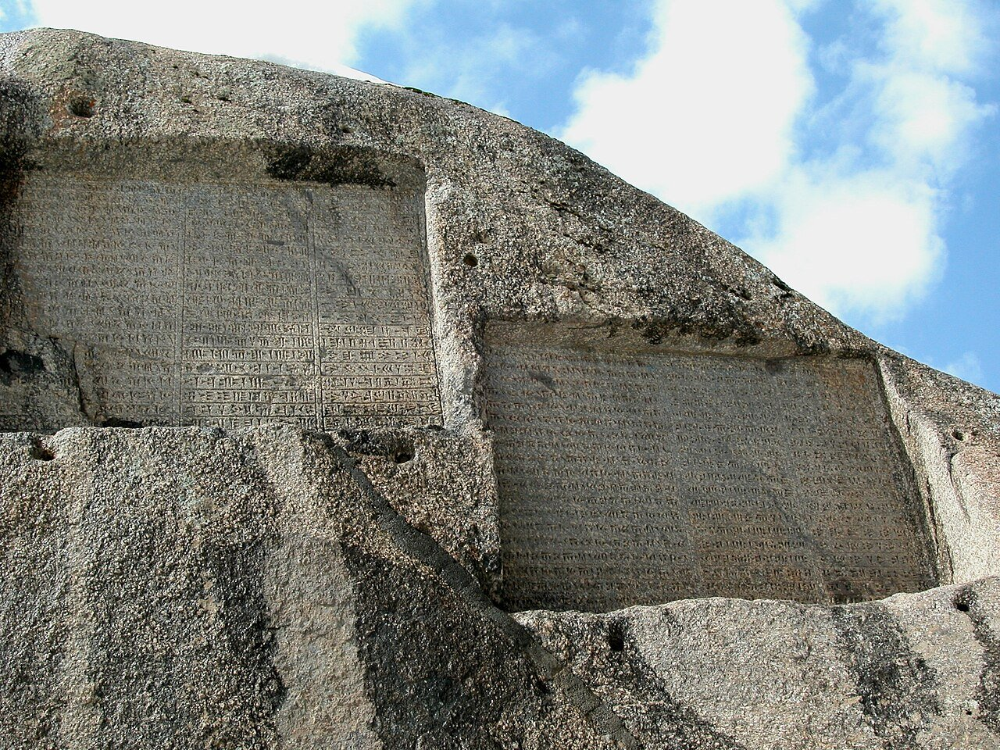

در دامنه‌های صخره‌ای و چشمه‌ساران خروشان کوهستان الوند در همدان، مشرف به کتیبه‌های میخی داریوش و خشایارشا در گنج‌نامه، دره‌ای ژرف و پرپیچ‌وخم به نام «تاریک‌دره» به سوی قله امتداد می‌یابد. در افسانه‌های سینه به سینه مردم کهنسال هگمتانه، این دره آشیانه‌ی یکی از شگفت‌انگیزترین موجودات اساطیری ایران باستان است: «گاو زرین الوند»؛ موجودی تنومند با پوستی از طلای تابناک و چشمانی از فیروزه درخشان که شاخ‌های نقره‌فامش چون تیغه‌های صاعقه آسمان را می‌شکافد.

بر اساس باورهای کهن همدانی، گاو زرین پاسدار گنجینه‌های باستانی مادها و کتیبه‌های زرین دفن‌شده در غارهای ناشناخته الوند است. این گاو مقدس در عهد کهن، با هر بار سم‌کوبیدن بر سنگ خاره، چشمه‌ای گوارا و سرشار از زندگی از دل صخره‌ها جاری می‌ساخت که باغ‌های مصفای عباس‌آباد و همدان را سیراب می‌نمود. روایت می‌کنند که اگر رهگذری پارسا و درویش‌مسلک در شب‌های تابستان به کنار آبشار گنج‌نامه بیاید، گاو زرین را خواهد دید که بر لبه‌ی صخره‌ها در حال چراست و گرد طلا از یال‌هایش بر آب می‌پاشد. اما اگر سپاهی غارتگر یا گنج‌یابی حریص با نیت غارت کتیبه‌ها پای به تاریک‌دره بگذارد، گاو با غرش سهمگین خود سنگ‌های عظیم الوند را به غلتیدن وامی‌دارد و راه خروج را با بهمنی از تخته‌سنگ‌ها مسدود می‌سازد.

> «الوند سینه به سنگ نهاده است و گاو زرین بر در گنج نشسته؛ به خاک پاک ماد دست‌درازی مکن، که خشم شاخ گاو، کوهستان را بر سر طمع‌کاران آوار خواهد کرد.» — پند کهنسالان محله جولان و بازار مسگرهای همدان.

دکتر پرویز اذکایی، همدان‌پژوه نامدار، در کتاب ارزشمند «همدان‌نامه» و هانری ماسه در «معتقدات و آداب ایرانی» یادآور می‌شوند که گاو زرین الوند، بازمانده‌ای مستقیم از اسطوره آفرینش نخستین حیوان در کیهان‌شناسی کهن مزدیسنا (گاو ایوک‌داد) است که در باورهای محلی پایتخت باستانی ایران به نگهبان ثروت‌های مدفون مادها بدل گشته است.

امروزه کتیبه‌های تاریخی گنج‌نامه و آبشار خروشان آن در میان کوهستان الوند، یادآور روزگاری است که انسان و طبیعت در سایه این اسطوره باستانی، حرمت آب و خاک را گرامی می‌داشتند.

کهنسالان همدان روایت می‌کنند که گاو زرین الوند در دل زمستان‌های سخت، با دمیدن نفس گرم خویش بر صخره‌های گنج‌نامه، مانع از یخ‌زدگی کامل چشمه‌های کوهستان می‌شده است تا حیوانات حیات وحش الوند از تشنگی هلاک نشوند. این پیوند زیبای میان ایثار حیوان اساطیری و بقای طبیعت، تصویری والاست از جهان‌بینی اصیل هگمتانه که در آن همه‌چیز در خدمت خیر و رویش جاودانه بوده است.

### منابع و اعتبار تصویر
- **منبع پژوهشی افسانه:** پرویز اذکایی، «همدان‌نامه؛ فرهنگ عامه و اسطوره‌های کهن هگمتانه»، همدان، ص ۱۸۴-۱۹۱؛ هانری ماسه، «معتقدات و آداب ایرانی»، ص ۲۴۰.
- **اعتبار تصویر:** ثبت‌شده در ویکی‌مدیا کامنز توسط Ywpark2003 Prof. Yong Woo Park؛ مجوز انتشار: [CC BY 4.0](https://commons.wikimedia.org/wiki/File:Ganjnameh_Cuneiform_Inscriptions_of_Darius_I_and_Xerxes_I_in_Hamadan_Iran.jpg).
