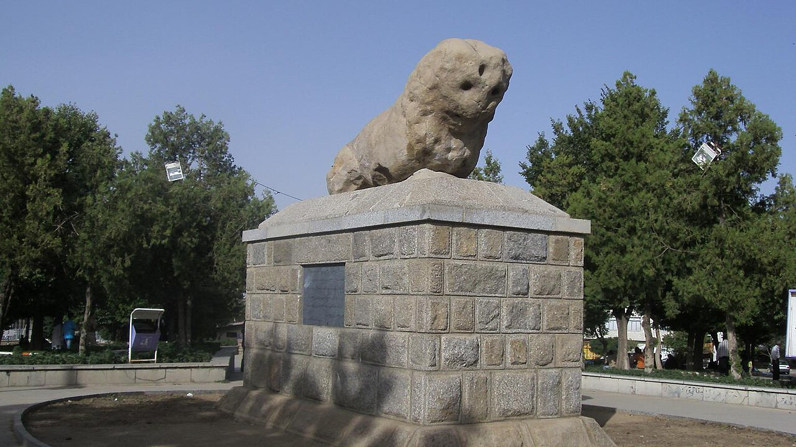

در میدان کهنسالی در شهر تاریخی همدان (هگمتانه باستان)، تندیسی سنگی از شیری تنومند و فرسایش‌یافته بر روی پایه‌ای استوار نشسته است که بومیان آن را «سنگ‌شیر» یا «شیر سنگی» می‌نامند. این اثر سترگ که قدمت آن به دوران اشکانیان یا اسکندر مقدونی می‌رسد، در درازنای قرن‌ها در باورهای مردم همدان فراتر از یک مجسمه تاریخی بوده است؛ سنگ‌شیر در خاطره جمعی این کهن‌شهر، نماد طلسمی جادویی، باطل‌السحر سوز و بوران‌های کوهستان الوند و حامی باروری و بخت‌گشایی جوانان است که بر دروازه ورودی شهر کهن پاسبانی می‌داد.

روایت‌های کهن تاریخی و فولکلوریک نقل می‌کنند که شهر همدان به سبب قرارگیری در پای قله الوند، در گذشته گرفتار زمستان‌هایی چنان سهمگین، مرگبار و مارهای گزنده در فصل گرما بود که زندگی را ناممکن می‌ساخت. پادشاه شهر از «بلیناس حکیم» (فیلسوف و دانای افسانه‌ای اسکندر) چاره خواست. بلیناس با آمیختن دانش نجوم و جادوی خاک، دو شیر سنگی تراشید و با طلسمی قدرتمند در دو سوی دروازه ورودی شهر کار گذاشت. با استقرار این تندیس‌ها، سوز بادهای الوند شکسته شد، مارهای سمی از محدوده شهر گریختند و صلح و ثروت بر هگمتانه سایه افکند.

> زنان کهنسال همدان تا دهه‌های پیش نذر سنگ‌شیر می‌کردند و می‌گفتند: «دست کشیدن بر پیشانی شیر و ریختن روغن یا شیره بر سر او، بخت‌های بسته را می‌گواید و چشم‌زخم حسودان را از خانه دور می‌سازد.»

در افسانه‌های هگمتانه آمده است که جفت این شیر در یورش بیگانگان در قرون گذشته سرنگون و خرد شد، اما شیر باقی‌مانده با وجود زخم‌های شمشیر و آسیب‌های روزگار، همچنان با سینه فراخ رو به سوی الوند دارد و شهر را از زلزله‌ها و بلاهای طبیعی مصون می‌دارد. دختران جوان در شب‌های چهارشنبه‌سوری بر پای این شیر کهن شمع می‌افروختند و با خواندن ابیاتی بومی، از روح صبور سنگ‌شیر پایداری در عشق را تمنا می‌کردند. پیرمردان بازار همدان هنوز هم با دیدن برف‌های سنگین الوند، بر روان سازنده شیر سنگی درود می‌فرستند. در تاریخ بیهقی و متون کهن جغرافیانویسان مسلمان آمده است که هرگاه حاکمی ناعادل بر هگمتانه می‌نشست، شیر سنگی غرشی بی‌صدا سر می‌داد و زمین زیر پای گنهکاران می‌لرزید تا دست از ستم بردارند. کودکان همدانی در گذر قرن‌ها بر پشت سنگی این شیر سوار می‌شدند تا شجاعت و دلیری را از صلابت سنگ بیاموزند و در برابر سختی‌های روزگار چون الوند استوار بمانند. شیر سنگی همدان با هیبت ساکت و باستانی‌اش، پیوندی جاودانه میان اسطوره، حکمت و فرهنگ عامه پایتخت تاریخ و تمدن ایران است.

### منبع روایت و تصویر
- **خاستگاه افسانه:** کتاب‌های تاریخ همدان و مسالک‌الممالک، باورهای شفاهی بومیان همدان درباره طلسم بلیناس و آیین‌های بخت‌گشایی سنگ‌شیر.
- **عکاس / پدیدآورنده تصویر:** Elmju
- **منبع تصویر:** [صفحه تصویر در ویکی‌انبار](https://commons.wikimedia.org/wiki/File:Stone_lion_of_Hamedan.JPG)
- **نوع مجوز:** CC BY-SA 3.0
