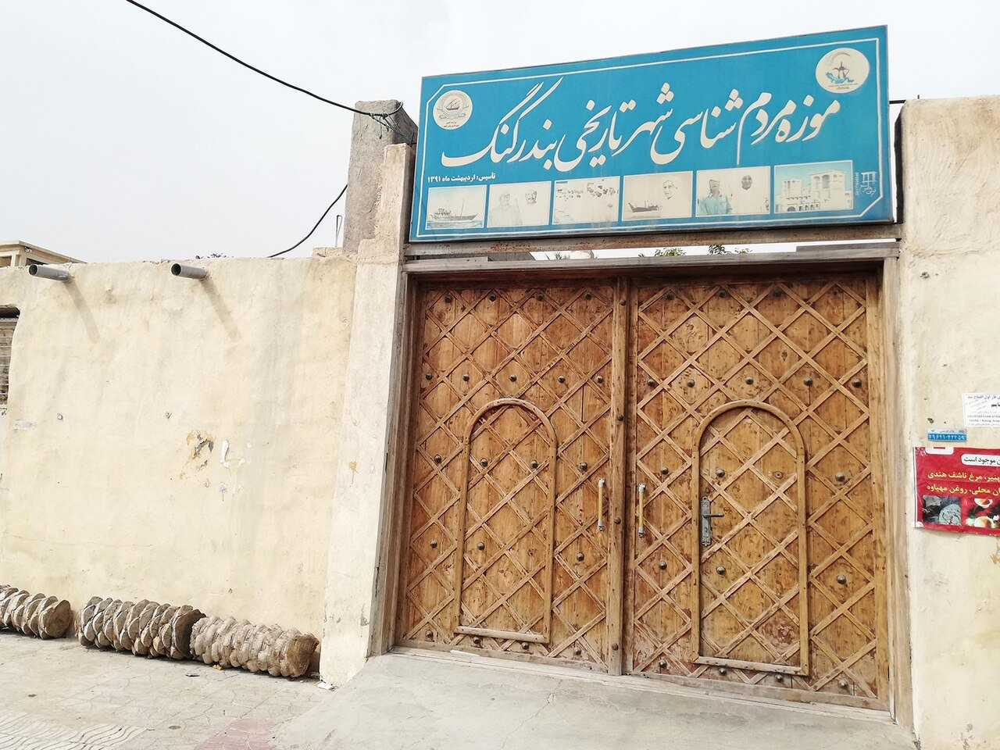

On moonless nights when the fierce Koush wind sweeps across the Persian Gulf and the waters turn as dark as liquid pitch, the veteran sailors of the historic port of Bandar Kong still whisper of the monstrous thud against the wooden hulls of their lenj boats. This colossal, barnacle-encrusted hand belongs to no mortal diver; it is the grasping claw of Baba Darya—the ancient, terrifying sea giant of southern maritime lore, whose chest is clad in phosphorescent scales and whose tangled beard drifts like slimy kelp beneath the ocean swells.

According to centuries-old Gulf folklore, Baba Darya reigns as the ruthless sovereign of the abyssal depths, guarding the boundary between terrestrial mortals and the sunken empire. Sea captains recount that he ascends only in the dead of night, when the watchmen succumb to the stupor of exhaustion. Towering twice the height of a grown man, he hauls his hulking frame against the ship's gunwale, his hollow, booming voice demanding: "Cast down one half-man to me, or your vessel shall never taste harbor again!" To ignore his chilling demand is to court doom, as invisible vortexes will seize the rudder and drag the vessel into the brine.

> "Never gaze into the dark foam over the gunwale past midnight; Baba Darya waits for the heavy eyelid to drag your soul into the abyss." — Oral maxim of the shipwrights of Bandar Kong.

Anthropological investigations by Gholam-Hossein Sa'edi in his seminal monograph *Ahl-e Hava* confirm that unlike spiritual Zar wind entities, Baba Darya was perceived as an intensely corporeal sea monster. Prudent navigators countered his predatory wrath by stowing roasted barley flour, red dates, and scrap iron in the ship's galley. Lore held that the heat of fire and the scent of red-hot iron could blind the primeval titan, for he dreads the luminescence of flame. To this day, amidst the windcatchers of Bandar Kong, elders recount the legendary escape of a bold captain whose blazing torch scorched the glowing gaze of Baba Darya, rescuing his wooden armada from the jaws of the abyss.

### Sources & Image Attribution
- **Research Source:** Gholam-Hossein Sa'edi, *Ahl-e Hava* (Peoples of the Wind), Tehran: Amir Kabir, pp. 45-52; Ahmad Saybani, *Folklore and Legends of Hormozgan*, Bandar Abbas, pp. 112-118.
- **Image Attribution:** Documented on Wikimedia Commons by Hasanbardal; License: [CC BY-SA 4.0](https://commons.wikimedia.org/wiki/File:BandarKong_Museum-01.jpg).
