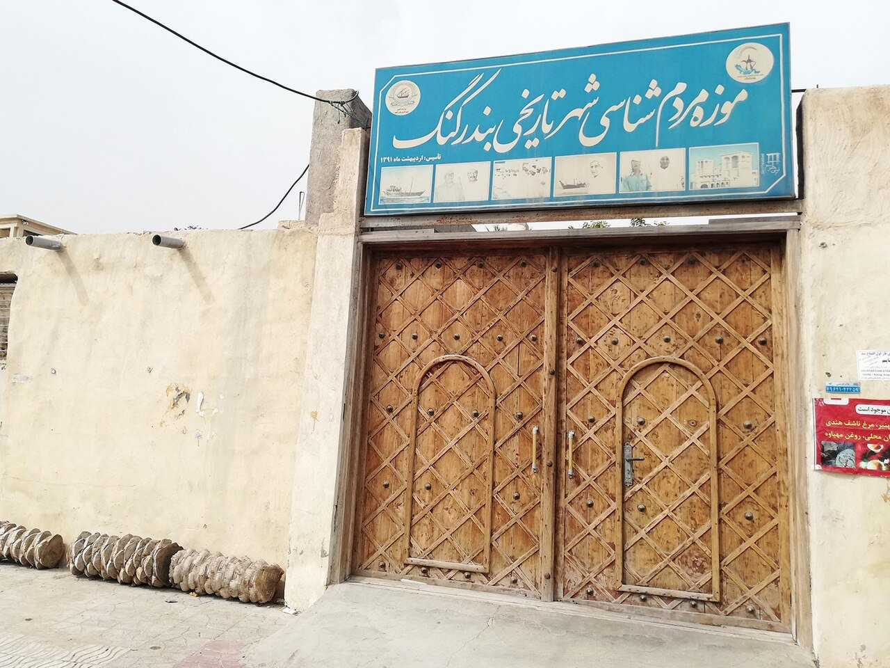

در شب‌های بی‌مهتاب که باد کوش از سمت عمان زوزه می‌کشد و آب‌های نیلگون خلیج فارس به تیرگی قیر می‌نشینند، کهنه‌جاشوهای بندر تاریخی کنگ هنوز هم صدای سهمگین کوبیده شدن دستی غول‌آسا بر بدنه چوبی لنج‌ها را به یاد دارند. این دست ستبر و پوشیده از خزه دریایی، متعلق به هیچ آدمی‌زادی نیست؛ این پنجه‌ی «بابا دریا» است؛ پیرمرد تنومند، ترسناک و اساطیری اعماق آب که سینه‌اش از پولک‌های درخشان پوشیده شده و ریش بلندش چون جلبک‌های لزج کف اقیانوس، در میان کفاب موج‌ها تاب می‌خورد.

بابا دریا در باور کهن ساحل‌نشینان و ناخداهای جهازات بادبانی، نگهبان بی‌رحم مرز میان دنیای زندگان خشکی و قلمرو تاریک زیر آب است. جاشوها روایت می‌کنند که او تنها شب‌هنگام، درست در لحظاتی که پاسبانان لنج در رخوت نیمه‌شب فرو می‌روند، سر از آبشار امواج بیرون می‌آورد. او با هیکلی دو برابر یک مرد درشت‌هیکل، بی‌صدا بر تخته‌بند لنج تکیه می‌زند و با صدایی غرنده و خفه، فریاد می‌زند: «یک نیمه‌مرد به من بدهید تا بگذرم شما به لنگرگاه برسید!» و وای بر لنجی که به ندای او بی‌اعتنایی کند، چرا که سکان کشتی به ناگاه در چنگال گردابی نامرئی قفل می‌شود و جهاز در دل توفان غرق خواهد شد.

> «در شب تار، هرگز سر از لبه جهاز بیرون مبر؛ بابا دریا در کمین چشمانی است که خواب بر آن‌ها چیره شده باشد تا آنان را به سیاهی نامتناهی خویش فروبکشد.» — باور سینه به سینه ناخدایان لنج‌سازی سنتی کنگ.

پژوهش‌های میدانی غلامحسین ساعدی در تک‌نگاری «اهل هوا» نشان می‌دهد که بابا دریا بر خلاف بادهای زار که وارد تن آدمی می‌شوند، موجودی کاملاً فیزیکی و تجسد هیولایی دریاهای جنوب تلقی می‌شده است. ناخدایان باهوش برای خنثی کردن خشم این پیر دریایی، همواره در انبار خواربار لنج مقداری آرد بوداده، خرمای سرخ و خرده‌های آهن نگهداری می‌کردند. باور بر این بود که بوی آهن تفته و برافروختن آتش بر عرشه، بابا دریا را کور و ناتوان می‌سازد، زیرا این هیولای کهن تنها از روشنایی شعله آتش و زنگ آهن هراس دارد.

امروزه در کوچه‌های بادگیردار بندر کنگ و کنار کارگاه‌های ساخت لنج‌های بوم، هنوز قصه‌ی شبی بازگو می‌شود که ناخدایی دلاور با پرتاب مشعلی افروخته به میان چشمان فسفری بابا دریا، لنج در حال شکستن خود را نجات داد و آب‌های سرخ‌فام خلیج، پیکر غول‌پیکر این موجود را تا صبح روز بعد در امواج ناپدید ساختند.

### منابع و اعتبار تصویر
- **منبع پژوهشی افسانه:** غلامحسین ساعدی، «اهل هوا»، تهران، انتشارات امیرکبیر، ص ۴۵-۵۲؛ احمد سایبانی، «باورها و افسانه‌های مردم هرمزگان»، بندرعباس، ص ۱۱۲-۱۱۸.
- **اعتبار تصویر:** ثبت‌شده در ویکی‌مدیا کامنز توسط Hasanbardal؛ مجوز انتشار: [CC BY-SA 4.0](https://commons.wikimedia.org/wiki/File:BandarKong_Museum-01.jpg).
