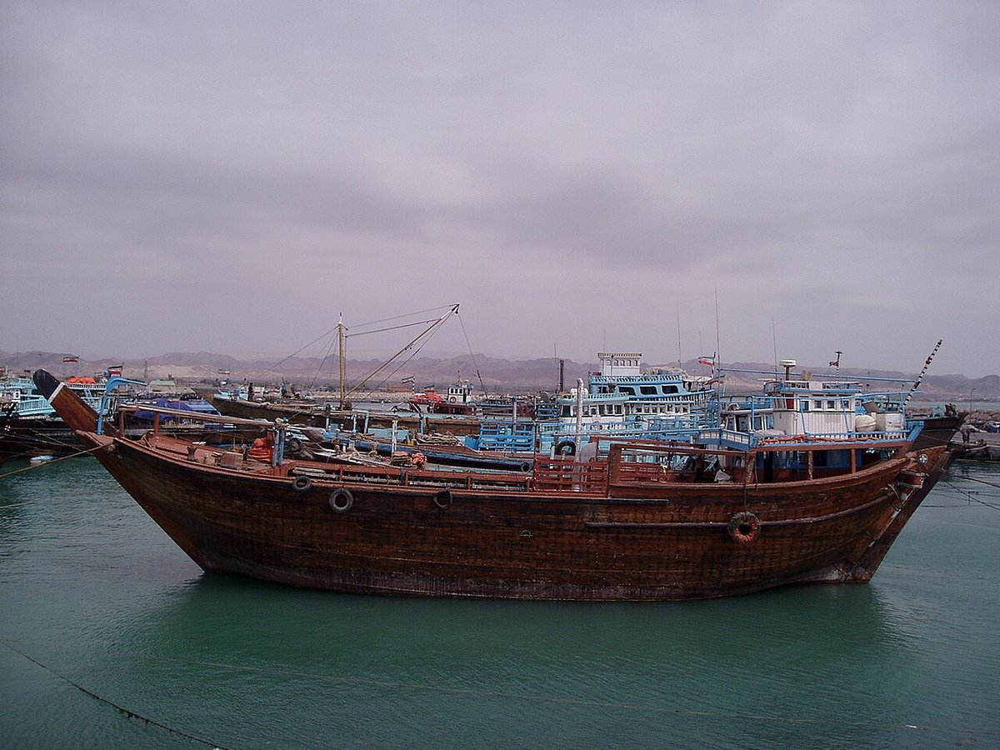

Along the historic Persian Gulf waterfront of Bandar Kong in Hormozgan province, master shipwrights (*Gallafs*) have for centuries constructed colossal hand-hewn wooden vessels known as *Lenj-e Boum*. These ships sailed across the Indian Ocean to Zanzibar, Yemen, and the Malabar coast. Before raising their triangular cotton sails into the monsoon winds, sea captains (*Nakhodas*) and sailors (*Jashus*) executed elaborate ceremonial rituals known as *Bala-Gardani* (the casting off of maritime misfortune), designed to ward off the predatory forces of the open ocean.

In the oral lore of Kong's maritime families, the deep ocean was not an empty void, but an animate expanse populated by unpredictable whirlpool entities, sea demons (*Ghul-e Darya*), and malevolent unseen forces. To ensure the vessel's survival through terrifying typhoons, a ram was traditionally sacrificed at the shoreline so its blood consecrated the keel, satiating the spirit of the sea before timber touched water. Furthermore, ornate brass medallions etched with protective celestial quadrants and talismanic verses were affixed to the bowsprit, referred to affectionately as the "Eye of the Lenj," guarding the ship against the evil eye of rogue waves.

> As ancestral Nakhodas chanted during long ocean crossings: "The sea plays no favorites; turn away the evil eye with salt and wild rue, so the seasoned teakwood of the Boum returns safely from Zanzibar to bring joy to waiting mothers."

When catastrophic squalls struck in the open ocean, the crew conducted the solemn ritual of the *Kaseh-ye Bala-Gardan* (the scapegoat bowl). An unglazed terracotta bowl filled with coarse sea salt, cold charcoal embers, and wild rue was circled seven times around the mainmast amidst rhythmic sailors' hymns and cast into the churning swells. It was believed that the bowl absorbed the wrath of the tempest, calming the elements and steadying the ship. These apotropaic maritime traditions sustained communal resilience, allowing generations of Iranian mariners to cross vast oceans in timber ships with unyielding courage.

### Anthropological & Folklore Analysis
The maritime rituals of Bandar Kong provide an extraordinary window into traditional Indian Ocean seafaring anthropology. Practices such as scapegoat offerings, talismanic ship ornamentation, and communal crisis rituals functioned as psychological mechanisms enabling mariners to face the mortal hazards of pre-modern long-distance oceanic navigation.

### Archival Sources & Attribution
- **Primary Source:** Comparative Mythological Analysis of Bala-Gardani Beliefs in the Maritime Tradition of Bandar Kong, Journal of Folk Culture and Persian Gulf Studies.
- **Source URL:** https://www.magiran.com/paper/2741145/%D8%AA%D8%AD%D9%84%DB%8C%D9%84-%D9%85%D9%82%D8%A7%DB%8C%D8%B3%D9%87-%D8%A7%DB%8C-%D8%A7%D8%B3%D8%B7%D9%88%D8%B1%D9%87-%D8%B4%D9%86%D8%A7%D8%B3%DB%8C-%D8%A7%D8%B2-%D8%A8%D8%A7%D9%88%D8%B1-%D8%A8%D9%84%D8%A7%DA%AF%D8%B1%D8%AF%D8%A7%D9%86%DB%8C-%D8%AF%D8%B1-%D8%B3%D9%86%D8%AA-%D8%AF%D8%B1%DB%8C%D8%A7%DB%8C%DB%8C-%D8%A8%D9%86%D8%AF%D8%B1%DA%A9%D9%86%DA%AF
- **Original Language:** Bandari Dialect & Persian
- **Image Attribution:** File:BandarKongBoum.JPG | Photographer: Ali Parsa | License: Public domain
