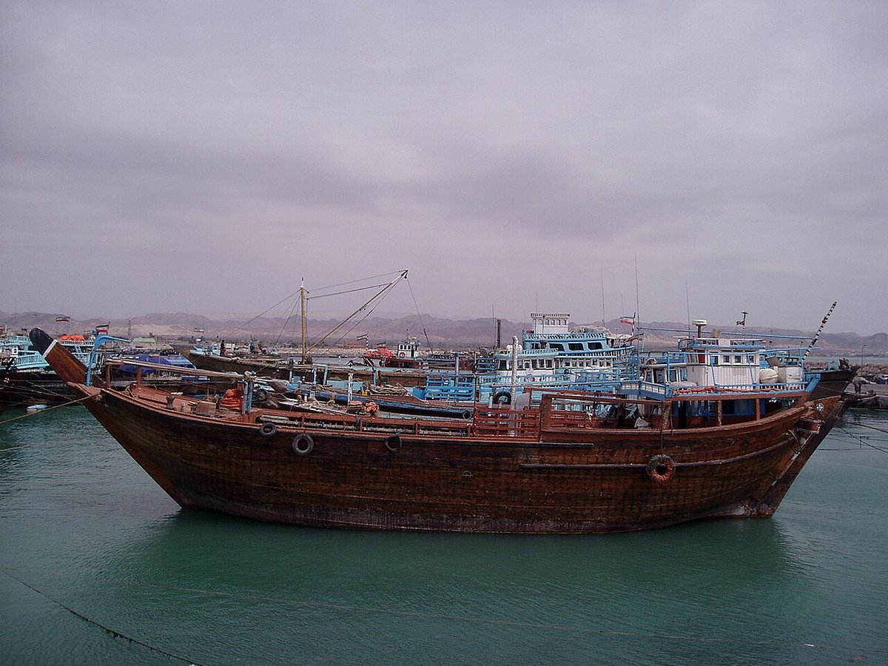

در کرانه‌های گرم و نیلگون خلیج فارس، بندر تاریخی «کنگ» در شهرستان بندر لنگه با کارگاه‌های لنج‌سازی سنتی (گلافان) و بوم‌های اقیانوس‌پیمایش، قرن‌ها دروازه دریانوردی ایرانیان به سوی سواحل هند، آفریقا و زنگبار بوده است. دریانوردان و ناخدایان کارآزموده کنگ پیش از به آب انداختن لنج و برافراشتن بادبان‌ها، مجموعه‌ای از آیین‌های نمادین و اسطوره‌ای را برای «بلاگردانی دریا» به جای می‌آوردند که ریشه در باوری عمیق به ارواح و نیروهای ناشناخته خلیج فارس و دریای عمان دارد.

در باور دریانوردان کهنسال کنگ، اقیانوس پهناور قلمرو موجوداتی فراطبیعی همچون «غول دریا» و گرداب‌های خشمگین بود که کشتی‌ها را به اعماق آب می‌کشیدند. برای در امان ماندن از گزند امواج سهمگین و توفان‌های موسمی، ناخدایان آیین‌های بلاگردانی را با دقتی تمام اجرا می‌کردند. در هنگام به آب انداختن هر لنج جدید، گوسفندی در پای بدنه چوبی قربانی می‌شد و خون آن بر دماغه لنج مالیده می‌شد تا حق دریا ادا شود. همچنین بر پیشانی چوب ساج لنج، پلاک‌های برنجی منقوش به ستاره‌های دریایی و آیات حفاظت نصب می‌گردید که به آن «چشم لنج» می‌گفتند تا چشم‌زخم امواج را دفع کند.

> ناخدایان کهنسال بندر کنگ در هنگام سفر دریایی می‌خوانند: «دریا با کس شوخی نداره؛ نظر بد رو با نمک و اسپند بگردون، تا چوب بوم به سلامت به زنگبار و بمبئی برسه و مادران چشم‌انتظار شاد بشن.»

در طول سفرهای چندماهه بر روی اقیانوس هند، هرگاه توفانی سهمگین لنج را در میان امواج سیاه محاصره می‌کرد، جاشوان آیینی به نام «کاسه بلاگردان» برپا می‌کردند. در این آیین، پیاله‌ای سفالین پر از نمک، زغال سرد اجاق و دانه‌های اسپند را در میان دعاهای موزون ملوانان هفت بار بر گرداگرد دکل اصلی گردانده و سپس به دل امواج خروشان پرتاب می‌کردند؛ با این باور که این کاسه بلا و کینه ارواح آب‌ها را در خود بلعیده و دریا را آرام می‌سازد. آرامش شگفت‌آور آب‌ها پس از این آیین‌ها، روحیه امید و همبستگی را در میان جاشوان زنده نگاه می‌داشت و لنج‌های چوبی کنگ را با بارهای ادویه و مروارید سالم به وطن بازمی‌گرداند.

### بن‌مایه‌ها و ویژگی‌های مردم‌شناختی
آیین‌های بلاگردانی دریانوردان بندر کنگ نمونه‌ای برجسته از انسان‌شناسی دریانوردی سنتی در حوزه اقیانوس هند و خلیج فارس است. مفاهیمی چون قربانی برای دریا (Marine sacrifice)، دفع چشم‌زخم از سازه چوبی لنج، و باورهای زیست‌محیطی دریانوردان، سازوکارهای انطباق روانی انسان سنتی با خطرات ناشناخته سفرهای طولانی اقیانوسی را بازتاب می‌دهد.

### منابع و پژوهش
- **منبع اصلی:** مقاله پژوهشی: تحلیل مقایسه‌ای اسطوره‌شناسی از باور بلاگردانی در سنت دریایی بندر کنگ، نشریه مطالعات فرهنگ عامه و خلیج فارس.
- **پیوند مرجع:** https://www.magiran.com/paper/2741145/%D8%AA%D8%AD%D9%84%DB%8C%D9%84-%D9%85%D9%82%D8%A7%DB%8C%D8%B3%D9%87-%D8%A7%DB%8C-%D8%A7%D8%B3%D8%B7%D9%88%D8%B1%D9%87-%D8%B4%D9%86%D8%A7%D8%B3%DB%8C-%D8%A7%D8%B2-%D8%A8%D8%A7%D9%88%D8%B1-%D8%A8%D9%84%D8%A7%DA%AF%D8%B1%D8%AF%D8%A7%D9%86%DB%8C-%D8%AF%D8%B1-%D8%B3%D9%86%D8%AA-%D8%AF%D8%B1%DB%8C%D8%A7%DB%8C%DB%8C-%D8%A8%D9%86%D8%AF%D8%B1%DA%A9%D9%86%DA%AF
- **زبان اصلی متن:** گویش بندری و فارسی
- **تصویر:** File:BandarKongBoum.JPG | عکاس: Ali Parsa | مجوز: Public domain
