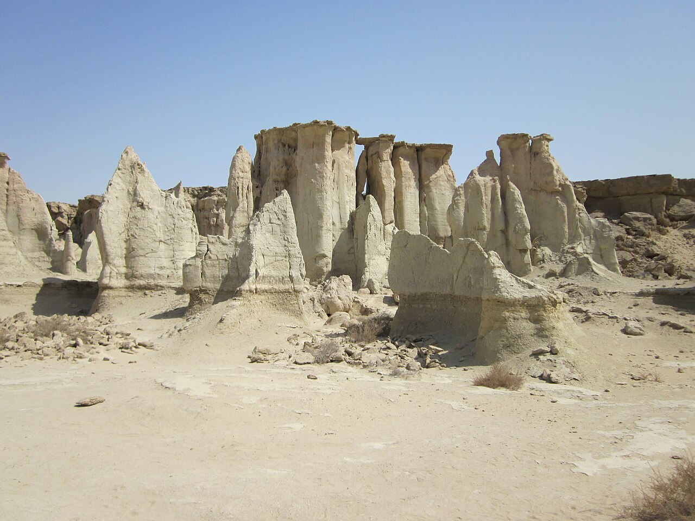

در کرانه‌های جنوبی جزیره شگفت‌انگیز قشم، در مجاورت روستای پاکیزه برکه خلف، چشم‌اندازی حیرت‌انگیز و سوررئال از تندیس‌های غول‌پیکر خاکی، ستون‌های ماسه‌ای تراشیده، طاق‌های سوزنی و دالان‌های پیچ‌درپیچ گسترده شده است که بومیان آن را «استاره کَفْتَه» (ستاره‌افتاده) و مسافران «دره ستارگان» می‌نامند. در باور مردم کهنسال قشم، این پدیده حاصل یک فرسایش بادی یا بارانی ساده نیست؛ بلکه در اعصار دور، ستاره‌ای پرفروغ و سنگین از آسمان به این نقطه اصابت کرده و با غرش مهیب خود زمین را در هم شکسته و ستون‌هایی از خاک و سنگ به شکل کاخ‌های سحرآمیز پدید آورده است. این ستون‌های تراشیده به اشکال جانوران و پهلوانان کهن شباهت دارند که گویی در حرکتی ابدی منجمد شده‌اند و سایه‌های بلندشان بر دامنه‌های شنی دلبری می‌کند.

اما راز اصلی دره ستارگان با فرارسیدن تاریکی شب آشکار می‌شود. بومیان روستای برکه خلف از دیرباز باور داشته‌اند که با غروب خورشید، دره به تسخیر ارواح سرگردان، پریان کویر و موجوداتی نامرئی موسوم به «اهل هوا» و بادهای جادویی درمی‌آید. هنگامی که بادهای خلیج فارس در میان دالان‌های باریک و حفره‌های قیفی‌شکل دره می‌پیچد، صداهایی مخوف شبیه به ناله، سوت، شیون کودکان و زمزمه‌هایی غریب در دل سنگ‌ها طنین‌انداز می‌شود. روستاییان معتقد بودند که ارواح ساکن دره در این ساعت‌ها بیدار می‌شوند و اگر کسی شب را در آنجا سپری کند، ممکن است دچار جن‌زدگی شود یا عقل خویش را از دست بدهد.

> کهنسالان برکه خلف به میهمانان جزیره پند می‌دهند: «در روشنایی روز زیبایی ستاره‌افتاده را با دل تماشا کنید، اما با افتادن سایه سرخ غروب از دالان‌ها بیرون بیایید؛ دره در شب جایگاه نجواگرانی است که چشم دیدن غریبه‌ها را ندارند.»

در افسانه‌های قشم آمده است که پریان دره ستارگان گاه در هیبت دخترانی با چادرهای گلابتون‌دوزی‌شده بندری روی لبه بلندترین تندیس‌ها می‌ایستند و بر طبل‌های کوچک شفا می‌کوبند. اگر صیادی بیمار یا ملوانی که بادهای شور او را رنجور ساخته به آستانه دره بیاید و با قلبی بی‌آلایش نذری از نان تمشی و خرما تقدیم کند، بادهای خشمگین تبدیل به نسیمی التیام‌بخش می‌شوند و دردهای او را با خود به دریا می‌برند. زنان بومی با حنا بستن به دستان دختران خویش، یاد پریان صبور استاره‌کفته را گرامی می‌دارند و آنان را رازداران صخره‌های پاک قشم می‌دانند. دره ستارگان با ستون‌های خیال‌انگیز و نجوای پایان‌ناپذیر بادهای شبانه‌اش، گنجینه‌ای بی‌همتا از عمیق‌ترین اساطیر پیوند کهکشان و خاک در کرانه‌های نیلگون جزیره قشم و هرمزگان است.

### منبع روایت و تصویر
- **خاستگاه افسانه:** باورهای شفاهی مردم قشم و روستای برکه خلف، افسانه‌های فولکلوریک استاره کفته و پیوند آن با آیین‌های زار و اهل هوا.
- **عکاس / پدیدآورنده تصویر:** Petr Adam Dohnálek
- **منبع تصویر:** [صفحه تصویر در ویکی‌انبار](https://commons.wikimedia.org/wiki/File:Stars_Valley_(Qeshm)_001.jpg)
- **نوع مجوز:** CC BY-SA 3.0 cz
