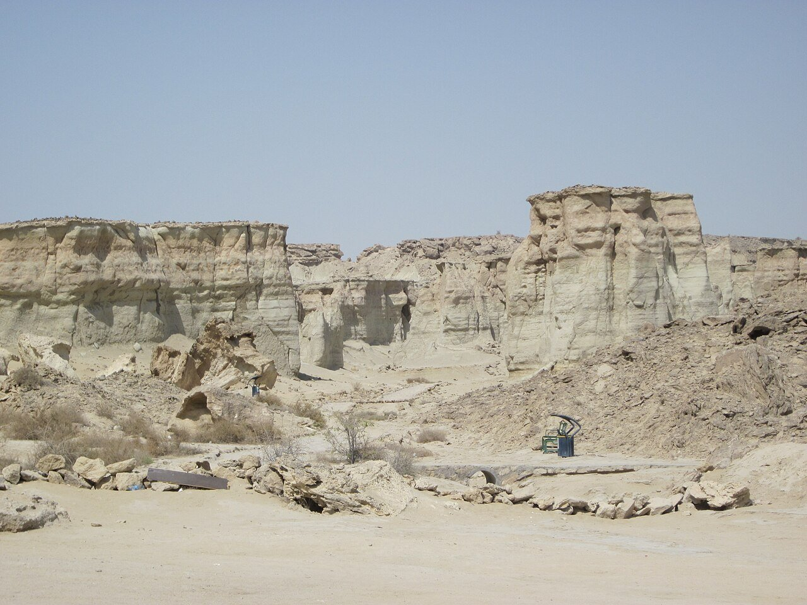

Along the southern perimeter of Qeshm Island, mere miles from the venerable settlement of Berkeh Khalaf, lies an eerie geological labyrinth known to the locals as *Estareh-Oftadeh*—the Valley of the Fallen Star. Local island folklore maintains that millennia ago, a blazing meteorite torn from the celestial dome crashed into this arid plateau. The titanic impact ruptured the earth, thrusting up colossal sand spires, labyrinthine canyons, and petrified chimneys within which trapped astral spirits were condemned to wander for eternity.

As dusk settles and coastal gusts howl through the subterranean crevices, the canyon echoes with haunting wails reminiscent of mourning women and spectral murmurs. The villagers of Berkeh Khalaf firmly hold that these sounds emanate from wind jinn and astral apparitions spawned by the fallen star. Anyone daring to traverse the valley after nightfall risks hallucination; the petrified spires appear to shift and warp, masquerading as stone gargoyles that seal off every path of retreat, leaving the trespasser hopelessly disoriented in the dark.

> "When oceanic mist clings to the fallen star valley, the stone fissures breathe; whoever enters after twilight becomes a companion to wandering shadows." — Oral tradition of Berkeh Khalaf elders.

Scholar Hossein Nourbakhsh, in his volume *The Persian Gulf and Iranian Islands*, observes that this folk myth stems from the dramatic erosional formations of Cenozoic marl and sandstone, yet culturally served to preserve travelers from perilous crumbling cliffs in the pitch black. For generations, islanders paid quiet reverence to these petrified spirits, leaving polished sea pebbles and green prayer threads at the canyon mouth to ward off malevolent wind gusts. The uncanny wind-sculpted pillars remain one of the most mesmerizing crossroads of terrestrial geology and cosmic folklore in Iranian lore.

### Sources & Image Attribution
- **Research Source:** Hossein Nourbakhsh, *The Persian Gulf and Iranian Islands*, Tehran: Sana'i, pp. 102-110; Iraj Afshar Sistani, *Qeshm Island and the Persian Gulf*, p. 88.
- **Image Attribution:** Documented on Wikimedia Commons by Petr Adam Dohnálek; License: [CC BY-SA 3.0 cz](https://commons.wikimedia.org/wiki/File:Stars_Valley_(Qeshm)_002.jpg).
