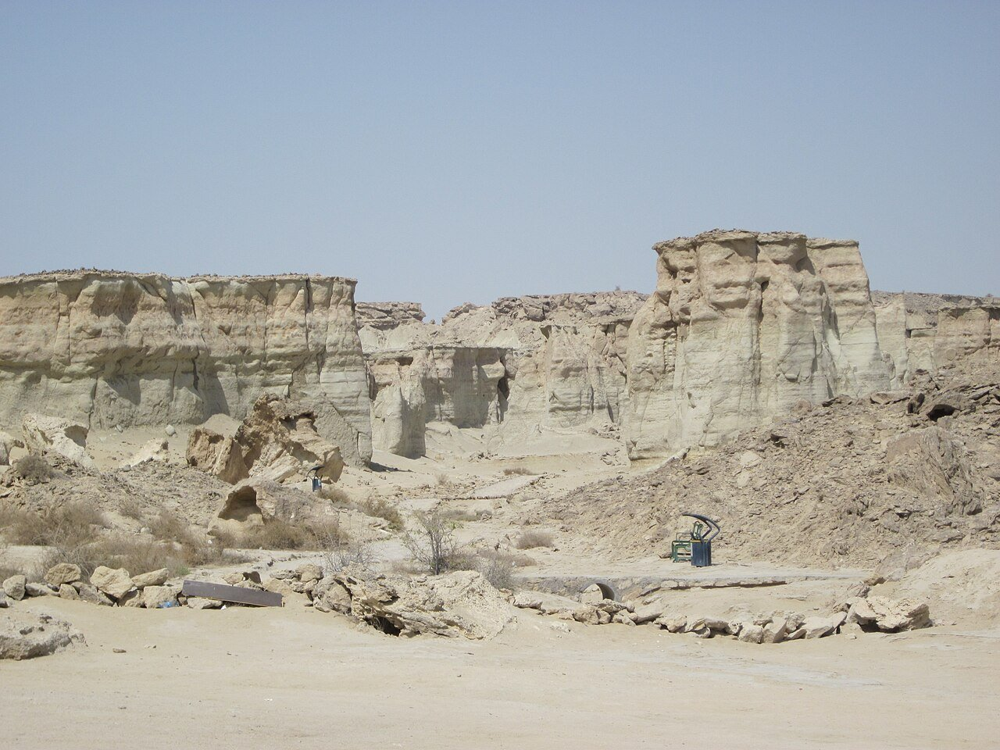

در کرانه‌های جنوبی جزیره قشم و چند فرسنگی روستای کهن «برکه خلف»، برهوتی سنگی و وهم‌انگیز دهان گشوده است که بومیان آن را «استاره‌افتاده» یا دره ستارگان می‌نامند. در باور مردم بومی جزیره، هزاران سال پیش، شهاب‌سنگی آتشین از ژرفای آسمان هفتم کنده شد و بر قلب این فلات خاکی فرود آمد. شدت این برخورد چنان مهیب بود که دل زمین شکافت، تندیس‌های عظیم از خاک و سنگ به هوا برخاستند و روح موجوداتی ناپیدا در ستون‌های مخروطی و طاق‌های باریک این دره به دام افتادند.

با فرونشستن خورشید و وزش تندبادهای ساحلی از فراز خلیج، در میان شکاف‌های تودرتوی دره ستارگان صدایی شبیه ناله‌ی سوزناک زنانی سوگوار و پچ‌پچه‌هایی نامفهوم طنین‌انداز می‌شود. اهالی برکه خلف معتقدند این زمزمه‌ها متعلق به اجنه و موجودات سرگردانی است که از برخورد آن شهاب آسمانی زاده شده‌اند و شب‌هنگام بر فراز برجک‌های ماسه‌سنگی گرد هم می‌آیند. اگر رهگذری جسارت ورزد و پس از غروب آفتاب پای در دهانه این دره بگذارد، سنگ‌ها در چشم او جابه‌جا می‌شوند و اشکال شگفت‌انگیز ستون‌ها به دیوهایی سنگی بدل می‌گردند که راه خروج را تا ابد بر مسافر می‌بندند.

> «در هنگامه‌ای که مه دریا بر فراز استاره‌کف می‌نشیند، خاک شیارها دهان باز می‌کند؛ هر که در تاریکی وارد شود، هم‌کلام سایه‌ها خواهد شد.» — باور کهنسالان روستای برکه خلف قشم.

پژوهش‌های حسین نوربخش در کتاب «خلیج فارس و جزایر ایرانی» نشان می‌دهد که این روایت عامیانه، ریشه در فرسایش شگفت‌انگیز سنگ‌های رسوبی دوران سنوزوئیک دارد؛ اما کارکرد فرهنگی آن محافظت از جان رهگذران در برابر پرتگاه‌های سست و بادگیرهای پرخطر شبانه بوده است. برای سالیان متمادی، مردم جزیره به احترام این ارواح سنگواره، در پای ورودی دره از ایجاد صداهای بلند خودداری می‌کردند و تکه‌هایی از پارچه سبز یا سنگ‌های سپید صیقلی را به عنوان نشان صلح در پای ستون‌ها بر جای می‌گذاشتند تا از گزند بادهای خشمگین مصون بمانند.

سکوت سنگین روز و غوغای بادهای شبانه در میان تندیس‌های دره ستارگان، این شاهکار شگفت‌انگیز زمین‌شناختی را به یکی از زنده‌ترین تجلی‌گاه‌های افسانه‌های نجومی و ارواح باد در جنوب ایران تبدیل کرده است.

پژوهشگران مردم‌شناسی جزایر خلیج فارس بر این باورند که سکوت وهم‌آور دره ستارگان در پیوند با پدیده‌ی طبیعی بادهای موسمی، ساختار ذهنی منحصربه‌فردی را در بومیان پدید آورده است. در گذشته‌های دور، دریانوردان کهن قشم پیش از آغاز سفرهای دراز به سوی هند و زنگبار، از ورود به این دره پرهیز می‌کردند؛ چرا که باور داشتند هم‌سخن شدن با ارواح باد، شومی و طوفان‌های زودرس دریایی را به دنبال خواهد داشت. خاک سرخ و لایه‌های شنی ستون‌ها نیز در طب سنتی جزیره برای ساخت مرهم‌های سوختگی به کار می‌رفت و همواره نوعی پیوند ناگسستنی میان درمان‌بخشی خاک و قداست ارواح استاره‌افتاده در باور پیران برکه خلف برقرار بود.

### منابع و اعتبار تصویر
- **منبع پژوهشی افسانه:** حسین نوربخش، «خلیج فارس و جزایر ایرانی»، تهران، انتشارات سنایی، ص ۱۰۲-۱۱۰؛ ایرج افشار سیستانی، «جزیره قشم و خلیج فارس»، ص ۸۸.
- **اعتبار تصویر:** ثبت‌شده در ویکی‌مدیا کامنز توسط Petr Adam Dohnálek؛ مجوز انتشار: [CC BY-SA 3.0 cz](https://commons.wikimedia.org/wiki/File:Stars_Valley_(Qeshm)_002.jpg).
