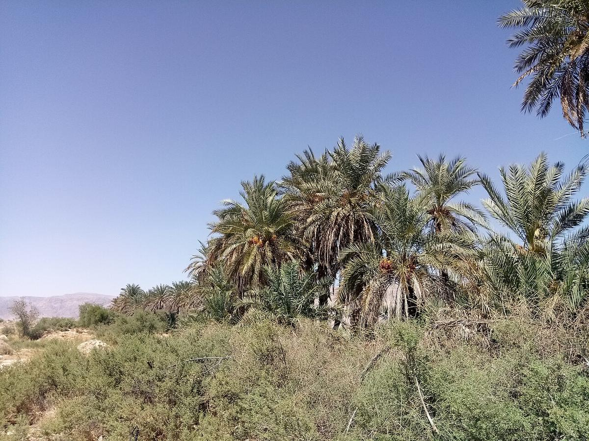

In the arid, subtropical oasis of Bastak in western Hormozgan province, where elegant stucco windcatchers (*Badgirs*) rise above domed cisterns (*Berkehs*) and extensive date groves, family evening gatherings known as *Gap-e Shev* keep alive the mystical folklore of *Dokh-e Shov* (literally, "The Night Maiden" in the vernacular Bastaki and Achomi dialects). Recorded in local ethnographic surveys, this legend expresses the deep spiritual affection between desert inhabitants and their sustaining date palm orchards.

According to ancient folk memory, Dokh-e Shov was an ethereal, nocturnal spirit with radiant silver tresses and garments woven from celestial indigo vapor. She emerged only after twilight when the intense desert heat receded, rising from the cool waters of subterranean kanats. Bearing a luminous silver spindle, she drifted silently between the trunks of the date palms, spinning invisible threads of starlight and nocturnal humidity around the ripening date clusters (*Kharak* and *Rotab*), shielding them from desert blights and scorching summer winds (*Tash-Bad*).

> As Bastaki elders remind children during hearth gatherings: "Dokh-e Shov watches over the palm groves; so long as your intentions toward nature and your neighbors remain pure, her silken light illuminates your desert trail, but if you harbor malice, the dark will lead you astray."

Folklore recounts that lost wanderers and weary children stranded in the vast groves of Faryab after dusk were comforted by the soothing, distant hum of Dokh-e Shov's lullabies. By casting luminescent date seeds along the dusty paths, she guided frightened wanderers safely back to the dome of the municipal cistern and the welcoming lanterns of the village. Conversely, if a thief entered the groves with predatory intent to steal the harvest reserved for the impoverished, the spirit spun her spindle backward, raising a blinding dust vortex that trapped the trespasser amidst sharp date thorns until dawn. Dokh-e Shov endures as an inspiring cultural symbol of ecological stewardship, nocturnal grace, and communal justice across southern Iran.

### Anthropological & Folklore Analysis
The myth of Dokh-e Shov embodies the sacred role of the date palm in southern Iranian desert oasis economies. By transforming the nocturnal hours into a sanctuary of maternal cultivation and protection, the narrative reflects how arid-zone communities conceptualized the natural environment as an active, conscious moral sanctuary demanding ethical respect.

### Archival Sources & Attribution
- **Primary Source:** Gap-e Shev: Tales and Legends of Bastak County Over the Past Century, recorded in the Terenoh Cultural Heritage Archive.
- **Source URL:** https://terenoh.blogfa.com/1390/10
- **Original Language:** Bastaki (Achomi) Dialect & Persian
- **Image Attribution:** File:Faryab-Bastak.jpg | Photographer: Didehjahan Bahram | License: CC BY-SA 4.0
