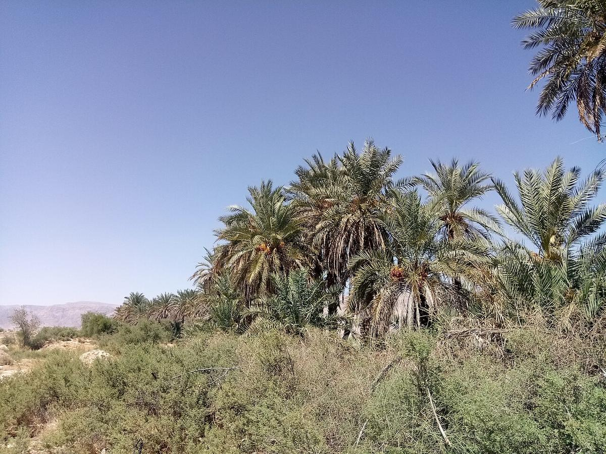

در اقلیم کویری و گرمسیری شهرستان تاریخی بستک در غرب هرمزگان، آنجا که بادگیرهای گچی باشکوه بر بام خانه‌ها قد برافراشته‌اند و برکه‌های مدور آب‌انبار تشنگی دشت را فرو می‌نشانند، کهنسالان در شب‌نشینی‌های خانوادگی یعنی «گَپِ شِو» از ماجراهای رازآلود «دُخِ شُو» (Dokh-e Shov؛ در گویش بستکی و اچمی به معنای دختر یا پری شب) سخن می‌گویند. این افسانه که در پژوهش‌های ادبیات بومی بستک ثبت شده است، تبیین‌کننده پیوند عاطفی عمیق بومیان با نخلستان‌های صبور این دیار است.

بر پایه این باور دیرپا، دُخِ شُو پری‌دختری اثیری با گیسوانی بلند به درخشندگی پرتو ماهتاب و جامه‌ای نیلی‌فام است که تنها پس از غروب آفتاب و در خنکای دل‌انگیز شب از دل چاه‌های قنات و نیزار برکه‌ها برمی‌آید. این پری نگهبان، دوکی سیمین در دست دارد و با قدم زدن میان ردیف‌های تاریک نخل، تارهایی نادیدنی از جنس شبنم و مهتاب به گرد خوشه‌های رطب و خارَک می‌تند تا آنها را از گزند ملخ‌های مهاجم بیابان و بادهای داغ و خشک تابستان که به «تش‌باد» شهرت دارند، حفظ کند.

> مردم بستک در متل‌های شبانه زمزمه می‌کنند: «دُخِ شُو تو نخلستون بیداره؛ تا وقتی که دلت با خدا و خلق صاف باشه، تار نورش راهت رو روشن می‌کنه، اما اگه نیت بدی داشته باشی، تو تاریکی هورت می‌بره.» (دختر شب در نخلستان بیدار است؛ تا زمانی که قلبت با خدا و مردم زلال باشد، رشته‌های نورش راهت را در بیابان روشن می‌سازد، اما اگر نیت پلیدی داشته باشی، در تاریکی سرگردانت می‌کند).

افسانه‌ها حکایت می‌کنند که مسافران درراه‌مانده یا کودکانی که هنگام گرگ‌ومیش راه خود را در نخلستان‌های گسترده فاریاب گم می‌کردند، با نغمه نرم و لالایی‌وار دُخِ شُو آرام می‌گرفتند. او با انداختن دانه‌های درخشان خرما بر مسیر خاک، آنان را تا نزدیکی بارگاه برکه آب‌انبار و چراغ‌های آبادی راهنمایی می‌کرد. با این حال، اگر کسی با نیتی ستمکارانه وارد نخلستان می‌شد تا سهم خرمای بیوه‌زنان و تهیدستان را برباید، دُخِ شُو با چرخاندن دوک خویش گردبادی از غبار شن برمی‌انگیخت و متجاوز را تا پگاه در میان تیغ نخل‌ها سرگردان نگاه می‌داشت. دُخِ شُو در فرهنگ بستک، تجسم روح مهربان و در عین حال بیدار طبیعت جنوب است که پاسداری از نان و خیر جمعی را تضمین می‌نماید.

### بن‌مایه‌ها و ویژگی‌های مردم‌شناختی
افسانه دُخِ شُو جلوه‌ای لطیف از اسطوره‌های زیست‌محیطی پیوندخورده با اقتصاد نخل‌داری در جنوب ایران است. تقدس نخل به عنوان موجودی صاحب روح در فرهنگ عامه، شب به عنوان زمان آرامش و باروری در اقلیم‌های سوزان بیابانی، و نقش زن پری‌زاد به عنوان نگهبان بخشنده منابع حیاتی، از مشخصه‌های مردم‌شناختی بارز این باور بستکی است.

### منابع و پژوهش
- **منبع اصلی:** پژوهش‌های گپ شو: قصه‌ها و افسانه‌های شهرستان بستک در صد سال اخیر، ثبت‌شده در پایگاه فرهنگی تِرِنُه.
- **پیوند مرجع:** https://terenoh.blogfa.com/1390/10
- **زبان اصلی متن:** بستکی (اچمی) و فارسی
- **تصویر:** File:Faryab-Bastak.jpg | عکاس: Didehjahan Bahram | مجوز: CC BY-SA 4.0
