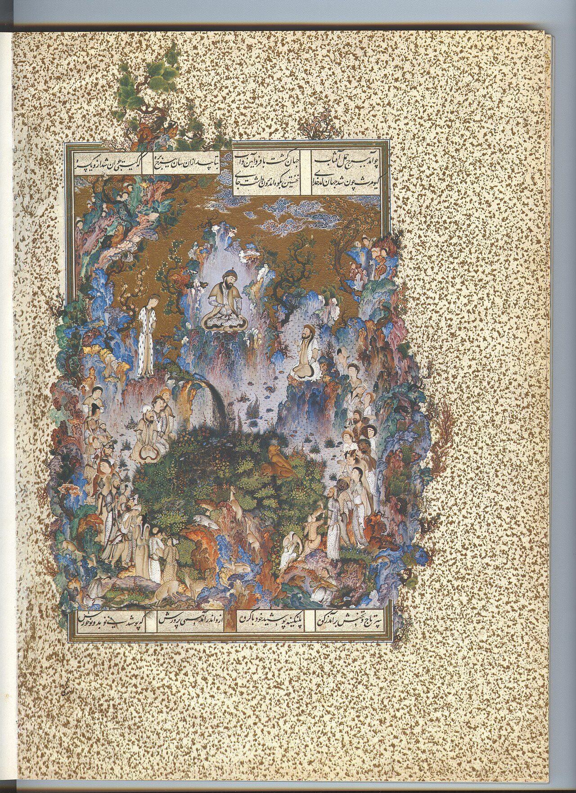

Preserved across centuries within the rich oral folklore of **Hormozgan** (encircling the historical domains of **قشم / بندرعباس**), the legendary lore of **Khazravan** stands as a compelling testament to Iran's enduring mythic imagination. Transmitted across hearths, mountain paths, and rural caravans, the tale has survived through the living memories of local elders.

Folklorists generally categorize **Khazravan** within the mythological taxonomy of *Shahnameh*. As with many traditional entities of Iranian folk belief, it embodies both the untamed natural elements and the ancestral anxieties regarding solitary wilderness. Classical collectors recorded its traditional traits as follows:

> "Illustration by Erfan Aghvami Kharvazān is the name of a black Dev who is referred to as the son of Ahriman ("destructive/evil spirit"). The story is told in the Shahname that Khazravan created an army to attack Kiyomarth and take the rulership from him. The beautiful and brave son of Gayoumart (the first human), named Siyamak, suits in leopard skin armor to fight the destructive black Dev. Siamak raises an army of animals, Peris, and Fairies to meet Xarvazan and stop him. But the mighty dev throws him to the ground and slices his back. When the news reached Kyomarth, he mourned the death of his son and cried a lot. To avenge his son, Kiyomarth formed an army of deer, livestock, chickens, and birds and sent them along with Hushang, Siamak's son, to the army of Khazravan, and he himself accompanied them. The two armies clashed with each other and Hushang's army destroyed the Balck Dev's army, then Hoshang went to Xarvazan and destroyed him. In this way, he took the revenge of his father Siamak from the Dev."

In local oral tradition, an encounter with **Khazravan** was regarded as a formidable threshold between familiar domestic reality and the unseen realm. Elders customarily advised night travelers, shepherds, and caravan drivers traversing the historic passes of Hormozgan to heed ancient apotropaic rituals—such as carrying iron amulets, maintaining solemn reverence towards nature, and never uttering provocative words—to pass through its territorial domain unharmed.

Today, the chronicle of **Khazravan** forms an invaluable component of Iran's intangible cultural heritage, offering modern readers an evocative window into how ancient communities interpreted their ecology, mystery, and moral balance.

---

### Sources & Image Attribution
- **Folklore Research & Origin:** Sourced and adapted from the Eranshahr Folklore Archive (`eranshahr.com/myths`) and regional oral narratives of Hormozgan.
- **Visual Artifact:** *"Court of Gayumars Persian miniature.jpg"*, sourced via Wikimedia Commons, contributed by Attributed to Sultan Muhammad, licensed under `Public domain` ([Source Link](https://commons.wikimedia.org/wiki/File:Court_of_Gayumars_Persian_miniature.jpg)).