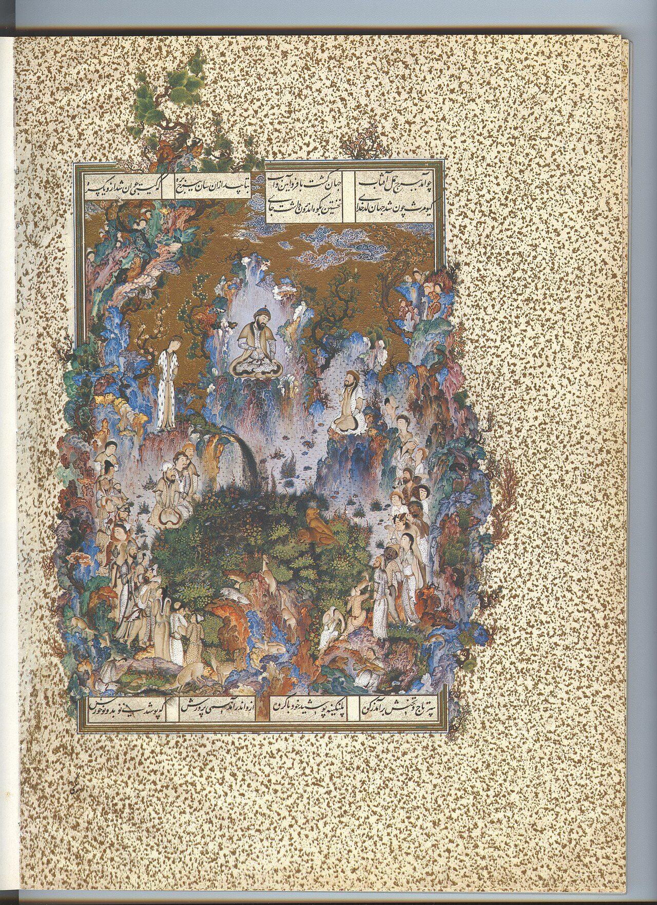

در یادمان‌های شفاهی و باورهای عامیانه‌ی مردم **هرمزگان** (به‌ویژه در گستره‌ی **قشم / بندرعباس**)، روایت‌های پرشماری از پدیده‌ای شگفت و موجودی دیرپا به نام **«خزروان»** سینه به سینه از روزگاران باستان تا کنون بازگو شده است. راویان بومی که با گویش و لهجه‌ی **بندری / هرمزگانی** به نقل قصه‌ها می‌نشستند، پیدایش این پدیده را با کوهساران، دشت‌های بی‌کران، جنگل‌ها یا آب‌های مرموز این خطه پیوند می‌زدند.

در طبقه‌بندی فرهنگ عامه، **خزروان** را غالباً با تیره‌ی *Shahnameh* هم‌بسته می‌دانند؛ چهره‌ای که تجسم نیروهای ناشناخته‌ی اقلیم و جهان نادیدنی پیرامون نیاکان بوده است. در توصیف‌ها و متون بازمانده‌ی پژوهشی پیرامون این افسانه آمده است:

> «Kharvazan|خزروان|خَروَزان|پوراهریمن ‌ ‌خَروَزان یا خزروان نام دیو سیاهی است که در شاهنامه به عنوان پوراهریمن از او یاد میشود. واژه خزروان یا خزربان مرکب از خزر و وان معنای نگهبان خزر است. روایت این موجود این چنین است کهکیومرثپادشاه ایران بود و دد و دام تحت فرمانروایی او بودند و از او اطاعت میکردند‌. او پسری به نامسیامکداشت و کیومرث بسیار او را گرامی میداشت. پادشاه هیچ دشمنی نداشت جز یک اهریمن، این اهریمن بچه ای داشت که مانند گرگی سترگ بود. خزروان سپاهی را پدید آورد تا به کیومرث حمله کند و فرمانروایی را از او بگیرد. هنگامی که این خبر بهسیامکپسر پادشاه رسید به خشم آمد و لباس رزم خود را پوشید و چون آن زمان زره جنگی وجود نداشت، لباس از چرم پلنگ پوشید و به جنگ خزروان رفت.سیامکبه نبرد تن به تن با خزروان پرداخت، خزروان چنگ بر پشت او زد و او را بر زمین انداخت و سینه اش را درید‌، بدین سان سیامک به دست خزروان کشته شد. هنگامی که خبر بهکیومرثرسید وی بر مرگ فرزندش سوگواری کرد و بسیار گریست. کیومرث برای انتقام فرزندش، لشکری را از دد و دام و مرغ و پری تشکیل داد و آن ها را همراه با هوشنگ فرزندسیامکبه سوی سپاه خزروان فرستاد و خودش نیز آن ها راه همراهی کرد. دو سپاه با یکدیگر آویختند و سپاه هوشنگ لشکر دیوان را نابود ساخت، سپس هوشنگ به جنگ با خزروان رفت و او را به خاک افکند و نابود کردبدین سان انتقام پدرشسیامکرا از خزروان گرفتسیامک بیامد برهنه تنابر آویخت با پور آهرمناسیامک به دست خزروان دیوتبه گشت و ماند انجمن بیخدیونگارگر: سید عرفان رسّام»

پیران و ریش‌سفیدان منطقه در شب‌نشینی‌ها گوشزد می‌کردند که رویارویی با **خزروان** همواره نشانه‌ای از لزوم هشیاری در برابر ناشناخته‌های طبیعت بوده است. در اعصار گذشته، مسافران، شبانان و کاروانیانی که شب‌هنگام در این نواحی گذر می‌کردند، برای مصون ماندن از گزند یا فریب این موجودات، آیین‌ها و دعاهای محافظتی خاصی را به کار می‌بستند و از شکستن سکوت شب یا نزدیک شدن به زیستگاه‌های آنان پرهیز می‌کردند.

امروزه داستان **خزروان** یکی از گنجینه‌های ماندگار میراث معنوی و مردم‌شناسی دیار **هرمزگان** به شمار می‌رود که پیوند عمیق روان‌شناختی انسان کهن را با رمزورازهای زیست‌بوم سرزمین ایران به تصویر می‌کشد.

---

### منابع و اعتبار تصویر
- **پژوهش و خاستگاه روایت:** برگرفته از دانشنامه فولکلور و اسطوره‌شناسی ایران‌شهر (`eranshahr.com/myths`) و روایت‌های شفاهی بومی هرمزگان.
- **تصویر:** اثر *«Court of Gayumars Persian miniature.jpg»*، بارگذاری‌شده در ویکی‌انبار (Wikimedia Commons)، پدیدآورنده: Attributed to Sultan Muhammad، تحت مجوز آزاد `Public domain` ([مشاهده منبع](https://commons.wikimedia.org/wiki/File:Court_of_Gayumars_Persian_miniature.jpg)).