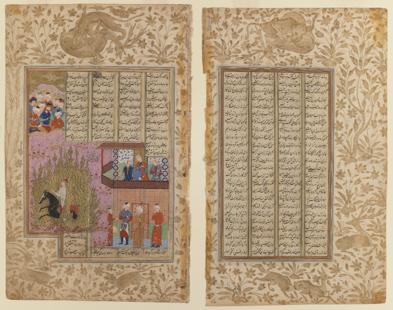

Preserved across centuries within the rich oral folklore of **Hormozgan** (encircling the historical domains of **قشم / بندرعباس**), the legendary lore of **Morgh-e-Geran** stands as a compelling testament to Iran's enduring mythic imagination. Transmitted across hearths, mountain paths, and rural caravans, the tale has survived through the living memories of local elders.

Folklorists generally categorize **Morgh-e-Geran** within the mythological taxonomy of *Bird*. As with many traditional entities of Iranian folk belief, it embodies both the untamed natural elements and the ancestral anxieties regarding solitary wilderness. Classical collectors recorded its traditional traits as follows:

> "Illustration by Farima Keshavarz In the poetry book, Faramarz-nāmā, when Faramarz was on his way to [Khavar-Zamin], he used the seaway. On his way, he saw something big and bright similar to the Sun, on the other side of the ocean. Faramarz asked the sailor about the creature. The sailor said, 'It's a massive, glowing bird. Elephants and lions are afraid of the bird's claws, and when it flies, you can't see the skies because of its enormous wings. No other creature lives in this area because of their fear of this bird.'Faramarz lived on a mountain close to that area. When the bird, called [Morgh-e-Geran], saw the ship, it flew towards it. The bird wanted to grab the ship with its claws and destroy it.Faramarz took his weapon out and shot the bird in its weak spot. The bird fell to the ground. Faramarz then went and cut both of its wings and destroyed the bird entirely. He used the bird's bones to build a majestic chair for the kings. Patterns and paintings of the Sun, the Moon, the Crown of Key-Khosrow, and all the other heroes of Iran-Zamin (like Rostam and Sām) were on the legs of the chair. He used gold and jewelry on this chair and sent it as a gift to the king of Iran. According to Faramarz-nāmā, the king named the chair [Tāgh-Das], and all the kings of the royal family used it. Translation: Sarah Mohebbi Moghadam …"

In local oral tradition, an encounter with **Morgh-e-Geran** was regarded as a formidable threshold between familiar domestic reality and the unseen realm. Elders customarily advised night travelers, shepherds, and caravan drivers traversing the historic passes of Hormozgan to heed ancient apotropaic rituals—such as carrying iron amulets, maintaining solemn reverence towards nature, and never uttering provocative words—to pass through its territorial domain unharmed.

Today, the chronicle of **Morgh-e-Geran** forms an invaluable component of Iran's intangible cultural heritage, offering modern readers an evocative window into how ancient communities interpreted their ecology, mystery, and moral balance.

---

### Sources & Image Attribution
- **Folklore Research & Origin:** Sourced and adapted from the Eranshahr Folklore Archive (`eranshahr.com/myths`) and regional oral narratives of Hormozgan.
- **Visual Artifact:** *"Brooklyn Museum - The Fire Ordeal of Siyawush from a Shahnama Manuscript.jpg"*, sourced via Wikimedia Commons, contributed by Unknown author Unknown author, licensed under `No restrictions` ([Source Link](https://commons.wikimedia.org/wiki/File:Brooklyn_Museum_-_The_Fire_Ordeal_of_Siyawush_from_a_Shahnama_Manuscript.jpg)).