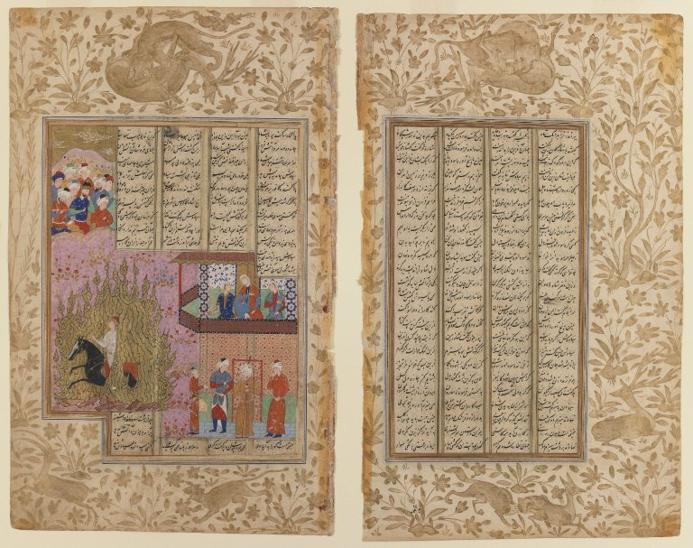

در یادمان‌های شفاهی و باورهای عامیانه‌ی مردم **هرمزگان** (به‌ویژه در گستره‌ی **قشم / بندرعباس**)، روایت‌های پرشماری از پدیده‌ای شگفت و موجودی دیرپا به نام **«مرغ گران»** سینه به سینه از روزگاران باستان تا کنون بازگو شده است. راویان بومی که با گویش و لهجه‌ی **بندری / هرمزگانی** به نقل قصه‌ها می‌نشستند، پیدایش این پدیده را با کوهساران، دشت‌های بی‌کران، جنگل‌ها یا آب‌های مرموز این خطه پیوند می‌زدند.

در طبقه‌بندی فرهنگ عامه، **مرغ گران** را غالباً با تیره‌ی *Bird* هم‌بسته می‌دانند؛ چهره‌ای که تجسم نیروهای ناشناخته‌ی اقلیم و جهان نادیدنی پیرامون نیاکان بوده است. در توصیف‌ها و متون بازمانده‌ی پژوهشی پیرامون این افسانه آمده است:

> «Morgh-e-Geran|مرغ گران در مثنوی حماسی 《فرامرزنامه》، فرامرز در راه رفتن به خاورزمین، هنگامی که از آب‌ها با کشتی عبور می‌کند ناگهان چیزی مانند خورشید در انتهای دریا می‌بیند. از کشتی‌ران نام و نشان این موجود را می‌پرسد و کشتی‌ران می‌گوید که این مرغ، بسیار بزرگ و بسیار فروزنده است. از چنگال تیز او شیر و فیل فرار می‌کنند. هنگامی که پرواز می‌کند آسمان از بزرگی پرش قابل دیدن نیست.هیچ موجودی از ترس این مرغ، در این حوالی زندگی نمی‌کند.فرامرز در کوهی در آن نزدیکی اقامت می‌کند.در همان حال این مرغ، که در فرامرزنامه به آن " مرغ گران" گفته شده است، متوجه کشتی می‌شود. به سمت کشتی پرواز می‌کند تا آن را بگیرد و از بین ببرد اما فرامرز با یک تیر به نقطه حساس بال مرغ او را به کوه می‌اندازد. سپس به نزدیک مرغ رفته، بال‌های او را قطع می‌کند و مرغ را از بین می‌برد.فرامرز با استخوان‌های این مرغ تخت پادشاهیِ بسیار باشکوهی می‌سازد؛ با پایه‌هایی از بلور که روی آن نقش و نگارهای بسیاری مثل ماه و خورشید، تاج کیخسرو، و تمام پهلوانان ایران‌زمین مانند رستم و سام نگاشته شده است. این تخت را با طلا و جواهرات بسیار تزیین می‌کند و به عنوان تحفه و هدیه برای شاه ایران می‌فرستد. در فرامرز نامه آمده است که خسروی ایران این تخت را 《طاق دس》 می‌نامد و این تخت نسل به نسل در خاندان پادشاهی ایران برجای می‌ماند. منابعفرامرزنامه»

پیران و ریش‌سفیدان منطقه در شب‌نشینی‌ها گوشزد می‌کردند که رویارویی با **مرغ گران** همواره نشانه‌ای از لزوم هشیاری در برابر ناشناخته‌های طبیعت بوده است. در اعصار گذشته، مسافران، شبانان و کاروانیانی که شب‌هنگام در این نواحی گذر می‌کردند، برای مصون ماندن از گزند یا فریب این موجودات، آیین‌ها و دعاهای محافظتی خاصی را به کار می‌بستند و از شکستن سکوت شب یا نزدیک شدن به زیستگاه‌های آنان پرهیز می‌کردند.

امروزه داستان **مرغ گران** یکی از گنجینه‌های ماندگار میراث معنوی و مردم‌شناسی دیار **هرمزگان** به شمار می‌رود که پیوند عمیق روان‌شناختی انسان کهن را با رمزورازهای زیست‌بوم سرزمین ایران به تصویر می‌کشد.

---

### منابع و اعتبار تصویر
- **پژوهش و خاستگاه روایت:** برگرفته از دانشنامه فولکلور و اسطوره‌شناسی ایران‌شهر (`eranshahr.com/myths`) و روایت‌های شفاهی بومی هرمزگان.
- **تصویر:** اثر *«Brooklyn Museum - The Fire Ordeal of Siyawush from a Shahnama Manuscript.jpg»*، بارگذاری‌شده در ویکی‌انبار (Wikimedia Commons)، پدیدآورنده: Unknown author Unknown author، تحت مجوز آزاد `No restrictions` ([مشاهده منبع](https://commons.wikimedia.org/wiki/File:Brooklyn_Museum_-_The_Fire_Ordeal_of_Siyawush_from_a_Shahnama_Manuscript.jpg)).