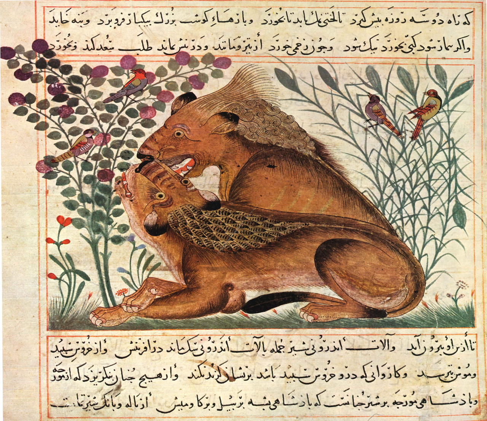

در یادمان‌های شفاهی و باورهای عامیانه‌ی مردم **هرمزگان** (به‌ویژه در گستره‌ی **قشم / بندرعباس**)، روایت‌های پرشماری از پدیده‌ای شگفت و موجودی دیرپا به نام **«موسی»** سینه به سینه از روزگاران باستان تا کنون بازگو شده است. راویان بومی که با گویش و لهجه‌ی **بندری / هرمزگانی** به نقل قصه‌ها می‌نشستند، پیدایش این پدیده را با کوهساران، دشت‌های بی‌کران، جنگل‌ها یا آب‌های مرموز این خطه پیوند می‌زدند.

در طبقه‌بندی فرهنگ عامه، **موسی** را غالباً با تیره‌ی *موجود افسانه‌ای* هم‌بسته می‌دانند؛ چهره‌ای که تجسم نیروهای ناشناخته‌ی اقلیم و جهان نادیدنی پیرامون نیاکان بوده است. در توصیف‌ها و متون بازمانده‌ی پژوهشی پیرامون این افسانه آمده است:

> «Musa-Ku-Taghi|موسی‌کو‌تقی|تقی کو نقی افسانه 《موسی کو تقی》 در باورهای مردم خراسان شنیده شده است و داستان آن از این قرار بوده که سه برادر بودند به نام‌های موسی، تقی و کریم. این سه برادر هنگامی که کودک بودند بدون اجازه برای بازی از خانه دور می‌شوند. تقی حین بازی کردن گم می‌شود و موسی و کریم نمی‌توانند او را پیدا کنند. در نهایت موسی و کریم از خدا می‌خواهند که یکی از آن‌ها را به پرنده‌ای تبدیل کند تا بتواند پرواز کند و از آسمان به دنبال تقی بگردد تا آن یکی هم بتواند به خانه برود و خبر گم شدن تقی را به پدر و مادر بدهد. خدا دعایشان را مستجاب می‌کند؛ کریم به پرنده‌ای تبدیل می‌شود و به پرواز در می‌آید اما نمی‌تواند تقی را پیدا کند. از آن به بعد مدام با صدای خودش از موسی سراغ تقی را می‌گیرد، شاید به خانه برگشته باشد.نقل است که این صدا به عنوان آواز در نسل‌های بعدی این پرنده نهادینه می‌شود. منابع@e_nahavandi:منابع شفاهی»

پیران و ریش‌سفیدان منطقه در شب‌نشینی‌ها گوشزد می‌کردند که رویارویی با **موسی** همواره نشانه‌ای از لزوم هشیاری در برابر ناشناخته‌های طبیعت بوده است. در اعصار گذشته، مسافران، شبانان و کاروانیانی که شب‌هنگام در این نواحی گذر می‌کردند، برای مصون ماندن از گزند یا فریب این موجودات، آیین‌ها و دعاهای محافظتی خاصی را به کار می‌بستند و از شکستن سکوت شب یا نزدیک شدن به زیستگاه‌های آنان پرهیز می‌کردند.

امروزه داستان **موسی** یکی از گنجینه‌های ماندگار میراث معنوی و مردم‌شناسی دیار **هرمزگان** به شمار می‌رود که پیوند عمیق روان‌شناختی انسان کهن را با رمزورازهای زیست‌بوم سرزمین ایران به تصویر می‌کشد.

---

### منابع و اعتبار تصویر
- **پژوهش و خاستگاه روایت:** برگرفته از دانشنامه فولکلور و اسطوره‌شناسی ایران‌شهر (`eranshahr.com/myths`) و روایت‌های شفاهی بومی هرمزگان.
- **تصویر:** اثر *«Ibn Bukhtishu - Manafi' al-Hayawan - Folio II Recto.png»*، بارگذاری‌شده در ویکی‌انبار (Wikimedia Commons)، پدیدآورنده: Michel Bakni، تحت مجوز آزاد `CC BY-SA 4.0` ([مشاهده منبع](https://commons.wikimedia.org/wiki/File:Ibn_Bukhtishu_-_Manafi%27_al-Hayawan_-_Folio_II_Recto.png)).