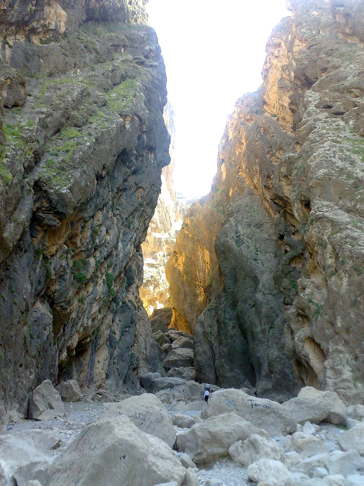

در دامنه‌های پرصلابت کبیرکوه و در نزدیکی شهر باستانی سیمره در شهرستان دره‌شهر ایلام، تنگه‌ای باریک، هولناک و نفوذناپذیر با دیواره‌های صخره‌ای سر به فلک کشیده دهان باز کرده است که از روزگار کهن به «تنگه بهرام چوبین» نام‌ور است. این دره صخره‌ای با آب‌انبارهای دست‌کند و پلکان‌های سنگی در دل کوه، پناهگاه و دژ دفاعی بهرام چوبین، سردار نامدار ساسانی، در نبرد سرنوشت‌سازش با خسرو پرویز به شمار می‌رفت. اما در حافظه اسطوره‌ای مردم لُر فیلی و لک خطه سیمره، این صخره‌های عمودی داستانی فراتر از نبردهای شاهنامه را در آغوش خود پنهان کرده‌اند: افسانه طلسم کوهستان و سوارانی که به سنگ بدل گشتند. صخره‌های دندانه‌دار این شکاف، مانند دندان‌های اژدهایی خفته، سینه آسمان را دریده‌اند و رودی زلال در کف آن خروشان است.

روایت پیران دره‌شهر حاکی از آن است که بهرام چوبین پس از عقب‌نشینی به این دره دست‌نیافتنی، همراه با کمانداران و سواران ورزیده‌اش در پناه دیواره‌های بلند کوه موضع گرفت. آب پاکیزه چشمه‌های درون تنگه و انبارهای ذخیره نان و عسل، دژ را برای ماه‌ها تسخیرناپذیر ساخته بود. هنگامی که محاصره‌کنندگان با نیرنگ و بهره‌گیری از جادوی سیاه‌ساحران خواستند شبانه از راه صخره‌های بالایی به درون اردوگاه بهرام راه یابند، موبد دانای سپاه بهرام متوجه توطئه شد. او با خواندن نیایش‌های کهن آب و سنگ، از ایزدبانوی کوهستان پاسداری از جان یاران را طلبید؛ طلسمی چنان سنگین که هر سرباز خائنی را پیش از دست درازی به آب انبارها، خشک می‌کرد.

> بزرگان سیمره می‌گویند: «آن ستون‌های صخره‌ای مخروطی که بر لبه پرتگاه‌های تنگه ایستاده‌اند، نگهبانان وفاداری هستند که سوگند خورده بودند تا ابد چشم از ورودی تنگه برندارند و با طلسم کوه به سنگ تبدیل شدند.»

در این روایت فولکلوریک آمده است که بهرام چوبین پیش از خروج واپسین خود از ایلام به سوی بلخ، گنجینه زره‌ها و کمان سحرآمیز خود را در عمیق‌ترین حفره صخره‌های بالای دره پنهان ساخت و ماری تنومند با پوست خالدار سنگی را به عنوان پاسدار طلسم بر آن گمارد. چوپانانی که در شیب‌های تند کبیرکوه بزها را می‌چرانند، نقل می‌کنند که در روزهای غبارآلود پاییز، اگر گوش دل به پیچش باد در شکاف سنگ‌ها بسپاری، صدای چکاچک شمشیرها و شیهه اسب راهوار بهرام از دل تنگه به گوش می‌رسد و سنگ‌شدگان همچنان با قامت‌های برافراشته در پاسداری از حریم آزادی ایستاده‌اند. تنگه بهرام چوبین تا به امروز نمادی از استقامت بی‌پایان زاگرس در برابر بیداد تاریخ باقی مانده و یادآور حماسه‌های فراموش‌نشدنی نیاکان در خطه باستانی سیمره است.

### منبع روایت و تصویر
- **خاستگاه افسانه:** روایت‌های شفاهی عشایر لُر فیلی و لک سیمره و دره‌شهر ایلام، فرهنگ بومی ایلام پیرامون پناهگاه کوهستانی بهرام چوبین.
- **عکاس / پدیدآورنده تصویر:** User:Milad2017
- **منبع تصویر:** [صفحه تصویر در ویکی‌انبار](https://commons.wikimedia.org/wiki/File:Bahram-e-Choobin_Gorge.jpg)
- **نوع مجوز:** CC BY-SA 3.0
