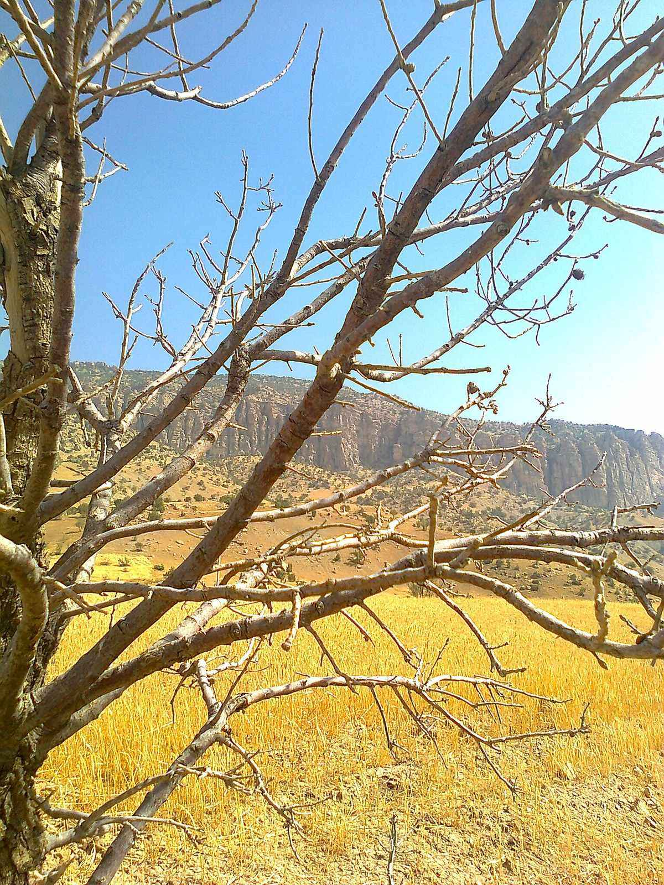

Along the rugged western flanks of Mount Manasht, amidst the ancient oak forests of Eyvan-e Gharb in Ilam province, a perennial freshwater spring bursts forth from an intricate karst grotto known locally as *Cheng-e Pari* (literally, "The Water Fairy's Harp" or "The Fairy's Claw"). In contemporary geomythological research, this site represents a remarkable cultural mechanism by which ancient Kalhori Kurdish communities explained subterranean hydrogeology through the poetic language of animistic folklore.

Oral traditions recount that during an epoch of catastrophic summer drought, all surface streams throughout the Eyvan plain dried up into cracked mud, leaving cattle and human encampments facing imminent starvation. An elderly shepherd, despairing as his last newborn kid wilted in the heat, knelt before the sheer limestone cliff and chanted an ancient tribal plea to the primordial spirits of hidden waters. In answer to his devotion, the rock wall parted, revealing a luminous water nymph (*Pari*) cloaked in shimmering vapor. Extending her fingers, she dragged her hand across the hard limestone, carving five deep parallel grooves that resembled both finger-marks and the strings of a harp. Instantly, pure, ice-cold water bubbled forth from the grooves, transforming the barren ravine into a fertile oasis.

> As Kalhori elders in Eyvan solemnly recount: "Cheng-e Pari is the very seal of water's sanctity; whoever harms this fountain with foul intent will silence the fairy's harp, and the water shall retreat forever into the depths."

For generations, local herders believed that the rhythmic dripping of water deep within the limestone cave was the echo of the fairy plucking the cords of her aquatic harp to regulate the seasonal aquifer flow. Strict traditional taboos prohibited polluting the pool or cutting down the sacred oak grove surrounding the spring, warning that any defilement would provoke the nymph's fury and dry up the subterranean aquifers. Consequently, the myth served as a resilient indigenous conservation code, preserving the vital freshwater spring for centuries across the semi-arid Zagros landscape.

### Anthropological & Folklore Analysis
"Cheng-e Pari" exemplifies an authentic geomythological narrative where hydrogeological karst phenomena are sacralized to protect vital resources. The myth incorporates classic Persian and Kurdish water-deity motifs reminiscent of Anahita, enforcing community-level ecological preservation through sacred social taboos.

### Archival Sources & Attribution
- **Primary Source:** The Legend of Cheng-e Pari: An Example of Geomythology in Western Zagros Folklore (Case Study: Eyvan-e Gharb, Ilam Province), ResearchGate Ethnogeology Archive.
- **Source URL:** https://www.researchgate.net/publication/353347134_The_Legend_of_Cheng-e_Pari_an_Example_of_the_Geomythology_in_Folklore_Case_Study_Eyvan-e_Qarb_Township_Ilam_Province_afsanh_chingi_pary_nmwnhay_az_astwrhshnasy_lwm_zmyn_dr_frhng_amh_mtal_mwrdy_shhrsta
- **Original Language:** Kalhori Kurdish & Persian
- **Image Attribution:** File:کاژه ور.jpg | Photographer: Mohammadhadi-s | License: CC BY-SA 3.0
