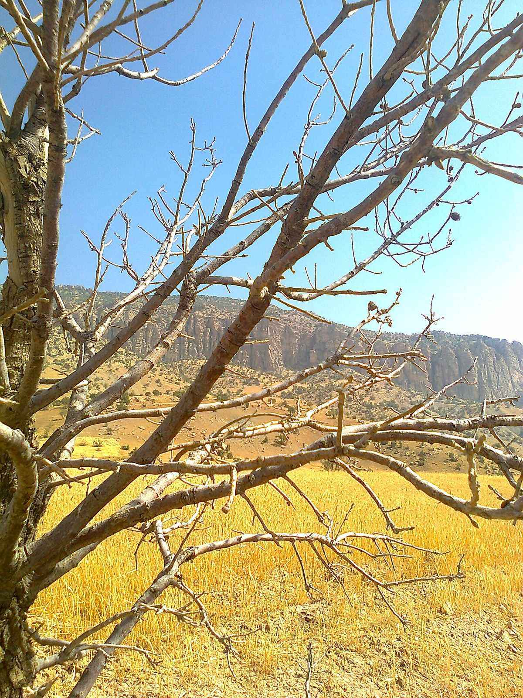

در دامنه‌های پرصلابت کوه مانشت و جنگل‌های کهنسال بلوط شهرستان ایوان غرب در استان ایلام، غاری آهکی و چشمه‌ای زلال از دل صخره‌های کارستی می‌جوشد که در باور بومیان از دیرباز با نام «چنگ پری» (Cheng-e Pari؛ به معنای پنجه یا چنگ پریان) شناخته می‌شود. در پژوهش‌های نوین زمین‌اسطوره‌شناسی (Geomythology)، این چشمه نمونه‌ای کم‌نظیر از تبیین پدیده‌های هیدروژئولوژیکی زاگرس از دریچه اسطوره‌شناسی کهن کلهری به شمار می‌رود.

روایت عامیانه کلهرها از خشکسالی ویرانگری در روزگاران باستان یاد می‌کند که تمام برکه‌ها و جویبارهای سطحی ایوان را به کام خشکی کشاند و گله‌های بز و میش در بیابانی تفتیده رو به مرگ نهادند. چوپانی سالخورده که آخرین بزغاله تشنه‌اش در حال جان باختن بود، روی به دیواره صخره‌ای مانشت نهاد و با سرودهایی سوزناک، ارواح آب‌های پنهان زمین را به یاری طلبید. در آن هنگام، شکافی در سنگ پدیدار شد و «پری آب» با چهره‌ای درخشان و جامه‌ای از قطرات شبنم بر او ظاهر شد. پری با سرانگشتان ظریف خویش پنج شیار عمیق بر دیواره صخره آهکی کشید که شبیه به جای پنج انگشت یا تارهای چنگ بود. از میان این شیارها، آبی زلال، خنک و جوشان فوران کرد و دره‌ای سرسبز را پدید آورد.

> پیران ایل کلهر در ایوان غرب چنین هشدار می‌دهند: «چنگ پری، نشانه پاکی آوه؛ هر که دس نامردی به سرچشمه بوره، پری چنگش کز کاد و آو د خاک فرو روه.» (چنگ پری نشانه قداست و پاکی آب است؛ هر کس با نیتی پلید به این سرچشمه دست درازی کند یا آن را بیالاید، پری چنگش را خاموش می‌سازد و آب به قعر زمین فرو خواهد رفت).

در باور کهنسالان منطقه، صدای ریزش آب در دالان‌های تاریک غار کارستی، نوای چنگ جادویی همان پری است که در ژرفای تاریکی می‌نوازد تا حیات چشمه تداوم یابد. در باور عشایر، این سرچشمه دارای روحی زنده‌انگارانه (آنیمیستی) است و آلوده کردن آن گناهی نابخشودنی شمرده می‌شد که موجب قهر پری و قطع ناگهانی جریان آب می‌گردید. به همین دلیل، در طول قرن‌ها مردم بومی با احترام به حریم چشمه، از آن به عنوان منبع حیاتی کشاورزی و دامپروری پاسداری کرده و درختان بلوط اطراف آن را به عنوان بیشه‌ای مقدس و دست‌نخورده نگاه داشته‌اند.

### بن‌مایه‌ها و ویژگی‌های مردم‌شناختی
افسانه چنگ پری یکی از اصیل‌ترین جلوه‌های «زمین‌اسطوره‌شناسی کارست» در زاگرس غربی است. مفهوم ایزدبانوی آب‌های زیرزمینی، قدسی‌سازی منابع آب شیرین در اقلیم‌های کم‌آب، و وضع تابوهای اجتماعی برای جلوگیری از تخریب محیط‌زیست و آلودگی چشمه‌ها، نشانگر کارکرد اخلاقی و اکولوژیک این اسطوره کلهری در استان ایلام است.

### منابع و پژوهش
- **منبع اصلی:** مقاله علمی-پژوهشی «افسانه چنگی پری، نمونه‌ای از اسطوره‌شناسی علوم زمین در فرهنگ عامه: مطالعه موردی شهرستان ایوان غرب، استان ایلام»، منتشرشده در نشریات تخصصی زمین‌شناسی و فرهنگ مردم.
- **پیوند مرجع:** https://www.researchgate.net/publication/353347134_The_Legend_of_Cheng-e_Pari_an_Example_of_the_Geomythology_in_Folklore_Case_Study_Eyvan-e_Qarb_Township_Ilam_Province_afsanh_chingi_pary_nmwnhay_az_astwrhshnasy_lwm_zmyn_dr_frhng_amh_mtal_mwrdy_shhrsta
- **زبان اصلی متن:** کردی کلهری و فارسی
- **تصویر:** File:کاژه ور.jpg | عکاس: Mohammadhadi-s | مجوز: CC BY-SA 3.0
