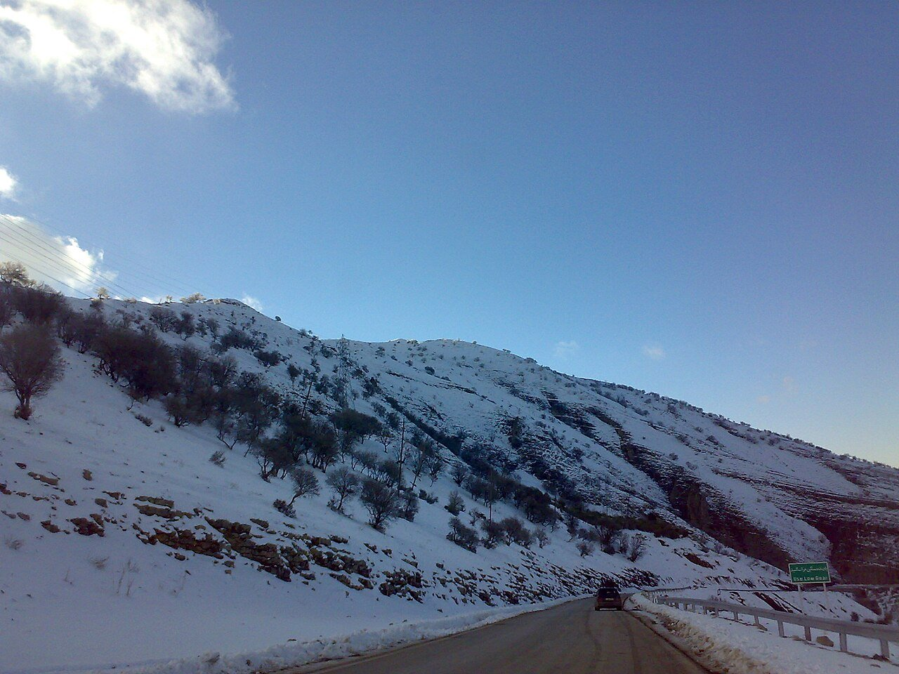

Upon the mist-wreathed ridges of Kabir-Kuh overlooking the Sasanian ruins of ancient Madakto in Darreh Shahr, a captivating mythological figure has regulated the conduct of hunters for generations. This ethereal being is *Mameh Khalan*—the benevolent White Guardian of the mountain realm, depicted as an ageless sage draped in robes woven from fresh snow, bearing a golden horn to herd and protect the wild ibex of the high cliffs.

In the folklore of the Kurds and Lurs of Ilam, Mameh Khalan is the sacred protector of alpine ecology. Traditional hunters firmly held that no arrow or bullet could touch a beast without Mameh Khalan’s divine consent. The guardian permitted the culling of a single mature male only when a family faced hunger. However, should an insatiable hunter target a pregnant doe, shoot a nursing kid, or kill for vanity, Mameh Khalan’s retribution was swift: the rifle barrel would split, blinding fog would swallow the path, and an unseen gale would fling the poacher from the crags into oblivion.

> "Loose no arrow upon the mountain doe, for the milk in her udder belongs to Mameh Khalan’s nurslings; whoever draws the sigh of a mother ibex snaps his thread of life upon the cliffs." — Ancient covenant of Zagros hunters.

Renowned folklore archivist Ali-Ashraf Darvishian in Volume 15 of *Encyclopedia of Iranian Folktales* identifies Mameh Khalan as an enduring regional survival of primeval nature divinities safeguarding the wild fauna. This mythological tradition functioned as an indigenous conservation charter, preserving the fragile biodiversity of the western Zagros. Today, mountain herders watching wild goat herds silhouetted against alpine clouds still whisper blessings to the invisible staff of Mameh Khalan.

### Sources & Image Attribution
- **Research Source:** Ali-Ashraf Darvishian, *Encyclopedia of Iranian Folktales*, Tehran: Ketab & Farhang, Vol. 15, entry: Mameh Khalan; Ethnographic field notes on traditional hunting in Kabir-Kuh.
- **Image Attribution:** Documented on Wikimedia Commons by Milad2017; License: [CC BY-SA 3.0](https://commons.wikimedia.org/wiki/File:Darreh_Shahr-Abdanan_road.JPG).
