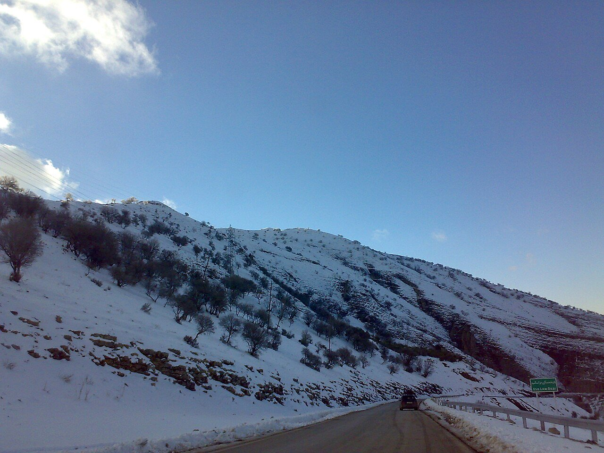

در کوهستان مه‌گرفته و فراخ کبیرکوه، مشرف به ویرانه‌های ساسانی شهر باستانی ماداکتو در دره‌شهر، پدیده‌ای شگفت‌آور قرن‌هاست که رفتار شکارچیان و رمه‌داران ایلام را تنظیم می‌کند. این پدیده، باور به «مه‌مه‌خالان» است؛ پیری پاک‌سرشت، با ردایی از برف سپید و شاخی زرین در دست، که شبانگاهان بر بلندترین ستیغ‌های کبیرکوه راه می‌رود و گله‌های کل و بزهای کوهی وحشی را چون گوسفندان خویش می‌چرد و تیمار می‌کند.

در فرهنگ فولکلور مردم کرد و لر ایلام، مه‌مه‌خالان ایزدبانو یا فرشته‌ی محافظ حیات وحش زاگرس است. شکارچیان سنتی معتقد بودند که هیچ صیادی بدون اذن مه‌مه‌خالان توان شکار در صخره‌ها را ندارد. این پیر سپیدرو تنها اجازه می‌داد صیاد برای سیر کردن شکم عیال و کودکان نیازمند، یک رأس شکار کند. اما اگر صیادی آزمندانه در پی صید بز ماده‌ی باردار یا بره‌بزها برمی‌آمد یا تیر تفنگش را به سرگرمی و بیهودگی بر تن وحوش شلیک می‌کرد، نفرین مه‌مه‌خالان دامن‌گیرش می‌شد: لوله‌ی تفنگش بر روی صخره‌ها باد می‌کرد، مه غلیظی چشمانش را می‌پوشاند و او را از بلندترین تیغه‌های کبیرکوه به دره‌های بی‌بازگشت پرتاب می‌نمود.

> «تیر به ماده‌بز مزن که شیر در پستانش برای بره‌های مه‌مه‌خالان است؛ هر که آه بز کوهی برآرد، طناب زندگانی‌اش بر صخره‌های کبیرکوه پاره خواهد شد.» — پیمان شکارچیان جوان با پیران دره‌شهر.

علی‌اشرف درویشیان در جلد پانزدهم «فرهنگ افسانه‌های مردم ایران» مدخل مه‌مه‌خالان را تجلی مدرن ایزدبانوی باستانی شکار و طبیعت (آرتمیس یا در اساطیر ایرانی، همزاد ایزد رام) در زیست‌بوم کوهستان ایلام برمی‌شمارد. این باور به شکلی معجزه‌آسا به عنوان یک قانون حفاظت محیط زیستی سنتی عمل می‌کرد و مانع از نابودی نسل حیات وحش شکننده در زاگرس غربی می‌شد.

حتی در روزگار کنونی، پیرمردان روستاهای دامنه کبیرکوه بر فراز دشت‌های دره‌شهر، گذر دسته‌های پازن‌ها بر لبه‌ی ابرها را گواهی بر نوازش دست‌های نامرئی مه‌مه‌خالان می‌دانند.

شکارچیان کهنسال کبیرکوه هنوز به یاد دارند که در روزگاران گذشته، صیادان پیش از حرکت به سوی ارتفاعات، وضو می‌ساختند و نذر می‌کردند که نیمی از گوشت شکار را میان فقرا و سالخوردگان ایل پخش کنند. اگر شکارچی از این عهد تخطی می‌کرد، مه‌مه‌خالان در کالبد بزی سپید و بالدار با شاخ‌های نقره‌ای بر پرتگاه پدیدار می‌شد و با کشیدن پای صیاد بر لبه‌ی برف‌ها، تفنگش را به قعر دره می‌انداخت تا دستش دیگر هرگز به سوی صید بی‌گناه شلیک نکند.

### منابع و اعتبار تصویر
- **منبع پژوهشی افسانه:** علی‌اشرف درویشیان، «فرهنگ افسانه‌های مردم ایران»، تهران، انتشارات کتاب و فرهنگ، جلد ۱۵، مدخل مه‌مه‌خالان؛ یادداشت‌های میدانی پیرامون شکار سنتی در کبیرکوه.
- **اعتبار تصویر:** ثبت‌شده در ویکی‌مدیا کامنز توسط Milad2017؛ مجوز انتشار: [CC BY-SA 3.0](https://commons.wikimedia.org/wiki/File:Darreh_Shahr-Abdanan_road.JPG).
