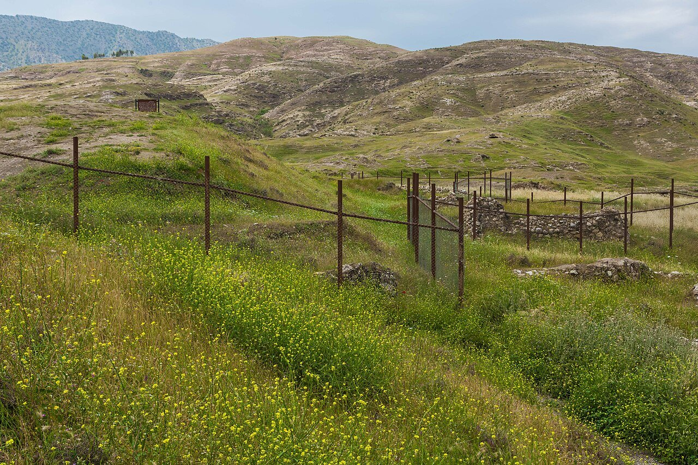

Within the sheer, shadowed corridor of Kafarin Gorge (locally known as Kafaraz) nestled along the Seimareh River beneath the crags of Kabir-Kuh, colossal cliffs cast daunting silhouettes upon the jade-green waters. The highland people of Ilam have long spoken of *Mard-Azma* (The Tester of Men)—an ancient supernatural entity tasked with testing mortal courage in the dead of night.

The Mard-Azma initially manifests in unassuming guises: a whimpering stray lamb, a swaddled infant abandoned upon the rocks, or an infirm wanderer seeking passage across the river. If a traveler lifts the creature, an unnatural density becomes palpable. With every stride, the Mard-Azma stretches skyward; its limbs elongate like ancient oak trunks until its horned visage blots out the stars. At this critical juncture, the trial unfolds: should the traveler shriek in terror or attempt flight, the entity delivers a maddening blow, casting them into the abyss. Conversely, if the traveler remains stoic, draws a blade of cold steel, and locks eyes with the specter without flinching, the Mard-Azma yields, vanishing into a mist of laughter while bestowing hidden treasures.

> "When Mard-Azma stretches before your feet, bend not your spine and avert not your gaze; he is the gale locked within stone—quiver and he shatters you; stand firm and he becomes your vanguard." — Oral wisdom of the Poshtkuh nomads.

Scholar Zaher Saraei notes in his studies on Ilam folklore that the Mard-Azma represents a vital psychological archetype designed to cultivate fortitude among mountaineers traversing hazardous Zagros defiles. In an era when mountain trails teemed with prowling wolves and raiders, this legend forged indomitable courage. Even today, as dusk descends upon Kafarin’s towering waters, veteran boatmen keep a steady gaze upon the limestone battlements.

### Sources & Image Attribution
- **Research Source:** Zaher Saraei, *Ancient Beliefs of Ilam and Poshtkuh*, Zana Quarterly, No. 3, pp. 28-35; Habibollah Mahmoudian, *Ilam Through History*, p. 155.
- **Image Attribution:** Documented on Wikimedia Commons by Morteza Aminoroayayi; License: [CC BY-SA 4.0](https://commons.wikimedia.org/wiki/File:Madaktu_01.jpg).
