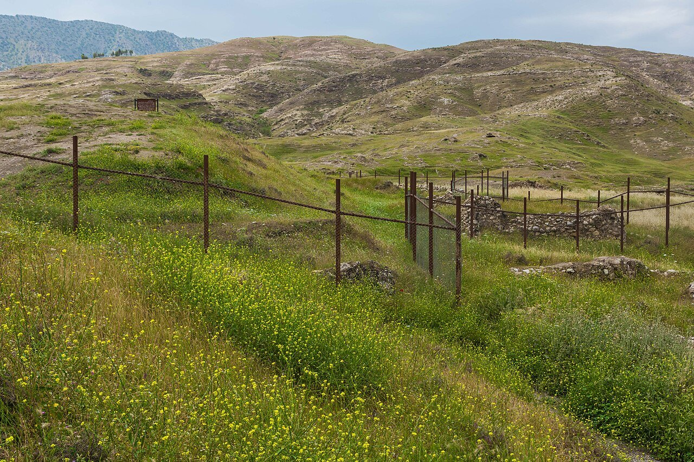

در دهانه‌ی عمیق و پرآب تنگه کافرین (کافاراز) در دامنه کوهستان کبیرکوه و حاشیه سد سیمره، صخره‌های مرتفعی قرار دارند که به هنگام شب، سایه‌هایی غول‌آسا بر آب‌های سبزفام می‌اندازند. مردم ایلام از دیرباز در این مسیرهای مالرو، با ترسی آمیخته به احترام از «مَردآزما» یاد کرده‌اند؛ موجودی ماوراءطبیعی که همان‌طور که از نامش پیداست، محک‌زننده‌ی شجاعت و پایمردی انسان‌ها در تاریکی مطلق است.

مردآزما ابتدا به شکل حیوانی کوچک و بی‌خطر، نوزادی پیچیده در قنداق، یا رهگذری تک‌افتاده و نیازمند کمک در کنار صخره‌ها ظاهر می‌شود. اگر مسافری از روی رحم یا کنجکاوی او را در آغوش گیرد، متوجه سنگینی غیرعادی‌اش خواهد شد. ناگهان با هر گامی که مسافر برمی‌دارد، قد مردآزما بلندتر می‌شود؛ دست‌ها و پاهایش به درازای درختان بلوط کشیده می‌شوند و هیبتش آن‌چنان فراخ می‌گردد که آسمان را می‌پوشاند. آزمون مردآزما در همین لحظه رقم می‌خورد: اگر مسافر از وحشت فریاد برآورد یا فرار کند، مردآزما با ضربه‌ای سنگین عقل او را زایل ساخته و او را در پرتگاه‌های دره رها می‌کند؛ اما اگر دلیرمردی خونسردی خود را حفظ کرده، تیغه‌ای فولادی بیرون کشیده و شجاعانه در چشمان آتشین او بنگرد، مردآزما تسلیم شده، با خنده‌ای از مه ناپدید گشته و گنجینه‌ای پنهان را به مسافر دلیر می‌بخشد.

> «چون مردآزما پیش پایت قد کشید، قامت خم مکن و نگاه از چشمانش مدزد؛ او باد خفته در سنگ است، اگر بلرزی، تو را در می‌نوردد و اگر بایستی، راهدارت خواهد شد.» — پند ایلیاتی شکارچیان پشتکوه ایلام.

ظاهر سارایی، پژوهشگر فرهنگ و زبان ایلام، در مقاله‌ای پیرامون «باورهای دیرین ایلام و پشتکوه» بیان می‌کند که مردآزما کهن‌الگوی مقابله با ترس درونی انسان در طبیعت بی‌رحم زاگرس بوده است. در روزگارانی که سفر میان ایلات تنها از کوره‌راه‌های کوهستانی انجام می‌شد، این باور مردان را برمی‌انگیخت تا در برابر خطرات واقعی چون گرگ‌ها و راهزنان، اعتمادبه‌نفس و آمادگی روانی خویش را حفظ کنند.

امروزه با وجود قایق‌های توریستی در تنگه کافرین، هنوز صیادان قدیمی سیمره شب‌هنگام مراقب سایه‌های صخره‌ها هستند تا اگر مردآزما سر برآورد، سربلند از آزمون شجاعت بیرون آیند.

در روایات محلی ایلام، مردآزما نمادی از شک و تردیدهای درونی است که انسان در تاریکی شب با آن روبه‌رو می‌شود. شکارچیان پشتکوه باور داشتند که اگر کسی بتواند ترس را در دل مهار کند و با مردآزما هم‌سخن شود، از اسرار گنجینه‌های کهن سیمره و مسیرهای پنهان دره‌های زاگرس آگاه خواهد شد و هیچ خطری در کوهستان توان آسیب رساندن به او را نخواهد داشت.

### منابع و اعتبار تصویر
- **منبع پژوهشی افسانه:** ظاهر سارایی، «باورهای دیرین ایلام و پشتکوه»، فصلنامه زانا، شماره ۳، ص ۲۸-۳۵؛ حبیب‌الله محمودیان، «ایلام در گذر تاریخ»، ص ۱۵۵.
- **اعتبار تصویر:** ثبت‌شده در ویکی‌مدیا کامنز توسط Morteza Aminoroayayi؛ مجوز انتشار: [CC BY-SA 4.0](https://commons.wikimedia.org/wiki/File:Madaktu_01.jpg).
