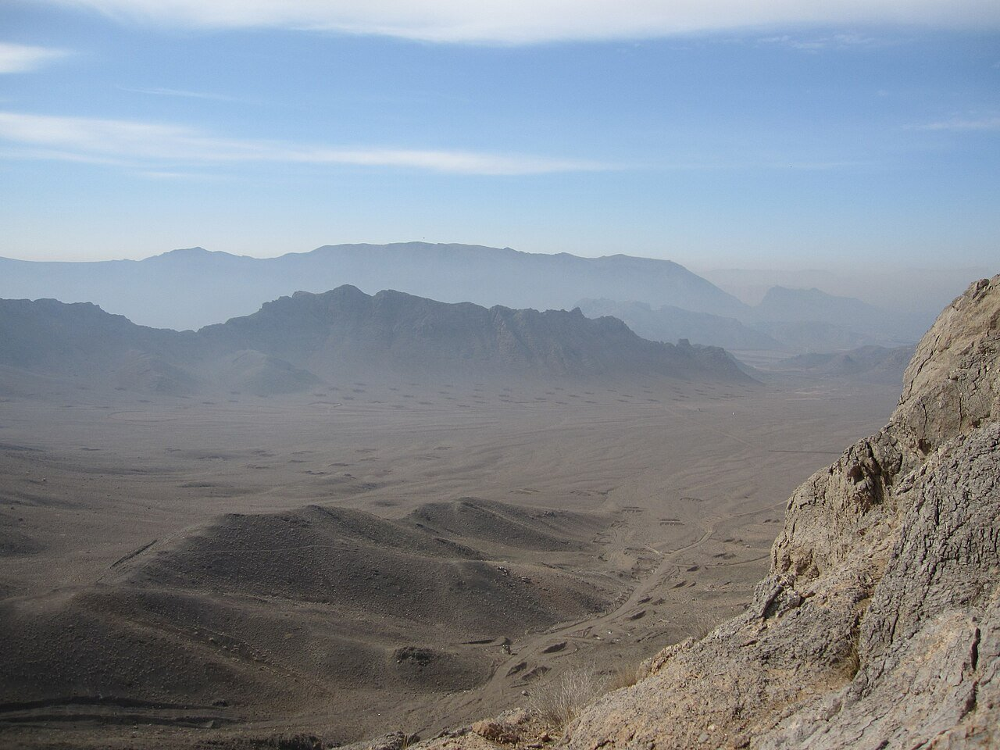

South of the turquoise domes of Isfahan, the commanding limestone ramparts of *Mount Soffeh* rise like a mythological throne overlooking the historical Zayandeh-Rood basin. Long before the mountain was paved for urban recreation, the old quarters of Isfahan preserved legends concerning the secluded *Cheshmeh Darvish* (Dervish Spring) and the elusive *Pari of Mount Soffeh*—a celestial nymph clad in emerald velvet who made her abode within the recesses of Ghanbar’s Cave beneath the crags.

Isfahani folklore portrays this fairy as the guardian of pristine aquifers that once sustained the celebrated royal gardens of Hezar-Jerib. By night, wielding an enchanted silver chisel, she carved subterranean basins into the stone to collect mountain water. It was believed that if an apprentice artisan seeking mastery in calligraphy, miniature painting, or chasing metals visited the spring with pure intentions, the Pari smiled upon his reflection in the pool, bestowing unmatched artistic dexterity upon his hands. However, should an arrogant interloper enter the caves driven by avarice to capture the fairy, the subterranean galleries collapsed, petrifying the trespasser within the bedrock.

> "Search not for gold in the dark grottos of Soffeh; the stone-carving Pari bestows divine art upon the pure of heart, and leaves only flint to the greedy." — Traditional saying of the old craftsmen of Isfahan.

Pioneering folklorist Sadegh Hedayat in *Neyrangestan* and Seyyed Abolghasem Enjavi Shirazi in *Proverbs and Parables* record these enduring beliefs surrounding Mount Soffeh’s sacred waters. In early spring, locals traditionally scattered wild wheat upon the cliffs for the mountain doves to invoke the fairy's blessing upon the city’s watercourses. The cool evening breezes wafting down from Soffeh’s crest continue to echo the silver chisel of this patron nymph of arts.

### Sources & Image Attribution
- **Research Source:** Sadegh Hedayat, *Neyrangestan*, Tehran: Amir Kabir, p. 63; Seyyed Abolghasem Enjavi Shirazi, *Proverbs and Parables*, p. 109.
- **Image Attribution:** Documented on Wikimedia Commons by Alireza Javaheri; License: [CC BY 3.0](https://commons.wikimedia.org/wiki/File:Iran_-_Esfehan_-_Around_Soffeh_-_panoramio.jpg).
