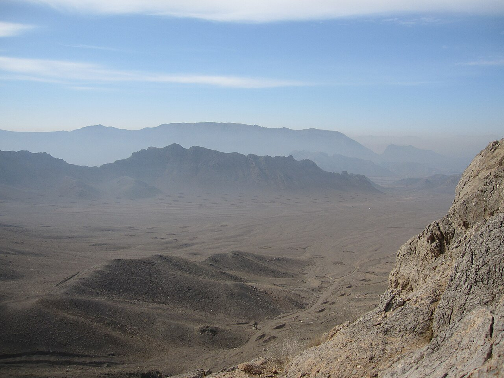

در جنوب شهر گنبدهای فیروزه‌ای اصفهان، دیواره‌های سنگی و پرابهت «کوه صفه» همچون تخت‌گاهی اسطوره‌ای بر زاینده‌رود اشراف دارند. سال‌ها پیش از آنکه این کوهستان به تفرجگاهی شهری بدل شود، مردم کهنسال اصفهان از چشمه‌ای پنهان در شکاف صخره‌ها به نام «چشمه درویش» و رازی پر از بیم و امید درباره‌ی «پری کوه صفه» سخن می‌گفتند؛ فرشته‌ای زیبا و اثیری با جامه‌ای از مخمل سبز که در شکاف‌های تاریک غار قنبر و زیر سنگ‌های تخت سلیمان آشیان داشت.

افسانه عامیانه اصفهان بازگو می‌کند که این پری، نگهبان چشمه‌های پاکی بود که روزگاری باغ‌های هزارجریب را سیراب می‌کردند. او شبانگاهان با تیشه‌ای نقره‌ای، سنگ‌های نرم کوهستان را می‌تراشید و حوضچه‌هایی بلورین برای آب خنک کوه پدید می‌آورد. باور بر این بود که اگر جوانی پاک‌دل و جویای هنر نقاشی یا قلم‌زنی در شب‌های جمعه به پای چشمه درویش می‌آمد و کوزه‌ای آب خنک از صخره‌ها برمی‌گرفت، پری در بازتاب آب بر او لبخند می‌زد و سرانگشتانش را به نبوغی جاودانه در هنر می‌آراست. اما اگر فردی دنیاپرست و متکبر به نیت صید پری یا دزدیدن تیشه سیمین او پای در غارهای تاریک صفه می‌نهاد، سنگ‌های سقف کوه بر او فرومی‌ریختند و کالبد متجاوز در همان غار برای همیشه سنگ می‌شد.

> «در تاریکی کوه صفه پی طلا مگرد؛ پری سنگ‌تراش به پاک‌دستان هنر می‌بخشد و به آزمندان جز سنگ خارا ارزانی نمی‌دارد.» — روایت پیران محله جلفا و تخت فولاد اصفهان.

صادق هدایت در کتاب مرجع «نیرنگستان» و سید ابوالقاسم انجوی شیرازی در «تمثیل و مثل» به باورهای فراگیر پیرامون چشمه‌ها و پریان کوه صفه اصفهان اشاره کرده‌اند. مردم قدیم اصفهان در فصل بهار برای نذر پری صفه، دانه‌های گندم بر صخره‌های چشمه می‌پاشیدند تا کبوتران کوهی از آن دانه برچینند و برکت زاینده‌رود و آبخوان‌های شهر همواره پایدار بماند.

غروب‌های دل‌انگیز کوه صفه با نسیم خنکی که از فراز سنگ‌ها می‌وزد، هنوز یادآور زمزمه‌های پری سنگ‌تراشی است که روح هنر و شیدایی را در کالبد خاک اصفهان دمیده است.

استادکاران قلم‌زن و فیروزه‌کوب اصفهان در گذشته بر این عقیده بودند که نقوش پیچیده و اسلیمی شاهکارهای میدان نقش‌جهان، الهام‌گرفته از بازتاب چهره پری صفه در آب چشمه درویش بوده است. جوانان هنرمند با پیاده‌روی در دامنه‌های کوه صفه و تنفس در هوای خنک صخره‌ها، روح خویش را از غبار روزمرگی می‌زدودند تا درخشش پری، ذهن آنان را به آفرینش آثار بی‌بدیل رهنمون سازد.

### منابع و اعتبار تصویر
- **منبع پژوهشی افسانه:** صادق هدایت، «نیرنگستان»، تهران، انتشارات امیرکبیر، ص ۶۳؛ سید ابوالقاسم انجوی شیرازی، «تمثیل و مثل»، ص ۱۰۹.
- **اعتبار تصویر:** ثبت‌شده در ویکی‌مدیا کامنز توسط Alireza Javaheri؛ مجوز انتشار: [CC BY 3.0](https://commons.wikimedia.org/wiki/File:Iran_-_Esfehan_-_Around_Soffeh_-_panoramio.jpg).
