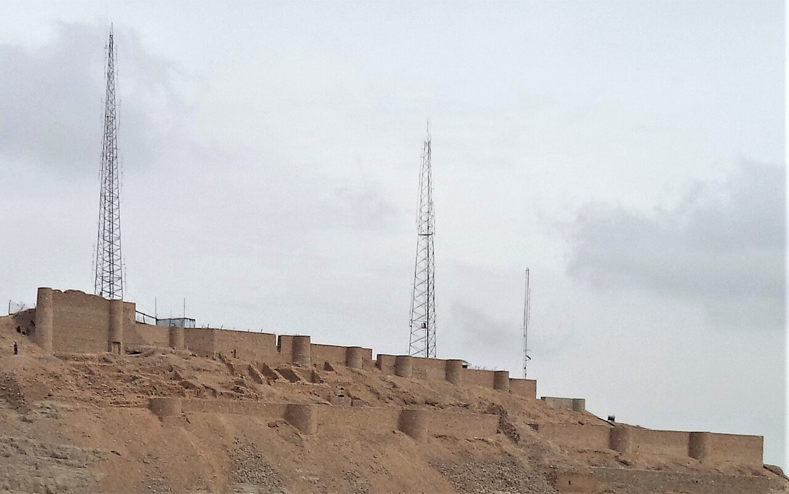

بر فراز قله صخره‌ای و مغرور کوه صفه که همچون دژبانی بر فراز شهر فیروزه‌ای اصفهان ایستاده است، بازمانده‌های برجی استوار و دیواره‌های سنگی کهنی قرار دارد که به «شاه‌دژ» (یا قلعه دیو) شهرت دارد. این دژ ساسانی و سلجوقی با پرتگاه‌های سرگیجه‌آور و غارهای پنهانی در دل سنگ، در خاطره جمعی مردم اصفهان جایگاهی آمیخته با وهم و اسطوره داشته است؛ مکانی که در آن گنجینه‌های باستانی زیر سایه ماری هفت‌سر و دیوانی سنگ‌تراش از دسترس غارتگران محفوظ نگاه داشته می‌شد و شکوه کوهستان را با اقتدار پایتخت صفوی و سلجوقی پیوند می‌زد.

بر پایه افسانه‌های کهن اصفهان، در شکاف هولناکی در پشت قله صفه که بومیان آن را «غار دیو» یا «تخت سلیمان کوه صفه» می‌نامند، دیوی کهنسال به همراه ماری هفت‌سر از زر و سیم و طلاهای شاهان پیشدادی پاسداری می‌کرد. این مار هفت‌سر دهانه‌ای داشت که آتش و دود خاکستری از آن برمی‌خاست و هرگاه سرداری ستم‌پیشه هوس غارت خزائن شهر زاینده‌رود را در سر می‌پروراند، دیو دژ با سنگی خارا راه چشمه‌های کوه را می‌بست و اژدهای هفت‌سر تندبادی مسموم به سوی دامنه‌ها می‌دمید تا دشمنان سرنگون شوند.

> اصفهانی‌های قدیم در شب‌های بارانی کوه صفه می‌گفتند: «آن درخشش سرخی که گاهی روی تیغه شاه‌دژ سوسو می‌زند، شعله‌های چشم مار هفت‌سر است که از خواب بیدار شده و شهر را زیر نظر دارد.»

افسانه می‌گوید هنگامی که پهلوانی پاک‌سرشت به نام آذرنوش برای نجات جان دختران اسیر به بلندای شاه‌دژ صعود کرد، به جای تیغ کشیدن بر دیو، آینه‌ای صیقلی در برابر هفت سر مار قرار داد. مار با دیدن تصویر مهیب خویش در آینه، به خود پیچید و با خشم خویشتن را نیش زد؛ با مرگ مار، دیو نگهبان تسلیم پاکی پهلوان شد و سوگند خورد که تا ابد تنها نگهبان وفادار صلح و آرامش مردم اصفهان باشد. چشمه‌های کوچک و قطره‌چکانی دامنه صفه مانند چشمه خچیره، در باور عامه اشک‌های این دیو نادم است. کوهنوردان اصفهانی هنوز هم در سحرگاهان بر فراز شاه‌دژ می‌ایستند و طلوع خورشید را بر گنبدهای نیلگون شهر به تماشا می‌نشینند. در دالان‌های زیرزمینی شاه‌دژ، حوضچه‌های سنگی کوچکی وجود دارد که آب چکه‌چکه از سقف صخره در آن‌ها جمع می‌شود؛ مردم اصفهان معتقد بودند این آب، پادزهر نیش مارهای کوهستان است که دیو نادم برای تبرک پهلوانان در دل سنگ نهاده است. شب‌هنگام که چراغ‌های شهر تاریخی اصفهان چون کهکشانی در پای کوه صفه روشن می‌شوند، سایه شاه‌دژ بر فراز باروها یادآور روزگارانی است که اساطیر و تاریخ در مهتاب زاینده‌رود در هم می‌آمیختند. شاه‌دژ کوه صفه با دیواره‌های برافراشته‌اش، یادآور حماسه‌های فراموش‌نشدنی مقاومت در بام زاینده‌رود است.

### منبع روایت و تصویر
- **خاستگاه افسانه:** تاریخ شفاهی و داستان‌های عامیانه کوه صفه و قلعه شاه‌دژ اصفهان، کتب فولکلور و نام‌جای‌های اصفهان.
- **عکاس / پدیدآورنده تصویر:** Mhsheikholeslami
- **منبع تصویر:** [صفحه تصویر در ویکی‌انبار](https://commons.wikimedia.org/wiki/File:Shah_dezh_Citadel-Isfahan-ID14280-_%D9%82%D9%84%D8%B9%D9%87_%D8%B4%D8%A7%D9%87%D8%AF%DA%98-%DA%A9%D9%88%D9%87_%D8%B5%D9%81%D9%87-%D8%A7%D8%B5%D9%81%D9%87%D8%A7%D9%86.jpg)
- **نوع مجوز:** CC BY-SA 4.0
