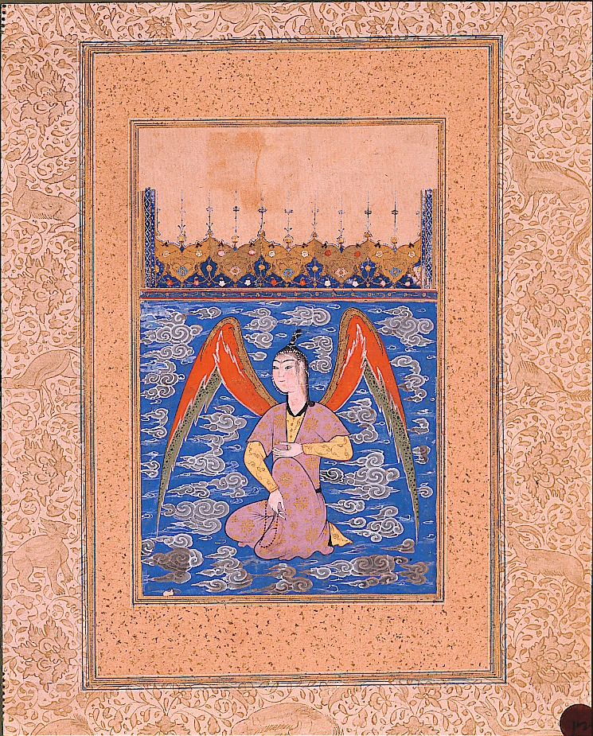

Preserved across centuries within the rich oral folklore of **Kerman** (encircling the historical domains of **کرمان / بم**), the legendary lore of **Aalam-Afrooz ‌** stands as a compelling testament to Iran's enduring mythic imagination. Transmitted across hearths, mountain paths, and rural caravans, the tale has survived through the living memories of local elders.

Folklorists generally categorize **Aalam-Afrooz ‌** within the mythological taxonomy of *Pari*. As with many traditional entities of Iranian folk belief, it embodies both the untamed natural elements and the ancestral anxieties regarding solitary wilderness. Classical collectors recorded its traditional traits as follows:

> "Illustration by Erfan Aghvami and Mo.Rasoulipour In Sām-nāma, there was a fairy named Ālam-Afrooz who fell in love with Sām. She turns herself into a zebra and appears in front of Sām to make him chase her and hunt her down.Using this magic, she drags Sām from the hunting ground to her castle, and after she changes to her human shape, she tries to confess her feelings to him.While listening to her, Sām saw a drawing on the castle walls. The face of Pari-Dokht, the king of China's daughter, was drawn on the wall. After seeing the picture, Sām leaves Ālam-Afrooz behind and goes to China to look for Pari-Dokht.Furious about the failure, Ālam-Afrooz holds a grudge against Sām and Pari-Dokht and seeks revenge against them. She does her best to break them apart and destroy them. Translation: Sarah Mohebbi Moghadam …"

In local oral tradition, an encounter with **Aalam-Afrooz ‌** was regarded as a formidable threshold between familiar domestic reality and the unseen realm. Elders customarily advised night travelers, shepherds, and caravan drivers traversing the historic passes of Kerman to heed ancient apotropaic rituals—such as carrying iron amulets, maintaining solemn reverence towards nature, and never uttering provocative words—to pass through its territorial domain unharmed.

Today, the chronicle of **Aalam-Afrooz ‌** forms an invaluable component of Iran's intangible cultural heritage, offering modern readers an evocative window into how ancient communities interpreted their ecology, mystery, and moral balance.

---

### Sources & Image Attribution
- **Folklore Research & Origin:** Sourced and adapted from the Eranshahr Folklore Archive (`eranshahr.com/myths`) and regional oral narratives of Kerman.
- **Visual Artifact:** *"An airborne peri with a rosary (6124504583).jpg"*, sourced via Wikimedia Commons, contributed by thesandiegomuseumofartcollection, licensed under `Public domain` ([Source Link](https://commons.wikimedia.org/wiki/File:An_airborne_peri_with_a_rosary_(6124504583).jpg)).