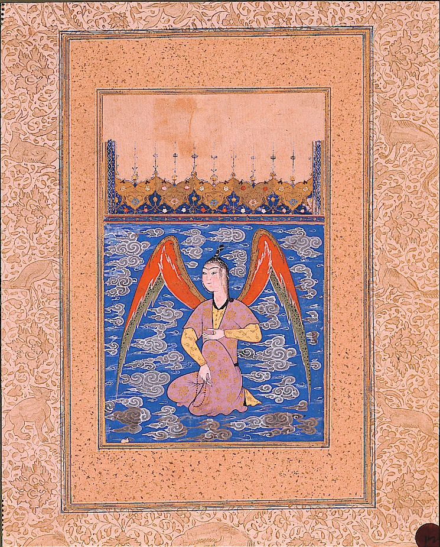

در یادمان‌های شفاهی و باورهای عامیانه‌ی مردم **کرمان** (به‌ویژه در گستره‌ی **کرمان / بم**)، روایت‌های پرشماری از پدیده‌ای شگفت و موجودی دیرپا به نام **«عالم»** سینه به سینه از روزگاران باستان تا کنون بازگو شده است. راویان بومی که با گویش و لهجه‌ی **کرمانی** به نقل قصه‌ها می‌نشستند، پیدایش این پدیده را با کوهساران، دشت‌های بی‌کران، جنگل‌ها یا آب‌های مرموز این خطه پیوند می‌زدند.

در طبقه‌بندی فرهنگ عامه، **عالم** را غالباً با تیره‌ی *Pari* هم‌بسته می‌دانند؛ چهره‌ای که تجسم نیروهای ناشناخته‌ی اقلیم و جهان نادیدنی پیرامون نیاکان بوده است. در توصیف‌ها و متون بازمانده‌ی پژوهشی پیرامون این افسانه آمده است:

> «Aalam-Afrooz|عالم‌افروز در منظومه سام‌نامه ( منسوب به خواجوی کرمانی) ، عالم‌افروز پری‌ای است که دلداده سام می‌شود. او خود را به شکل گورخری در می‌آورد و در مسیر سام قرار می‌گیرد تا سام به قصد شکار به دنبال او برود. عالم‌افروز سام را با این جادو از نخجیرگاه تا قصر خود می‌کشاند، بر او ظاهر می‌شود و عشقش را به او اعتراف می‌کند. سام در حال شنیدن سخنان عالم‌افروز چشمش به نگاره‌ای بر دیوار قصر می‌افتد که تصویر پری‌دخت، دختر پادشاه چین است. سام به عالم‌افروز بی‌توجهی می‌کند و به دنبال پری‌دخت به سرزمین چین می‌رود. عالم‌افروز از شکست خوردن این عشق خشمگین می‌شود، کینه سام و پری‌دخت را به دل می‌گیرد و با تمام قوای خود درصدد جدایی افکندن بین سام و پری‌دخت و حتی نابود کردن آن‌ها بر می‌آید. منابعسام نامه»

پیران و ریش‌سفیدان منطقه در شب‌نشینی‌ها گوشزد می‌کردند که رویارویی با **عالم** همواره نشانه‌ای از لزوم هشیاری در برابر ناشناخته‌های طبیعت بوده است. در اعصار گذشته، مسافران، شبانان و کاروانیانی که شب‌هنگام در این نواحی گذر می‌کردند، برای مصون ماندن از گزند یا فریب این موجودات، آیین‌ها و دعاهای محافظتی خاصی را به کار می‌بستند و از شکستن سکوت شب یا نزدیک شدن به زیستگاه‌های آنان پرهیز می‌کردند.

امروزه داستان **عالم** یکی از گنجینه‌های ماندگار میراث معنوی و مردم‌شناسی دیار **کرمان** به شمار می‌رود که پیوند عمیق روان‌شناختی انسان کهن را با رمزورازهای زیست‌بوم سرزمین ایران به تصویر می‌کشد.

---

### منابع و اعتبار تصویر
- **پژوهش و خاستگاه روایت:** برگرفته از دانشنامه فولکلور و اسطوره‌شناسی ایران‌شهر (`eranshahr.com/myths`) و روایت‌های شفاهی بومی کرمان.
- **تصویر:** اثر *«An airborne peri with a rosary (6124504583).jpg»*، بارگذاری‌شده در ویکی‌انبار (Wikimedia Commons)، پدیدآورنده: thesandiegomuseumofartcollection، تحت مجوز آزاد `Public domain` ([مشاهده منبع](https://commons.wikimedia.org/wiki/File:An_airborne_peri_with_a_rosary_(6124504583).jpg)).