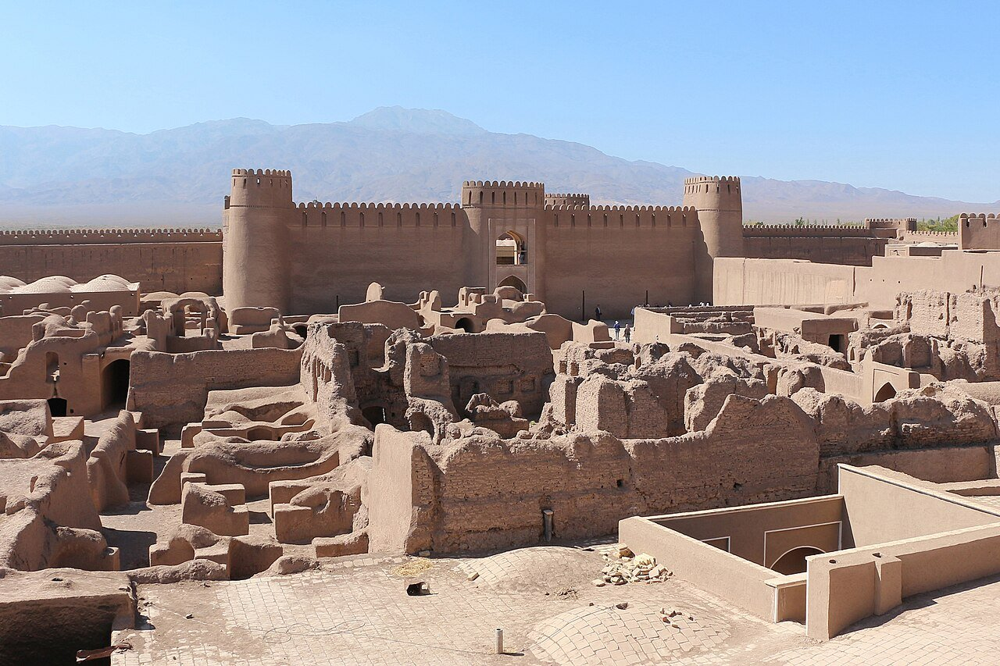

At the base of the snow-capped massif of Mount Hezar in Kerman province, the monumental mudbrick citadel of Rayen glows like an unyielding bastion inherited from the Sasanian era. In the ancient desert folklore of Kerman, this formidable fortress is intrinsically linked to the enigmatic legend of the *Lady of the Seven Castles* (*Khatoun-e Haft Ghaleh*)—a sovereign, wise, and courageous matriarch of ancient frontier wardens who defended the realm with the aid of a colossal, amber-scaled guardian serpent.

Kermani oral tradition recounts that beneath the labyrinthine subterranean galleries of the Rayen Citadel, the Lady excavated a deep cistern connected to the pristine alpine springs of Mount Hezar. Within this vault resided a golden serpent crowned with a glowing ruby. While the serpent's fiery breath reduced foreign marauders to ash, it was venerated by the townsfolk as an auspicious protector of groundwater aquifers and municipal fertility. Whenever invaders besieged the town, the Lady ascended the highest rampart, turning an ancient bronze talisman on her arm to summon the amber serpent, which encircled the citadel walls with walls of protective flame.

> "Strike no covetous pickaxe into Rayen's soil; the Lady of the Seven Castles sleeps not, and the amber serpent rests its brow upon ancestral relics until righteousness reigns across the desert." — Oral proverb of Rayen elders.

Eminent historian Dr. Mohammad-Ebrahim Bastani Parizi in his folklore classic *Khatoun-e Haft Ghaleh* observes that this legend personifies the indomitable tenacity of Kerman's desert folk and the prominent historical role of women in defending desert oases against nomadic raids. In the archaeological symbolism of the ancient Halil-Rud civilization, the serpent was celebrated as the sacred guardian of vital irrigation canals. The magnificent bastions of the Rayen Citadel stand today against the azure desert sky as monuments to this legendary matriarch.

### Sources & Image Attribution
- **Research Source:** Mohammad-Ebrahim Bastani Parizi, *Khatoun-e Haft Ghaleh* (The Lady of the Seven Castles), Tehran: Amir Kabir, pp. 18-29; Kerman Studies Center, *Folklore of the People of Kerman*, p. 84.
- **Image Attribution:** Documented on Wikimedia Commons by Bernard Gagnon; License: [CC BY-SA 4.0](https://commons.wikimedia.org/wiki/File:Rayen_Castle_01.jpg).
