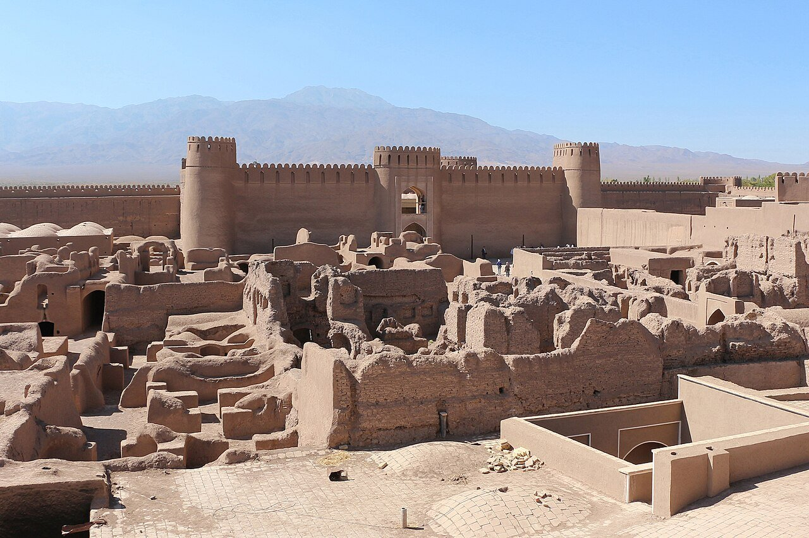

در پای کوهستان برف‌پوش هزار در استان کرمان، ارگ خشتی و استوار راین همچون نگینی بازمانده از عهد ساسانیان بر تارک دشت می‌درخشد. در افسانه‌های کهن مردم کویر، این دژ نفوذناپذیر با روایتی اسرارآمیز پیرامون «خاتون هفت‌قلعه» گره خورده است؛ بانویی خردمند، زیبا و مقتدر از دودمان مرزبانان کهن که پاسداری از هفت دژ کویری را بر عهده داشت و با یاری ماری عظیم به رنگ کهربای درخشان، از مرزهای شرقی ایران در برابر هجوم مهاجمان صحراگرد پاسداری می‌کرد.

روایت کرمانی بازگو می‌کند که خاتون هفت‌قلعه در زیرزمین‌های تودرتوی ارگ راین، چاهی عمیق حفر کرده بود که به چشمه‌های آب جاودان کوه هزار راه داشت. در این چاه، ماری زرین با تاجی از لعل سرخ می‌زیست که طمع‌کاران و بیگانگان را با دمی سوزان خاکستر می‌کرد، اما برای اهل دژ، نماد زایش، ثروت و نگهداری از آب قنات‌ها بود. هرگاه لشکری غاصب به راین یورش می‌آورد، خاتون برفراز باروهای خشتی می‌ایستاد و با چرخاندن بازوبندی مفرغی، مار کهربایی را فرا می‌خواند. مار عظیم با پیچیدن به دور ارگ، هاله‌ای از آتش و غبار پدید می‌آورد و دشمنان را در حصاری از وحشت ناکام می‌گذاشت.

> «بر خاک راین تیشه نامحرم مزن؛ خاتون هفت‌قلعه در خواب نیست و مار کهربا بر سر گنجینه‌های نیاکان سر نهاده است تا روزی که راستی بر دشت‌ها فرمان راند.» — کلام کهنسالان راین در کوچه‌باغ‌های چنار.

استاد محمدابراهیم باستانی پاریزی در شاهکار فولکلوریک و تاریخی خویش «خاتون هفت‌قلعه» اشاره می‌کند که این اسطوره، تجسم استقامت تاریخی مردم کویر کرمان و نقش برجسته زنان در مدیریت، دفاع و بقای تمدن‌های حاشیه لوت بوده است. مار در اساطیر باستانی حوزه هلیل‌رود و جیرفت همواره نماد خیر، برکت و نگهبان آب‌های زیرزمینی بوده و در راین با حماسه دفاع از مرزهای ملی تلفیق گشته است.

امروزه برج‌ها و کنگره‌های باصلابت ارگ راین در برابر آسمان لاجوردی کرمان، یادآور روزگاری است که خاتون هفت‌قلعه و مار افسانه‌ای‌اش، استواری این کهن‌دژ را در دل تاریخ تضمین می‌کردند.

مردم کهنسال راین باور دارند که ارگ تاریخی راین و برج‌های نگهبانی آن، بازتابی از هوشمندی نظامی و معنوی خاتون هفت‌قلعه در دفاع از راه‌های کاروانی لوت بوده است. این مار کهربایی در باور عامه، نمادی از رگه‌های غنی مس و آهن در دل کوهستان هزار بوده که ابزار دفاع و ادوات کشاورزی دلاوران راین را تأمین می‌کرده و اقتدار پایدار این دژ خشتی را تضمین می‌نموده است.

### منابع و اعتبار تصویر
- **منبع پژوهشی افسانه:** محمدابراهیم باستانی پاریزی، «خاتون هفت‌قلعه»، تهران، انتشارات امیرکبیر، ص ۱۸-۲۹؛ فرهنگ عامیانه مردم کرمان، مرکز کرمان‌شناسی، ص ۸۴.
- **اعتبار تصویر:** ثبت‌شده در ویکی‌مدیا کامنز توسط Bernard Gagnon؛ مجوز انتشار: [CC BY-SA 4.0](https://commons.wikimedia.org/wiki/File:Rayen_Castle_01.jpg).
