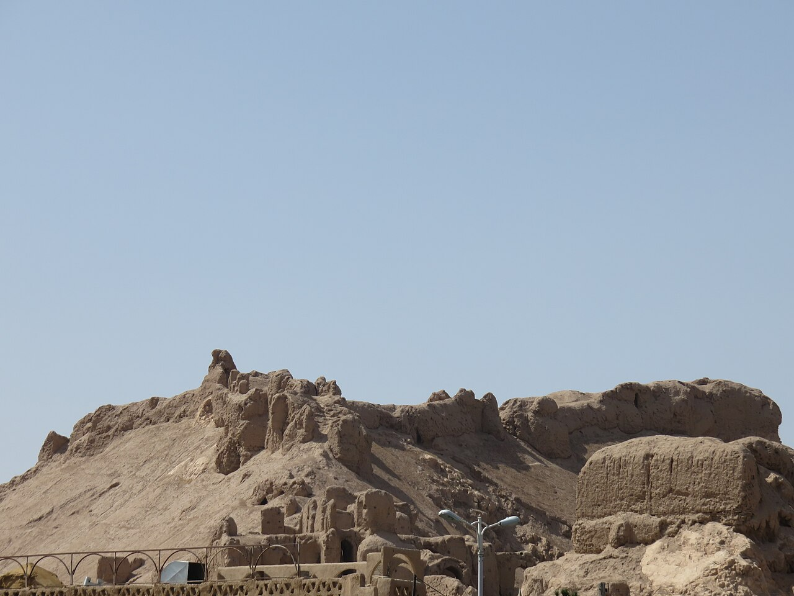

بر فراز صخره‌های شرقی شهر تاریخی کرمان، برج و باروی خشتی دژی کهنسال سر به آسمان ساییده است که از دیرباز «قلعه دختر» (قلعه کهنه) نامیده می‌شود. این دژ نفوذناپذیر که پیشینه‌اش به دوران مادها و ساسانیان می‌رسد و به نام ایزدبانوی آب‌ها آناهیتا پیوند خورده است، در فرهنگ عامه مردم کویرنشین کرمان کانون یکی از شگفت‌انگیزترین افسانه‌های جادو، وفاداری و طلسم‌های نفوذناپذیر به شمار می‌رود؛ داستانی از دختری زیباروی و دانا که پادشاهی دژ را بر عهده داشت و با تار ابریشمی زرین از دروازه‌های شهر پاسداری می‌کرد. خشت‌های قطور این بارو در طول هزاران سال در برابر زلزله‌ها و طوفان‌های شن کویر لوت مقاومت کرده‌اند.

بنا بر روایت پیران کرمانی، این دژ چنان بر لبه پرتگاه صخره بنا شده بود که هیچ لشکری با منجنیق و نردبان توان رخنه به آن را نداشت. دختر پادشاه که حاکم قلعه بود، طلسمی باستانی از نیاکان به ارث برده بود؛ او دوکی از طلای ناب داشت و با نخ‌های ابریشمین جادویی، پرده‌ای نامرئی به نازکی تار عنکبوت پیرامون صخره‌ها می‌تنید. هرگاه سپاه دشمن به پای قلعه نزدیک می‌شد، اسب‌ها و جنگاوران در این تارهای نادیده گرفتار می‌شدند و با هر تکان بیشتر در بند می‌افتادند، گویی صخره خود دشمنان را بلعیده است. از این رو دژ همواره تسخیرناپذیر و «دست‌نخورده» (دختر) باقی مانده بود و نام کرمان با تسلیم‌ناپذیری بر سر زبان‌ها می‌گشت.

> مادربزرگان کرمانی هنگام لالایی خواندن می‌گویند: «قلعه دختر با شمشیر و گرز گشوده نشد، بلکه با شکستن عهد و خیانت فروریخت؛ طلسم تا زمانی کارساز است که دل‌ها پاک و دست‌ها بی‌طمع باشد.»

افسانه حکایت از آن دارد که در زمان محاصره طولانی دژ توسط اردشیر بابکان، جوانی خائن یا چوپانی فریب‌خورده به درون بارو راه یافت و برای رسیدن به گنجینه‌های وعده‌داده‌شده، دوک زرین دختر شاه را از بالای برج به چاه سنگی افکند و تارهای ابریشمین با تماس با خاکستر باطل شدند. با فرو ریختن طلسم، سپاهیان اردشیر به دژ هجوم آوردند و دختر فرمانروا برای آنکه به اسارت درنیاید، خود را از بلندترین صخره به اعماق دره پرتاب کرد. مردم کرمان باور دارند که در شب‌های مهتابی بهار، نجوای چرخش دوک نخ‌ریسی دختر از شکاف خشت‌های کهن قلعه شنیده می‌شود و روح پاکبان دژ هنوز بر فراز کرمان پاسبانی می‌دهد تا حافظ سربلندی دیار کریمان باشد. دختران قالی‌باف کرمانی هرگاه تار و پود دار قالی را گره می‌زنند، یاد صبر و پاکی دختر صخره را در نقش‌های ترنج و اسلیمی زنده می‌دارند.

### منبع روایت و تصویر
- **خاستگاه افسانه:** تاریخ شفاهی و باورهای کهن عامیانه مردم کرمان پیرامون وجه تسمیه قلعه دختر، کتاب‌های تاریخ و باستان‌شناسی دیار کریمان.
- **عکاس / پدیدآورنده تصویر:** Zahraaa 69
- **منبع تصویر:** [صفحه تصویر در ویکی‌انبار](https://commons.wikimedia.org/wiki/File:Dokhtar_Castle_(Kerman).jpg)
- **نوع مجوز:** CC BY-SA 4.0
