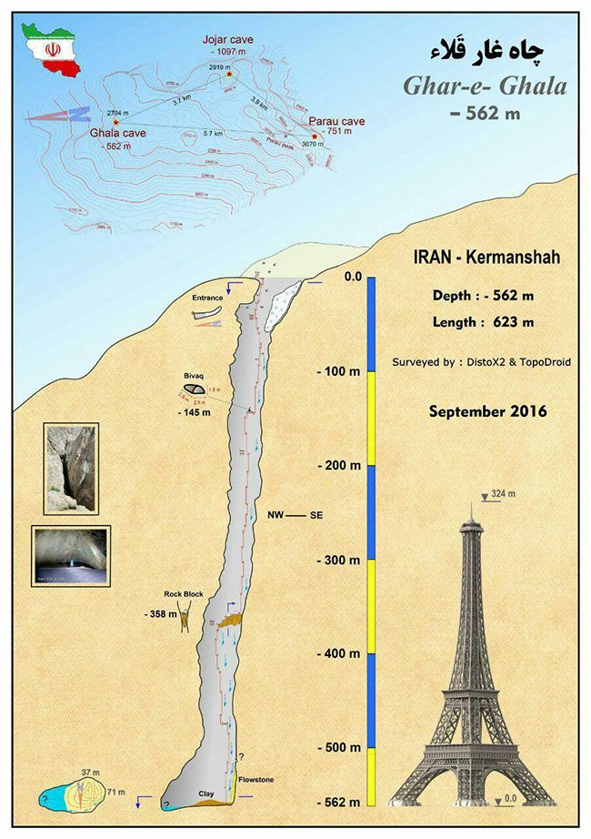

High upon the wind-battered limestone crown of Mount Parau northeast of Kermanshah opens a vertical abyss descending into the earth: *Ghar-e Parau* (The Cave of Waters)—one of the most perilous and technically demanding vertical caves in the world. Long before speleologists penetrated its freezing shafts with modern ropes, Kurdish nomads of the Kalhor and Zanganeh tribes spoke with awe of the *Dragon of the Parau Depths*—a colossal, wing-bearing chthonic serpent whose frost-breath and glowing eyes guarded ancient arms and primordial ice within the seventh subterranean hall.

In regional oral tradition, the shaft connects the high alpine peaks to the subterranean rivers of the underworld. The Dragon of Parau acts as the fearsome guardian of the aquifers feeding the historic springs of Taq-e Bostan and Bisotun. Mountaineers believe that when a howling sound like a war horn issues from the vertical entrance during winter blizzards, it is the dragon stirring its icy coils. Trespassers seeking hidden relics are swept away by sudden flash deluges of sub-zero meltwater that plunge them into the abyss.

> "Cast no stone into the mouth of Parau; that cavern is the ear of the sleeping mountain dragon, and his fury turns the crystal fountains of Kermanshah into mud and tempests." — Warning of mountain guides in Parau.

Historian Mohammad-Ali Soltani in *Historical and Indigenous Geography of Kermanshah* observes that this legend directly mirrors the genuine, lethal hazards of Parau’s karst system, where water temperatures hover near freezing year-round. The dragon served as an essential folkloric deterrent, preserving youth from venturing into one of the most treacherous geological chasms in the Zagros. To this day, when storm clouds veil the 3,300-meter summit, Parau's gaping entrance retains its primeval dread.

### Sources & Image Attribution
- **Research Source:** Mohammad-Ali Soltani, *Historical and Indigenous Geography of Kermanshah*, Tehran: Soha, Vol. 1, pp. 204-211; Seyyed Abolghasem Enjavi Shirazi, *Ancient Tales and Legends*, Vol. 2, p. 176.
- **Image Attribution:** Documented on Wikimedia Commons by یوسف سورنی نیا; License: [CC BY-SA 4.0](https://commons.wikimedia.org/wiki/File:4057_orig.jpg).
