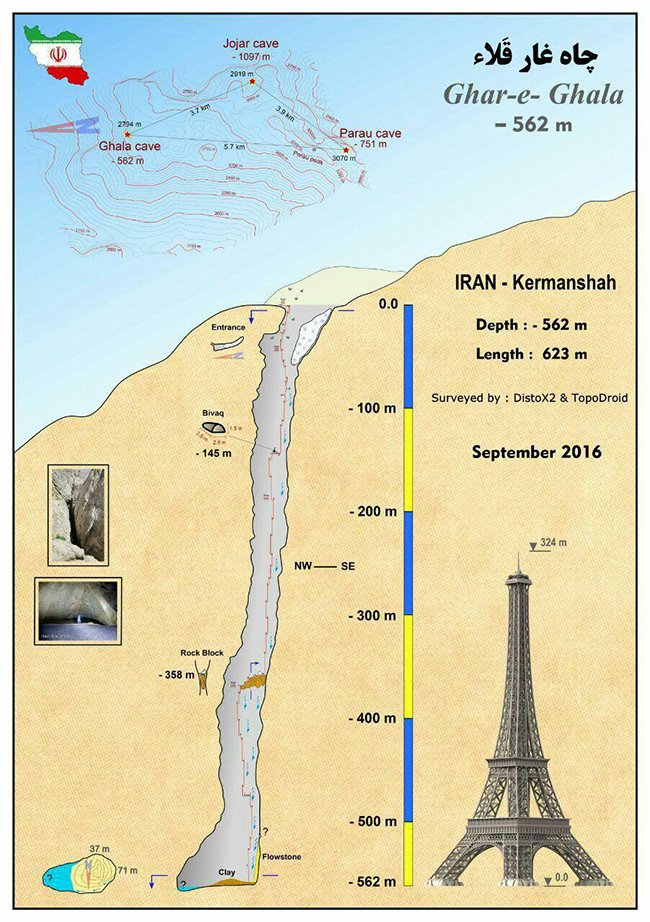

بر فراز ستیغ خشن و آهکی کوه پراو در شمال شرقی کرمانشاه، دهانه‌ای عمودی به سوی اعماق زمین باز شده است که یکی از مخوف‌ترین و عمیق‌ترین غارهای طبیعی جهان را در خود جای داده است: «غار پراو» یا غار پرآب. سال‌ها پیش از آنکه غارنوردان مدرن با طناب‌های فولادی به تالارهای یخ‌بندان آن نفوذ کنند، ایلات کرد کلهر و زنگنه با بیم و شگفتی از «اژدهای ژرفای پراو» سخن می‌گفتند؛ ماری بالدار با چشمان فسفری و نفس یخ‌زده که در هفتمین تالار تاریک این غار، بر روی گنجینه‌ای از یخ‌های جاودان و شمشیرهای باستانی خفته است.

در باورهای محلی، غار پراو دهلیزی است که قله کوه را به رودخانه‌های زیرزمینی جهان مردگان متصل می‌کند. اژدهای پراو، پاسبان آب‌های گوارای چشمه بیستون و سراب طاق‌بستان است. عشایر روایت می‌کنند که اگر در زمستان صدای زوزه‌ای شبیه به شیپور جنگی از دهانه چاه غار پراو برخیزد، این نفس اژدهاست که یخ‌های عمیق را به حرکت درمی‌آورد. اگر صخره‌نوردی ناشی یا غارتگری طماع پای به درون چاه‌های عمودی بگذارد، اژدها با برانگیختن آبشارهای ناگهانی از آب گل‌آلود و منجمدکننده، او را به چاه‌های بی‌پایان ۲۶ متری می‌کشاند و اثری از او بر جای نمی‌گذارد.

> «در دهانه چاه پراو سنگ نیندازید؛ آن چاه، گوش اژدهای بیستون است و خشم او، چشمه‌های پاک طاق‌بستان را به لجن و طوفان بدل خواهد ساخت.» — پند راهنمایان کهنسال کوهستان پراو.

محمدعلی سلطانی در کتاب معتبر «جغرافیای تاریخی و بومی کرمانشاهان» یادآور می‌شود که این اسطوره بازتابی از طبیعت فوق‌العاده سهمگین و سرمای کشنده این غار کارستی است. دمای آب در تمام طول سال میان یک تا سه درجه سانتی‌گراد است و چاه‌های عمودی پی‌درپی، آن را به قتلگاهی طبیعی تبدیل کرده است. اسطوره اژدها، هشداری آیینی و حیاتی بوده تا جوانان ایل بی‌گدار به آب نزده و جان خود را در یکی از مرگبارترین پدیده‌های زمین‌شناختی زاگرس به خطر نیندازند.

امروزه نیز هنگامی که ابرها بر فراز قله ۳۳۰۰ متری پراو چادر می‌زنند، سنگ‌های رسوبی دهانه غار ابهتی هولناک به خود می‌گیرند؛ گویی اژدهای اساطیری در خلوت یخ‌های خویش همچنان نگهبان نبض آب‌های کرمانشاه است.

غارنوردان و محققان زمین‌شناسی معتقدند جریان‌های باد فوق‌العاده سرد و صداهای پژواک‌یافته در چاه‌های عمودی غار پراو، به شکل طبیعی بستری برای آفرینش اسطوره اژدها در ذهن بومیان فراهم آورده است. چوپانان کرمانشاهی باور داشتند که مارهای عظیم غار پراو در زمستان‌ها برای محافظت از چشمه‌های زلال بیستون، آب‌ها را منجمد می‌سازند تا سیلاب‌های بهاری با قدرت و پاکیزگی از دل کوهستان فوران کنند و دشت کرمانشاه را به گلستانی خرم بدل سازند.

### منابع و اعتبار تصویر
- **منبع پژوهشی افسانه:** محمدعلی سلطانی، «جغرافیای تاریخی و بومی کرمانشاهان»، تهران، نشر سها، جلد ۱، ص ۲۰۴-۲۱۱؛ سید ابوالقاسم انجوی شیرازی، «قصه‌ها و افسانه‌های باستان»، جلد ۲، ص ۱۷۶.
- **اعتبار تصویر:** ثبت‌شده در ویکی‌مدیا کامنز توسط یوسف سورنی نیا؛ مجوز انتشار: [CC BY-SA 4.0](https://commons.wikimedia.org/wiki/File:4057_orig.jpg).
