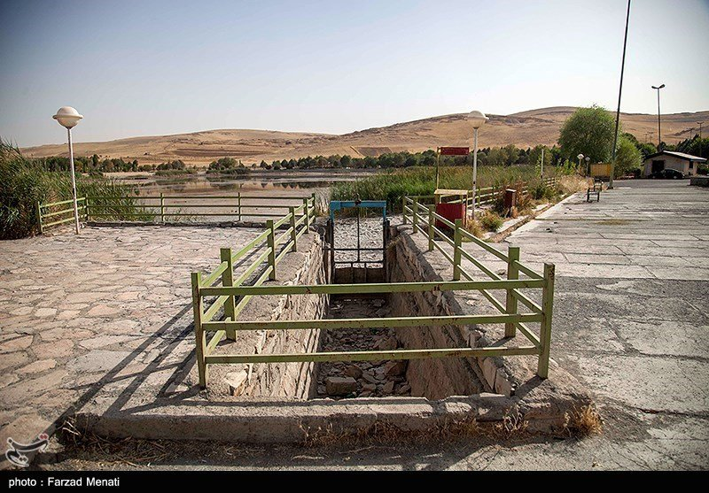

Just northwest of the historic city of Kermanshah, cradled at the foot of Zagros crags in the Mahidasht plain, lies *Sarab-e Niloofar*—a vast natural freshwater lagoon famed for its luminous tapestry of blooming aquatic lotuses. In Kurdish folklore, this tranquil sanctuary preserves one of the most poignant fairy romances of the highlands: the legend of the *Pari of the Lotus*, the celestial water nymph who binds heaven and earth through sacrifice.

Kalhori lore relates that in a forgotten epoch of catastrophic drought, the springs desiccated and crops withered to ash. A virtuous and compassionate maiden, unable to bear the agony of her parched people, walked into the cracked clay bed carrying a basket of sacred lotus seeds, beseeching the divine waters for salvation. Her tears mingled with the dry earth, instantly awakening subterranean geysers that flooded the hollow into a crystalline lake. To anchor the blossoming seeds, the maiden surrendered her mortal form, transforming into an ethereal Water Pari who ascends each summer to open the fragrant lotus blossoms.

> "Every lotus that crowns the waters of Kermanshah holds the memory of an answered prayer; pluck not the petal, lest the heart of the Water Pari bleed and the springs retreat into the abyss." — Ancient adage of the Kalhor Kurds.

Folklorist Keyvan Pendar in *Folk Culture of Kermanshah and Sacred Waters* elucidates that Sarab-e Niloofar was historically venerated as a living sanctuary of Anahita, the divinity of waters, closely tied to the rock reliefs of Taq-e Bostan. During traditional summer solstices, pilgrims gathered here for ritual water-splashing rites (*Ab-Pashan*), casting sweets into the depths to ensure communal fertility. The serene dance of lotus blossoms floating upon Sarab-e Niloofar remains an enduring testament to this self-sacrificing water guardian.

### Sources & Image Attribution
- **Research Source:** Keyvan Pendar, *Folk Culture of Kermanshah and Sacred Waters*, Kermanshah: Taq-e Bostan, pp. 88-93; Seyyed Abolghasem Enjavi Shirazi, *Winter Festivals and Customs*, p. 204.
- **Image Attribution:** Documented on Wikimedia Commons by Farzad Menati; License: [CC BY 4.0](https://commons.wikimedia.org/wiki/File:Niloufar_Spring2022-08-13_19.jpg).
