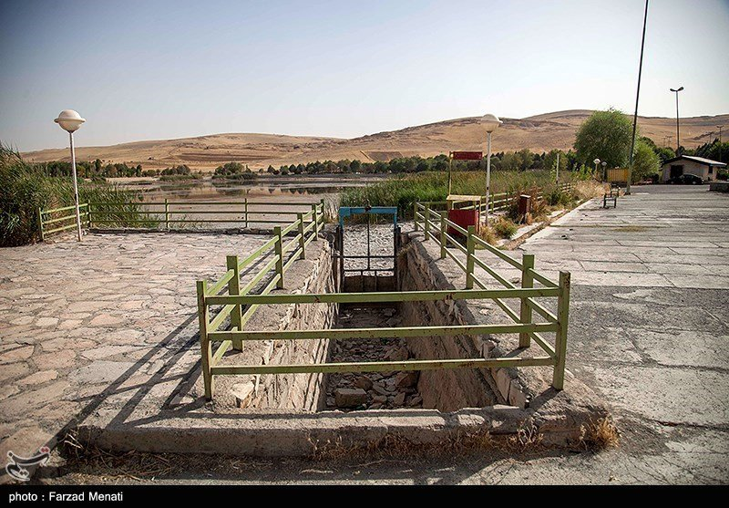

در شمال غربی شهر تاریخی کرمانشاه و در پای صخره‌های دشت ماهیدشت، استخری طبیعی و پهناور به نام «سراب نیلوفر» قرار دارد که در فصل تابستان، سراسر سطح آن با گل‌های زرد و سپید نیلوفر آبی پوشیده می‌شود. در باورهای کهن کردی، این سراب خاستگاه یکی از زیباترین افسانه‌های پریان در زاگرس است؛ افسانه‌ی «پری نیلوفر» که دختر محبوب چشمه‌سارها و پیونددهنده‌ی زمین و آسمان بوده است.

روایت کلهری بازگو می‌کند که در عهد باستان، این چشمه در پی خشکسالی مرگباری که کشتزارها را به آتش می‌کشید، خشکید و خاکش شکاف برداشت. دوشیزه‌ای پارسا و زیبا از تبار پهلوانان که رنج تشنگی مردم را تاب نمی‌آورد، با گلدانی از دانه‌های مقدس نیلوفر به میان بستر خشکیده سراب رفت و با تضرع از خداوندگار آب‌ها باران خواست. اشک‌های پاک دوشیزه بر خاک تشنه چکید؛ ناگهان چشمه‌هایی جوشان از زیر پای او فوران کردند و آب با سرعتی باورنکردنی سراب را فراگرفت. دوشیزه برای نجات بذرها، خود در دل آب باقی ماند و کالبد زمینی‌اش به پری درخشانی از نور بدل گشت که هر سال در فصل گرما، گل‌های نیلوفر را از اعماق آب به شکوفایی می‌نشاند.

> «هر نیلوفری که بر سراب کرمانشاه سر برآورد، چشم به دعای باران دارد؛ دست بر گلبرگش مزن، که دل پری چشمه می‌شکند و آب به اعماق تاریک خاک بازمی‌گردد.» — باور دیرین مردم کلهر در سراب نیلوفر.

کیوان پندار در کتاب «فرهنگ مردم کرمانشاه و باورهای آب‌های مقدس» نشان می‌دهد که سراب نیلوفر همواره در نزد اهالی غرب ایران مکانی آیینی شمرده می‌شده و پیوند ژرفی با معبد آناهیتا در کنگاور و تاق‌بستان دارد. مردم در ایام تیرگان به ساحل این سراب می‌آمدند و با پاشیدن آب بر روی یکدیگر و اهدای دانه‌های شیرینی به امواج، برکت و زلالی را طلب می‌کردند.

رقص گل‌های نیلوفر بر سطح آب در پرتو خورشید کرمانشاه، یادآور حضور زنده این پری اساطیری است که عشق خویش به مردمانش را در قالب گلبرگ‌های شاداب به تصویر کشیده است.

مردم کلهر کرمانشاه در گذشته‌های دور، بر این باور بودند که گل نیلوفر آبی سراب، گلی مقدس و آسمانی است که عصاره‌ی اشک‌های پری را در خود جای داده است. در جشن‌های سنتی آب، دوشیزگان ایل گیسوان خود را با آب سراب می‌شستند تا شادابی و درخشندگی پری چشمه بر بخت آنان بتابد. گلبرگ‌های خشکیده نیلوفر نیز در طب سنتی زاگرس برای درمان اندوه و آرامش دل‌های بی‌قرار به کار می‌رفت و نمادی از تسکین‌بخشی ابدی پری چشمه شمرده می‌شد.

### منابع و اعتبار تصویر
- **منبع پژوهشی افسانه:** کیوان پندار، «فرهنگ مردم کرمانشاه و باورهای آب‌های مقدس»، کرمانشاه، انتشارات طاق‌بستان، ص ۸۸-۹۳؛ سید ابوالقاسم انجوی شیرازی، «جشن‌ها و آداب زمستان»، ص ۲۰۴.
- **اعتبار تصویر:** ثبت‌شده در ویکی‌مدیا کامنز توسط Farzad Menati؛ مجوز انتشار: [CC BY 4.0](https://commons.wikimedia.org/wiki/File:Niloufar_Spring2022-08-13_19.jpg).
