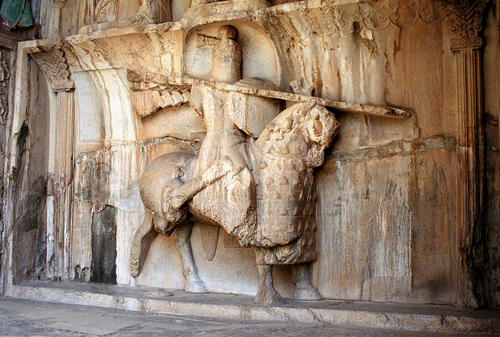

در سرزمین باستانی کرمانشاه، آنجا که صخره‌های پرغرور بیستون کتیبه‌های هخامنشی را در سینه دارند و طاق‌های ساسانی طاق‌بستان بر چشمه‌های جوشان سایه افکنده‌اند، نام اسبی افسانه‌ای در ترانه‌ها و متل‌های کُردی طنین‌انداز است: «شَودێز» (شبدیز). شبدیز، اسب سیاه‌فام، بادپا و وفادار خسروپرویز بود که در شعر نظامی و باورهای مردم زاگرس تندیسی از دلیری، وفاداری و هوش سرشار حیوانی به شمار می‌رفت؛ مرکبی چنان چابک که گویی سم‌هایش هرگز خاک زمین را لمس نمی‌کرد و بر فراز بادها می‌تاخت و چون باد صبا دشت‌های زاگرس را درمی‌نوردید.

روایت پیران کلهر و بیستون حاکی از آن است که شبدیز تنها یک اسب جنگی نبود، بلکه از تبار اسبان ایزدی چشمه‌های سیمره زاده شده بود. هنگامی که فرهاد کوه‌کن در سوز عشق شیرین صخره‌های بیستون را با تیشه می‌شکافت، شیرین سوار بر شبدیز از قصرشیرین به دیدار او می‌شتافت. در یکی از این دیدارها، اسب در پیچ تند صخره از پای درآمد؛ فرهاد با دیدن رنج شیرین، اسب را بر دوش گرفت و به بالای کوه رساند. اما شاهکار جاودانه، نقش‌برجسته‌ای است که فرهاد و سنگ‌تراشان کهن در طاق‌بستان آفریدند: پیکر سنگی شبدیز که سوار زره‌پوشش را با وقار بر فراز آب‌های چشمه نگه داشته است.

> عاشقان کردستان در پای کوه بیستون زمزمه می‌کنند: «صدای تیشه فرهاد خاموش شد، اما شیهه شبدیز در سنگینی صخره زنده است؛ اسبی که مرگش پادشاه را به سوگی جاودانه نشاند.»

افسانه می‌گوید خسروپرویز سوگند خورده بود هر کس خبر مرگ شبدیز را بیاورد گردن خواهد زد. باربد، رامشگر نامدار، با نغمه‌ای سوزناک بر ساز چنان ناله سر داد که پادشاه خود دریافت و گفت: «گویی شبدیز مرده است!» و باربد پاسخ داد: «شاه خود چنین فرمود!» سالخوردگان کرمانشاه باور دارند که در شب‌های ابری، شبدیز سنگی طاق‌بستان زنده می‌شود، یال‌های سیاهش در باد رها می‌گردد و گرد بیستون می‌چرخد تا وفاداری بی‌پایان به یاران باستان را یادآور شود. جوانان کُرد هنگام تاخت با اسبان اصیل کُردی، نام شبدیز را بر زبان می‌آورند تا برکت چابکی در گام‌های اسبشان بماند. سواره‌نظامان ساسانی و پهلوانان کُرد در گذر قرن‌ها، پیش از عزیمت به نبردهای سرنوشت‌ساز، در برابر تندیس سنگی شبدیز در طاق‌بستان زانو می‌زدند و کاسه‌ای از آب چشمه مقدس به یال اسب‌های خود می‌پاشیدند تا چالاکی و وفاداری شبدیز را در رگ‌های مرکب خویش جاری سازند. نقش‌برجسته شبدیز با زره‌پوش سنگین و سم‌های برافراشته‌اش، قرن‌هاست که چشم به جریان زلال آب‌های طاق‌بستان دوخته و شکوه خاموش تاریخ را بازگو می‌کند. شبدیز نماد ابدی همراهی، اصالت و عشق در منظومه اساطیر کُردی کرمانشاه است.

### منبع روایت و تصویر
- **خاستگاه افسانه:** خمسه نظامی گنجوی (خسرو و شیرین) و روایات فولکلوریک مردم کرمانشاه و بیستون پیرامون نقش‌برجسته شبدیز در طاق‌بستان.
- **عکاس / پدیدآورنده تصویر:** Philippe Chavin
- **منبع تصویر:** [صفحه تصویر در ویکی‌انبار](https://commons.wikimedia.org/wiki/File:Taq-e_Bostan_-_equestrian_statue.jpg)
- **نوع مجوز:** CC BY 2.5
