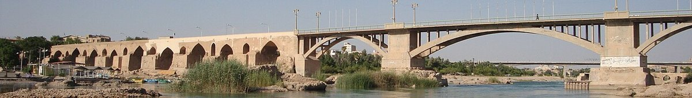

Along the historic sandstone banks of the ancient city of Dezful in northern Khuzestan, where the turquoise waters of the Dez River sweep past Sasanian millraces and the brick piers of the Old Bridge, oral storytellers have preserved the enchanting fairy tale of *Narenj-e Tala* (The Golden Bitter Orange). Recounted in the rhythmic cadence of the vernacular Dezfuli dialect, the tale celebrates the vital role of pure running water in the quest for true love.

The legend tells of a young prince who roamed the vaulted brick alleys of the old quarters, disillusioned by superficial courtiers. Beneath the arches of an ancient river mill, a wise water-woman revealed to him that his destined bride was concealed within three enchanted golden bitter oranges growing upon a solitary tree atop a cliff across the roaring river. She issued a solemn warning: "Never slice the golden rinds upon dry earth; they must only be opened at the very edge of the living river, or the thirst of the desert will consume them!" The prince swam the fierce currents of the Dez, scaled the precipice, and plucked the three radiant fruits.

> In the authentic words of the Dezfuli narrators: "The golden orange blooms only at the water's edge; whoever approaches with a clean spirit receives life from the Dez River, but malice is swallowed by the rushing tide."

Overcome by impatience on the arid road home, the prince cut open the first fruit; a radiant maiden appeared, gasping for water, but perished in an instant upon the parched earth. Grieving, he sliced the second orange with the same tragic result. Having learned his painful lesson, he rushed to the banks of the river and submerged the third orange beneath the crystal-clear waters before cutting the peel. From the golden rind stepped forth a maiden of peerless beauty with eyes bright as mountain dawn, breathing the intoxicating fragrance of orange blossoms. Though an envious sorceress attempted to drown her in the eddies, transforming her into a golden fish, the sacred purity of the Dez River dissolved the evil hex, reuniting the lovers beneath the ancient bridge.

### Anthropological & Folklore Analysis
"Narenj-e Tala" is a regional variant of the widespread Mediterranean and Middle Eastern "Three Oranges of Love" folktale (ATU 408). In Dezful, the story is deeply embedded in the civic geography of the river, utilizing the sacred life-giving properties of fresh running water as a catalyst for magical transformation and spiritual rebirth.

### Archival Sources & Attribution
- **Primary Source:** Folkloric Tale in the Dezfuli Dialect: The Story of Narenj-e Tala (Parts 1 & 2), ethnographic recording by Nahid Habibian, Anthropology and Culture.
- **Source URL:** https://anthropologyandculture.com/%D9%82%D8%B5%D9%87-%D8%A7%DB%8C-%D8%A8%D9%87-%DA%AF%D9%88%DB%8C%D8%B4-%D8%AF%D8%B2%D9%81%D9%88%D9%84%DB%8C-%D8%AF%D8%A7%D8%B3%D8%AA%D8%A7%D9%86-%D9%86%D8%A7%D8%B1%D9%86%D8%AC-%D8%B7%D9%84%D8%A7-1/
- **Original Language:** Dezfuli Dialect & Persian
- **Image Attribution:** File:Dezful Iran banner.jpg | Photographer: ZcarstvnzAuthor of original photo: Mansor110 | License: CC BY-SA 4.0
