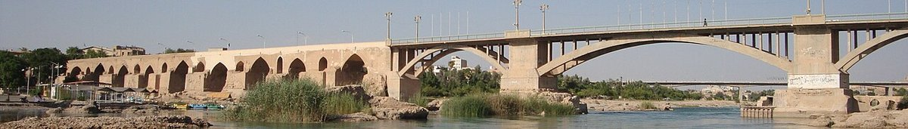

در امتداد ساحل صخره‌ای و بافت آجری کهنسال دزفول، آنجا که آب‌های زلال و نیلگون رودخانه دز از پای آسیاب‌های باستانی و طاق‌های ساسانی پل قدیم می‌گذرند، متل شورانگیز «نارنج طلا» (Narenj-e Tala) یکی از لطیف‌ترین و اصیل‌ترین قصه‌های عامیانه این کهن‌شهر است که با لهجه دلنشین دزفولی نسل به نسل نقل شده است.

داستان از شاهزاده‌ای خوش‌سیما حکایت می‌کند که در کوچه‌های آجرچین دزفول در جستجوی عشقی پاک و بی‌ریا روزگار می‌گذراند. روزی پیرزنی دانا در کنار طاق‌های نمناک ساحل رود به او گفت: «معشوق راستین تو در میان دختران نازپرورده شهر نیست؛ او در دل سه نارنج طلایی جادویی بر شاخسار درختی بر فراز صخره‌های آبگیر رود دز نهفته است؛ اما هشدار که این نارنج‌ها را تنها باید در لب آب زلال بشکافی وگرنه عطش هلاکشان خواهد کرد!» شاهزاده به شنا در امواج خروشان دز تن سپرد، از صخره‌های مرجانی بالا رفت و سه نارنج زرین و درخشان را چید. در راه بازگشت، از فرط کنجکاوی نتوانست شکیبایی ورزد و نارنج اول را در بیابان خشک گشود؛ پری‌دختری زیباروی با فریاد «آب! آب!» سر برآورد، اما در نبود آب، در یک دم چون حبابی ناپدید شد. نارنج دوم را نیز در دامنه خشکی شکافت و همان فرجام تکرار شد.

> کهنسالان دزفول در نقل متل به گویش خویش می‌گویند: «نارنجِ طلا لبِ رو وا مووه؛ هر کس دلش پاکه، دز بهش زندگی میده، هر کس بدخواهه، اوِ رو غرقش می‌کنه و به مراد نمی‌رسه.» (نارنج طلا تنها در لب رود گشوده می‌شود؛ هر کس دلی پاک داشته باشد دز به او زندگی می‌بخشد و هر که نیت بد دارد، آب خروشان او را ناکام می‌سازد).

شاهزاده درس عبرت گرفت؛ با سرعتی بی‌مانند به سوی ساحل دز شتافت و سومین نارنج طلا را در حالی که دستانش درون آب زلال و گوارای رودخانه بود، با کارد نقره‌ای شکافت. از دل پوسته‌های زرین، دختری پری‌زاد با چشمانی روشن و گیسوانی عطرآگین به بوی بهارنارنج پدیدار شد که با نوشیدن قطره‌ای از آب دز، جاودانه بر زمین ماند. اگرچه حسودان و ساحران تلاش کردند با فریب و جادو او را به کبوتر و ماهی زرین بدل سازند، اما وفاداری شاهزاده و پاکی آب‌های دز طلسم‌ها را باطل ساخت و پیوند آنان در کنار آسیاب‌های آبی شهر جشن گرفته شد.

### بن‌مایه‌ها و ویژگی‌های مردم‌شناختی
متل نارنج طلا در دزفول جلوه‌ای درخشان از پیوند آب شیرین و حیات‌بخش با باروری و عشق حقیقی است. حضور رودخانه خروشان دز (Dez River) به عنوان عنصری حیاتی در تطهیر و شکستن طلسم‌ها، بازتاب هویت معماری آجری و اقلیم نخل و نارنج خوزستان، و اهمیت حیاتی عنصر آب در فرهنگ مردم دزفول از ویژگی‌های برجسته این روایت بومی است.

### منابع و پژوهش
- **منبع اصلی:** قصه ای به گویش دزفولی: داستان نارنج طلا (بخش‌های ۱ و ۲)، پژوهش انسان‌شناختی ناهید حبیبیان، انسان‌شناسی و فرهنگ.
- **پیوند مرجع:** https://anthropologyandculture.com/%D9%82%D8%B5%D9%87-%D8%A7%DB%8C-%D8%A8%D9%87-%DA%AF%D9%88%DB%8C%D8%B4-%D8%AF%D8%B2%D9%81%D9%88%D9%84%DB%8C-%D8%AF%D8%A7%D8%B3%D8%AA%D8%A7%D9%86-%D9%86%D8%A7%D8%B1%D9%86%D8%AC-%D8%B7%D9%84%D8%A7-1/
- **زبان اصلی متن:** گویش دزفولی و فارسی
- **تصویر:** File:Dezful Iran banner.jpg | عکاس: ZcarstvnzAuthor of original photo: Mansor110 | مجوز: CC BY-SA 4.0
