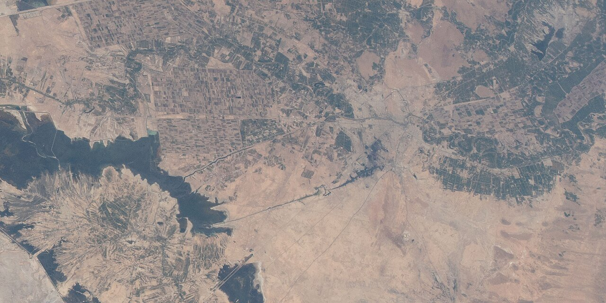

Beneath the humid, mist-shrouded date palm groves along the Karun River and across the vast reed waters of Shadegan wetland in Khuzestan, the name *Umm al-Sibyan* (known colloquially in southwestern Iran as *Shesh-Andaz* or the "Predator of Infants") strikes deep apprehension into the hearts of families. A terrifying nocturnal wraith born of malevolent wind and creeping shadows, she is depicted as a withered crone with disheveled, matted hair and curved iron talons, universally regarded as the sworn nemesis of newborns and mothers during the forty days following childbirth.

In both Khuzestani Arab and Persian folklore, Umm al-Sibyan arrives as an abrupt freezing draft sweeping through the palm fronds. Creeping over the wicker cradle, she breathes onto the sleeping child’s face or presses upon their frail chest, inducing violent convulsions, burning fevers, and choking respiratory seizures. Matriarchs warn that should a mother leave her infant unattended in the dark or leave an uncovered vessel of water in the birth chamber, Umm al-Sibyan will steal the infant’s shadow or swap the child for a sickly changeling.

> "Leave no cradle alone in the twilight and place cold steel beneath the child’s pillow; Umm al-Sibyan watches from the palm shadows, but flees the flash of forged iron and the scent of burning wild rue." — Ancient counsel of Khuzestani grandmothers.

Folklorist Gholam-Hossein Sa'edi in *Ahl-e Hava* and Jalal Al-e Ahmad observe that the Umm al-Sibyan archetype arose as a mythological explanation for real, life-threatening tropical ailments such as neonatal tetanus, malaria, and febrile seizures prevalent in marsh environments. To ward off the nocturnal demon, families established rigorous protective customs: tucking iron scissors beneath the mattress, adorning the infant with turquoise beads and protective amulets, and burning wild rue with alum each dusk. This cautionary folklore ensured around-the-clock maternal vigilance during the infant's most vulnerable weeks.

### Sources & Image Attribution
- **Research Source:** Gholam-Hossein Sa'edi, *Ahl-e Hava*, Tehran: Amir Kabir, pp. 98-103; Jalal Al-e Ahmad, *Monographs on Khuzestan and the South*, p. 175.
- **Image Attribution:** Documented on Wikimedia Commons by Earth Science and Remote Sensing Unit, Lyndon B. Johnson Space Center; License: [Public domain](https://commons.wikimedia.org/wiki/File:ISS067-E-1160_-_View_of_Iran-_Ahvaz_-_Karun_River_-_Shadegan_Ponds_(cropped).jpg).
