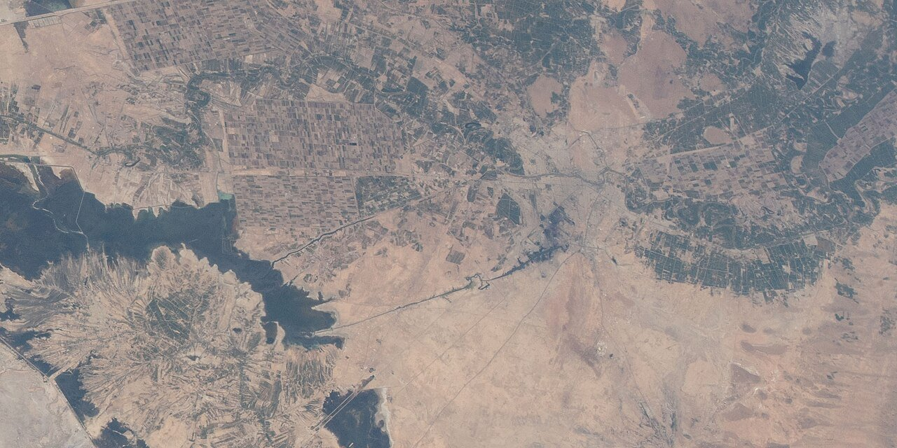

در نخلستان‌های مه‌گرفته‌ی حاشیه رود کارون و میان تالاب‌های اساطیری شادگان در خوزستان، نام «اُم‌الصِبیان» (که در گویش‌های محلی خوزی به «شش‌انداز» یا «مادر کودکان» نیز شناخته می‌شود) با ترسی دیرپا همراه است. ام‌الصبیان موجودی نامرئی، پیر و مخوف از تبار شیاطین باد و سایه است که با گیسوان ژولیده و ناخن‌هایی خمیده و آهنین، دشمن قسم‌خورده‌ی نوزادان، کودکان خردسال و مادران زائو در روزهای پس از زایمان به شمار می‌رود.

در باور مردم عرب و فارس خوزستان، ام‌الصبیان به صورت بادی سرد و ناگهانی یا پیرزنی سیاه‌پوش از سقف نخلستان‌ها فرود می‌آید. او شب‌هنگام بر بالای سر گهواره نوزاد ظاهر می‌شود و با دمیدن در چهره کودک یا فشردن سینه او، باعث تب‌های شدید، تشنج‌های ناگهانی یا قطع شدن نفس نوزاد می‌گردد. کهنسالان شادگان روایت می‌کنند که اگر مادری در چهل روز نخست پس از تولد کودک، او را حتی برای لحظه‌ای تنها بگذارد یا ظرف آب بدون سرپوش در اتاق نهد، ام‌الصبیان فرزند او را با یکی از فرزندان زشت‌خوی خود جابه‌جا می‌کند یا سایه‌اش را از جسم او می‌دزدد.

> «نوزاد را در تاریکی رها مکن و آهن تیز بر بالینش بنه؛ ام‌الصبیان از سایه نخل‌ها تماشا می‌کند و از درخشش فولاد و بوی اسپند چون باد می‌گریزد.» — پند مادران کهنسال در روستاهای حاشیه کارون.

غلامحسین ساعدی در پژوهش‌های مردم‌شناختی جنوب و جلال آل‌احمد در تک‌نگاری‌های خوزستان یادآور می‌شوند که باور به ام‌الصبیان، تجسم اساطیری و عامیانه بیماری‌های خطرناک دوران نوزادی نظیر کزاز نوزادان، مالاریا و تشنج‌های ناشی از تب در اقلیم گرمسیری و مرطوب جنوب بوده است. برای در امان ماندن از این دیو شوم، زنان خوزستانی سنت‌های حفاظتی دقیقی داشتند: سنجاق قفلی آهنی یا قیچی کوچکی را زیر بالش نوزاد می‌نهادند، گردنبندی از مهره‌های کبود و حرزهای مقدس بر گردنش می‌آویختند و هر غروب دانه‌های اسپند و زاج سفید را در آتش می‌سوزاندند تا هوای خانه از حضور شیاطین پاک گردد.

این اسطوره هولناک با ایجاد مراقبت شبانه‌روزی و حفظ اصول بهداشتی در دوران کهن، جان هزاران نوزاد را از خطرات محیطی تالاب‌ها و آب‌های راکد خوزستان نجات بخشیده است.

زنان محلی اهواز و شادگان برای خنثی کردن گزند ام‌الصبیان، سنت کهن آویختن حرزهای نقره‌ای و سوزن‌های پولادین را تا چهل روزگی نوزاد با دقت اجرا می‌کردند. در باور عامه، ام‌الصبیان نمادی از ناامنی شب‌های بیابان و خطرات ناشی از بادهای مسموم فصلی بود و این مراقبت‌های سرسختانه، محیطی امن، پاکیزه و سرشار از مهر مادری را برای بقای نوزادان در گرمای نفس‌گیر خوزستان به ارمغان می‌آورد.

### منابع و اعتبار تصویر
- **منبع پژوهشی افسانه:** غلامحسین ساعدی، «اهل هوا»، تهران، انتشارات امیرکبیر، ص ۹۸-۱۰۳؛ جلال آل‌احمد، «تک‌نگاری‌های خوزستان و جنوب»، ص ۱۷۵.
- **اعتبار تصویر:** ثبت‌شده در ویکی‌مدیا کامنز توسط Earth Science and Remote Sensing Unit, Lyndon B. Johnson Space Center؛ مجوز انتشار: [Public domain](https://commons.wikimedia.org/wiki/File:ISS067-E-1160_-_View_of_Iran-_Ahvaz_-_Karun_River_-_Shadegan_Ponds_(cropped).jpg).
