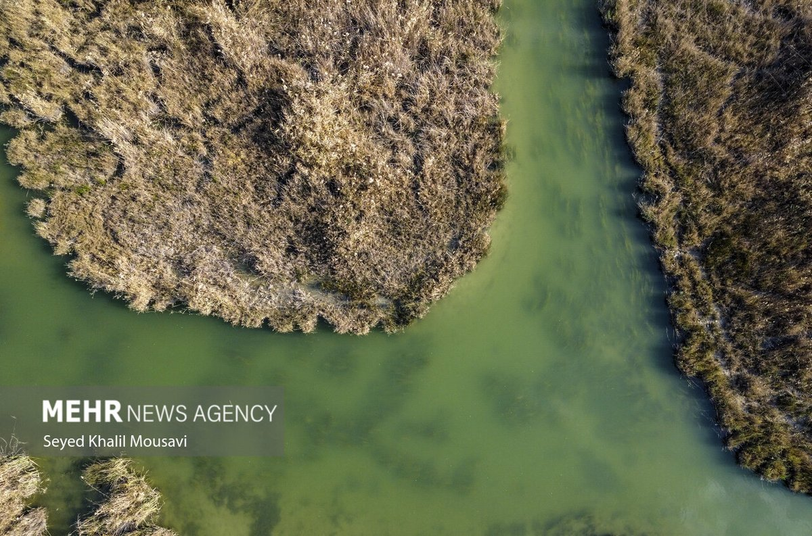

Across the boundless labyrinth of reeds comprising the Shadegan Wetland (Al-Falahiya) and the winding, muddy loops of the lower Karun River in Ahvaz, fishermen gliding in slender wooden *Mashoof* canoes maintain a reverent dread for *Al-Sa'luwah* (or *Sa'lat*). Far from a mere terrifying apparition, she is venerated in the oral folklore of Khuzestan's Arab communities as the ancient amphibious spirit of the marshes.

Depicted as a creature possessing the torso of an untamed woman draped in dark river-weed, burning ember eyes, and webbed amphibious talons, Al-Sa'luwah is believed to reside within the deepest, submerged eddies beneath floating reed beds (*Chibayish*). Traditional fishermen hold that she serves as nature's ultimate ecological sentinel. When reckless poachers poison the waterways, slaughter breeding stocks, or disturb the nesting grounds of migratory marsh-fowl, Al-Sa'luwah rises as a sudden maelstrom, overturning boats and pulling offenders down into the subterranean muck.

> As marsh elders declare in reed guest-houses (*Mudhifs*): "Al-Sa'luwah never harms an honest soul; but whoever defiles the water and the reeds is dragged to the abyss, never to return."

Conversely, to impoverished fishermen who treat the wetland with ancestral reverence—tossing a portion of their catch to hungry pelicans and chanting rhythmic *Mawwal* odes across the waters—Al-Sa'luwah acts as a miraculous benefactress. Countless legends speak of destitute families saved from starvation when a mysterious, web-fingered silhouette emerged during moonless winter nights to drive schools of giant carp directly into their submerged nets. In the collective consciousness of southwestern Iran, Al-Sa'luwah embodies the fragile, sacred equilibrium governing human survival in the wetlands.

### Anthropological & Folklore Analysis
The myth of Al-Sa'luwah traces ancient Mesopotamian and Semitic water-demon traditions, adapted to the unique ecological realities of the Khuzestan marshlands. Serving as an environmental enforcement mechanism, the folklore regulates traditional fishing practices, deterring overexploitation through the threat of supernatural retribution.

### Archival Sources & Attribution
- **Primary Source:** Journey into the Folktales and Myths of Ahwaz, Center for Ahwazi Historical and Anthropological Studies, and Analytical Survey of Folk Tales in Khuzestan (Falahiyati Archive).
- **Source URL:** https://astudies.org/ar/2025/11/%D8%B1%D8%AD%D9%84%D8%A9-%D9%81%D9%8A-%D9%82%D8%B5%D8%B5-%D9%88%D8%A3%D8%B3%D8%A7%D8%B7%D9%8A%D8%B1-%D8%A7%D9%84%D8%A3%D8%AD%D9%88%D8%A7%D8%B2/
- **Original Language:** Khuzestani Arabic & Persian
- **Image Attribution:** File:Shadegan International Wetlands (10).jpg | Photographer: Seyed Khalil Mousavi | License: CC BY 4.0
