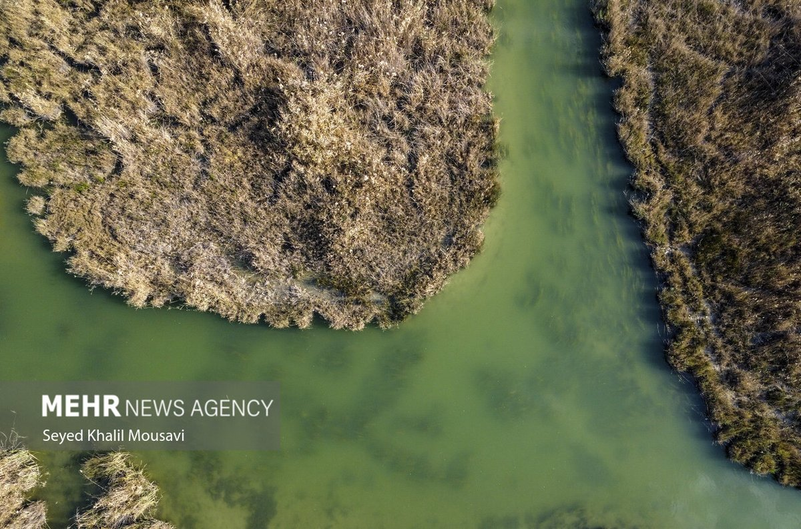

در میان نیزارهای بی‌انتهای هورالعظیم و تالاب بین‌المللی شادگان (الفلاحية)، آنجا که بلم‌رانان عرب سوار بر «مَشوف» (Mashoof؛ قایق باریک سنتی هور) در پیچ‌وخم آبراه‌های خاموش پارو می‌زنند و رود کارون در جلگه اهواز آرام می‌گیرد، باوری عمیق و کهن پیرامون موجودی افسانه‌ای به نام «السِّعلوة» (Al-Sa'luwah؛ سعلوات) در سینه شب‌های مضیف‌ها زنده است. در مطالعات مردم‌شناسی فولکلور عرب خوزستان، سعلوه هیولایی تک‌بعدی نیست، بلکه تجسم ارواح سرکش و باستانی آب‌ها و نیزارهاست.

روایت‌های بومی شادگان نشان می‌دهند که سعلوه زنی نیمه‌انسان و نیمه‌آبزی با گیسوانی انبوه از جلبک‌های تیره رودخانه، چشمانی چونان آتشدان گداخته و دندان‌هایی تیز است که در گرداب‌های عمیق زیرزمینی و زیر ریشه‌های نی اتراق دارد. صیادان کهنسال باور دارند که سعلوه دو چهره دارد؛ برای کسانی که با طمع‌ورزی، ماهیان کوچک و باردار را صید کنند، آب‌های هور را با مواد سمی بیالایند، یا آرامش مرغان مهاجر را بر هم زنند، سعلوه چونان طوفانی سیاه برمی‌خیزد، قایقشان را واژگون می‌سازد و آنان را به قعر لجنزار فرو می‌کشد.

> عرب‌های خوزستان در مضیف‌های نیین می‌گویند: «السعلوة ما تاذی ابن الحلال؛ بس المو محترم المای و الگصب، تسیحه لغمگ الهور وما یرجع ابد.» (سعلوه هرگز به انسان پاک‌نهاد گزند نمی‌رساند؛ اما هر کس حرمت آب و نیزار را پاس ندارد، او را به ژرفای هور می‌کشد و هرگز بازنمی‌گردد).

اما برای صیادان زحمتکش و پاک‌دستی که سهمی از صید روزانه خود را برای پرندگان گرسنه بر آب می‌ریزند و با زمزمه آوازهای محلی حرمت هور را نگاه می‌دارند، سعلوه فرشته‌ای یاری‌رسان است. داستان‌هایی نقل شده از ماهیگیرانی فقیر که در شب‌های سرد و بی‌صید، زن آبزی را با آوایی محزون بر کرانه دیده‌اند که ماهیان بزرگ کپور و بنی را به سوی تورهای آنان هدایت کرده و جان خانواده‌هایشان را از گرسنگی رهانیده است. پیوند میان انسان و سعلوه در فرهنگ جنوب خوزستان، نمادی از تعادل زیست‌محیطی و احترام ناگزیر به طبیعت دست‌نخورده تالاب است.

### بن‌مایه‌ها و ویژگی‌های مردم‌شناختی
افسانه «السعلوة» ریشه‌های عمیق میان‌رودانی و سامی کهن دارد که در جغرافیای زیستی تالاب‌های خوزستان بازآفرینی شده است. دوگانگی شخصیت سعلوه (هیولای انتقام‌جوی اکولوژیک و مادر مهربان آب‌ها)، باور به قداست زیست‌بوم هور، و استفاده از این کهن‌الگو برای آموزش اخلاق صیادی پایدار به نسل‌های جوان، جایگاه ویژه‌ای به این باور بخشیده است.

### منابع و پژوهش
- **منبع اصلی:** رحلة في قصص وأساطير الأحواز (پژوهش در اساطیر و قصه‌های عامیانه عرب خوزستان)، معهد دراسات الاحواز؛ و نظرة تحليلية علی الحکايات الشعبية العربية في خوزستان (مدونة فلاحيتي).
- **پیوند مرجع:** https://astudies.org/ar/2025/11/%D8%B1%D8%AD%D9%84%D8%A9-%D9%81%D9%8A-%D9%82%D8%B5%D8%B5-%D9%88%D8%A3%D8%B3%D8%A7%D8%B7%D9%8A%D8%B1-%D8%A7%D9%84%D8%A3%D8%AD%D9%88%D8%A7%D8%B2/
- **زبان اصلی متن:** عربی خوزستانی و فارسی
- **تصویر:** File:Shadegan International Wetlands (10).jpg | عکاس: Seyed Khalil Mousavi | مجوز: CC BY 4.0
