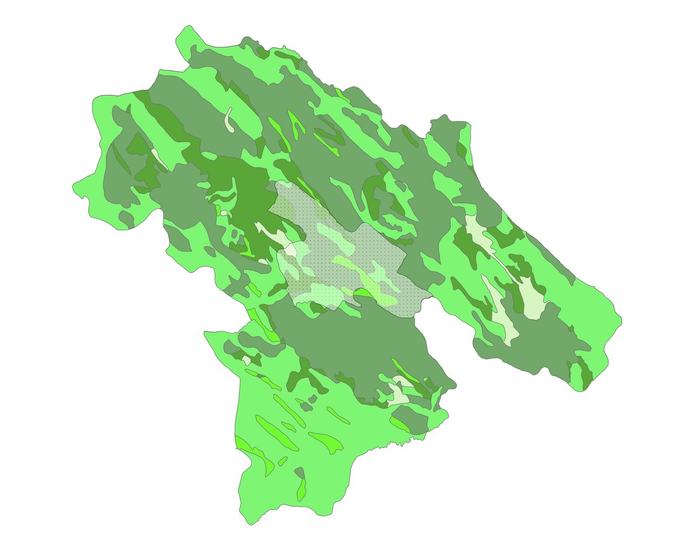

Enclosed within the sun-scorched gypsum hills of the southern Zagros in Bahmaie county lies *Barm-e Alvan*—an extraordinary, deep turquoise lake whose waters shift hues with the changing seasons. The nomadic Bahmaie tribes have long regarded this aquatic enigma with sacred caution, weaving legends around the *Div of Barm-e Alvan*, a subterranean aquatic fiend that inhabits the unfathomed thermal fissures beneath the lakebed.

Local Lur folklore maintains that the lake possesses no bottom, opening directly into primeval subterranean seas. The Div manifests as an undulating black slick beneath the ripples or as an austere, dark-robed stranger lingering upon the gypsum banks. During blistering summer middays, when stifling heat lures unwary herders and youth into the water, the Div extends spectral, kelp-like tentacles around their ankles, dragging them down into sulfurous abyssal sinkholes where no corpse ever resurfaces.

> "Never tread the shores of Barm-e Alvan in the blaze of noon; the waters change their color, and the Div waits within the iridescent foam to claim mortal breath." — Warning of Bahmaie elders in Sarpari village.

Folklorist Yaghoub Ghaffari in *Beliefs and Folktales of Kohgiluyeh and Boyer-Ahmad* explains that this myth corresponds directly to perilous natural hazards: underwater sinkholes and sudden releases of toxic sulfurous gases that alter water density, causing swimmers to sink. To placate the aquatic demon, nomadic herders historically cast virgin white sheep’s wool and wild rue into the lake at the start of summer, ensuring their flocks drank in safety. The mysterious chromatic shifts of Barm-e Alvan at dawn cement its reputation as one of the most enigmatic mythological water bodies of southwestern Iran.

### Sources & Image Attribution
- **Research Source:** Yaghoub Ghaffari, *Beliefs and Folktales of Kohgiluyeh and Boyer-Ahmad*, Yasuj: Chavil, pp. 63-68; Iraj Afshar Sistani, *Ethnography of Khuzestan and Kohgiluyeh*, p. 304.
- **Image Attribution:** Documented on Wikimedia Commons by Mr.Polaz; License: [CC BY-SA 4.0](https://commons.wikimedia.org/wiki/File:Choram_land_use.png).
