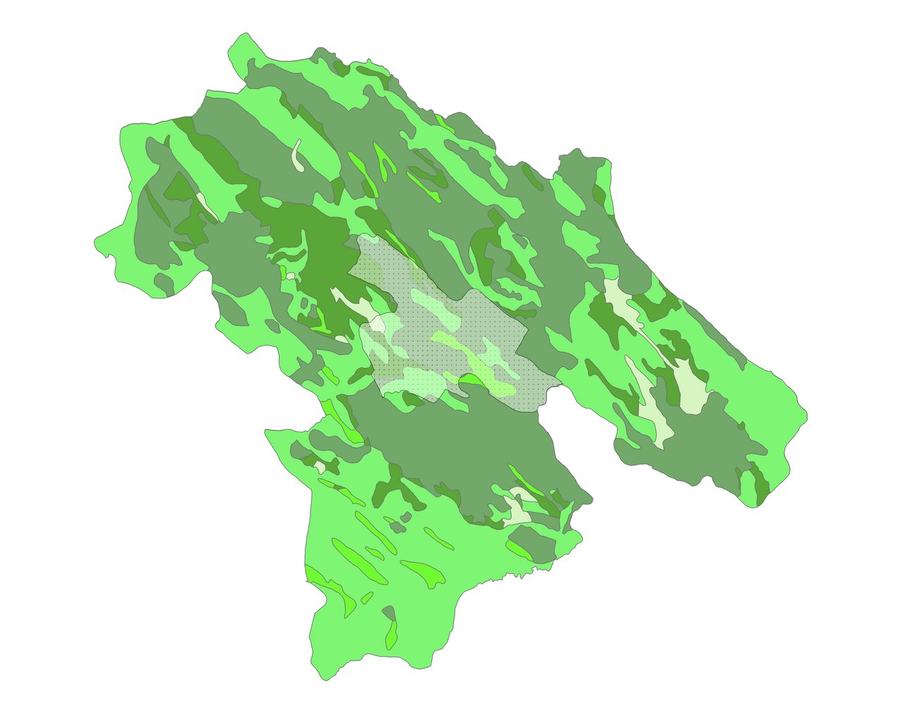

در دل تپه‌ماهورهای خشک و گچی زاگرس جنوبی در شهرستان بهمئی، دریاچه‌ای عمیق، فیروزه‌ای و شگفت‌انگیز به نام «برم الوان» جای گرفته است که رنگ آب آن در فصول مختلف تغییر می‌کند. مردم ایل بهمئی از دیرباز این دریاچه را دارای رازی مخوف می‌دانستند؛ رازی گره‌خورده با حضور «دیو آبزی» که در اعماق بی‌پایان چشمه‌های زیرسطحی دریاچه لانه دارد.

روایت لری بهمئی بازگو می‌کند که این دریاچه هیچ کفی ندارد و مستقیماً به اقیانوس‌های تاریک زیرزمین متصل است. دیو برم الوان، موجودی دگردیس و سیه‌چرده است که به شکل توده‌ای سیاه و لزج یا پیرمردی سیاه‌پوش بر ساحل دریاچه ظاهر می‌شود. او در ظهرگاهان تابستان که گرمای طاقت‌فرسا چوپانان و شناگران را به سوی آب می‌کشاند، وسوسه‌گر آب‌تنی می‌شود؛ اما به محض ورود شناگر به میان دریاچه، دیو پاهای او را در چنگال لجنی خود می‌گیرد و به درون حفره‌های تاریک اعماق آب می‌کشد، بی‌آنکه هرگز اثری از پیکر قربانی بر آب بازگردد.

> «در گرمای نیمروز بر کناره برم الوان پای منه؛ آب رنگ عوض می‌کند و دیو در سایه‌روشن کفاب‌ها در کمین نفس‌های گرم نشسته است.» — باور پیران ایل بهمئی در روستای سرپری.

یعقوب غفاری در کتاب ارزشمند «باورها و افسانه‌های کهگیلویه و بویراحمد» اشاره می‌کند که اسطوره دیو برم الوان، ارتباط مستقیمی با خطرات واقعی چشمه‌های گچی و گازهای گوگردی کف دریاچه دارد؛ پدیده‌ای طبیعی که گاه به دگرگونی ناگهانی چگالی آب و غرق شدن شناگران ناآشنا منجر می‌شده است. عشایر بهمئی برای دفع گزند این دیو، هر ساله در آغاز تابستان تکه‌ای از پشم سپید گوسفند نارسیده را با دانه‌های اسپند در آب می‌انداختند تا از قهر دیو در امان بمانند و احشامشان هنگام آب خوردن طعمه گرداب‌های ناگهانی نشوند.

رنگ‌های هفت‌گانه دریاچه برم الوان در سپیده‌دم و سکوت وهم‌انگیز نیزارهای پیرامون آن، این نگین پنهان کهگیلویه را به یکی از بکرترین و حیرت‌انگیزترین زیستگاه‌های دیوان آبزی در فرهنگ شفاهی جنوب غرب ایران بدل ساخته است.

روستاییان پیرامون برم الوان بازگو می‌کنند که در پاییز، هنگامی که لایه‌های گوگردی آب دریاچه به سطح می‌آیند و آب به رنگ نیلی تیره می‌نشیند، صدای غل‌غل خفیفی از قعر دریاچه شنیده می‌شود که مردم آن را نفس‌های خشمگین دیو در خواب زمستانی می‌دانند. بزرگان ایل بهمئی برای در امان ماندن جوانان از وسوسه شنا در گرداب‌های عمیق، نقل این افسانه‌ها را در شب‌نشینی‌ها زنده نگه می‌داشتند تا احترام به طبیعت پرخطر تالاب، با حکمت مردمی حفظ گردد.

### منابع و اعتبار تصویر
- **منبع پژوهشی افسانه:** یعقوب غفاری، «باورها و افسانه‌های کهگیلویه و بویراحمد»، یاسوج، نشر چویل، ص ۶۳-۶۸؛ ایرج افشار سیستانی، «مردم‌شناسی خوزستان و کهگیلویه»، ص ۳۰۴.
- **اعتبار تصویر:** ثبت‌شده در ویکی‌مدیا کامنز توسط Mr.Polaz؛ مجوز انتشار: [CC BY-SA 4.0](https://commons.wikimedia.org/wiki/File:Choram_land_use.png).
