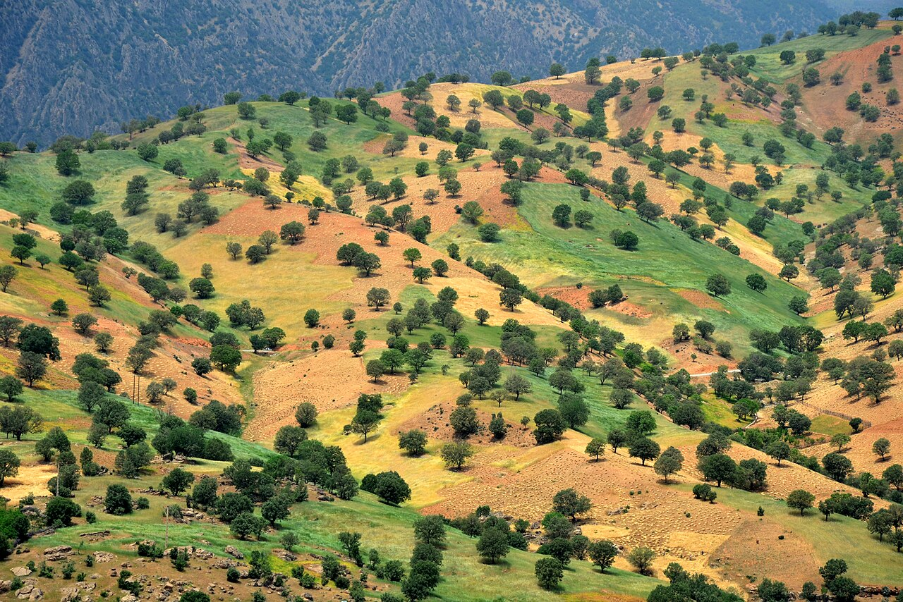

در دامنه‌های سترگ و پربرف رشته‌کوه دنا، بام کهگیلویه و بویراحمد، شهری زیبا و باغ‌دره‌ای مصفا به نام «سی‌سخت» آرمیده است. نام این دیار پرغرور، ریشه در یکی از حماسی‌ترین و سوزناک‌ترین تراژدی‌های اساطیری ایران‌زمین دارد؛ داستانی از وفاداری، دلیری و مرگ در آغوش بوران و برف که سینه‌به‌سینه در شاهنامه‌خوانی‌های عشایر بویراحمد روایت شده است. نام سی‌سخت یادگار جاودانگی «سی پهلوان سخت‌کوش» است که در واپسین سفر کیخسرو، پادشاه آرمانی ایران، همراه او به دل کوهستان سپید گام نهادند تا در پای رفیع‌ترین صخره‌های زاگرس بر پیمان وفاداری بمانند. باغ‌های گردو و تاکستان‌های سی‌سخت گویی در پای آن شکوه سنگی سر به تعظیم فرود آورده‌اند و جویبارهای جاری از چشمه میشی، زلالی اشک پهلوانان را زمزمه می‌کنند.

بر پایه این روایت حماسی، هنگامی که کیخسرو پس از پیروزی بر تورانیان و استقرار عدل، جهان خاکی را شایسته اقامت ندید و روی به سوی نیایشگاه ایزدی نهاد، سی تن از نامدارترین پهلوانان ایران‌زمین از جمله بیژن، گیو، فریبرز، طوس و گستهم، پای پیاده به دنبال او روانه ارتفاعات دنا شدند. پادشاه آنان را از همراهی بر حذر داشت و فرمود که در این کوهستان تندبادی سهمگین در راه است؛ اما پهلوانان سوگند خوردند که هرگز پادشاه خود را تنها نگذارند. کیخسرو در چشمه‌ای غسل کرد و در میان مهستان و برف ناپدید گشت. پهلوانان وفادار در گردنه‌ای که امروز «گردنه بیژن» نامیده می‌شود در جست‌وجوی شهریار ماندند تا آنکه طوفانی استخوان‌سوز و برفی سنگین فرود آمد.

> سالخوردگان سی‌سخت در شب‌های زمستانی می‌گویند: «آن سی پهلوان در زیر برف دنا نمردند؛ دنا کالبد آنان را در بلورهای یخ نگه داشته و هر صخره‌ای در گردنه بیژن نشانگر یکی از آن دلاوران است که سخت ایستادگی کردند.»

در باور مردم بومی بویراحمد، صخره‌های عمودی و تندیس‌مانند خط‌الراس دنا، پیکرهای یخ‌زده و سنگ‌شده همان سی پهلوان است که به سبب پایداری بی‌مانندشان در برابر بوران، «سی‌سخت» لقب یافتند. چوپانانی که در چمنزارهای کوه‌گل و گردنه بیژن شب را سپری می‌کنند، روایت می‌کنند که در شب‌های چله بزرگ، صدای طبل نبرد، خروش اسبان و نجوای بیژن در پیچش بادهای دنا به گوش می‌رسد؛ ارواحی که تا ابد حراست از سرحدات آزادگی و اصالت این خاک را بر دوش دارند. پیرزنان ایل هرگاه گردبادی از برف در قله می‌پیچد، اسفند دود می‌کنند و به روح پاک گیو و بیژن درود می‌فرستند. سی‌سخت با چشمه‌های جوشان، هوای خنک و قله‌های سربه‌فلک‌کشیده‌اش، موزه زنده‌ای از وفاداری جاودانه پهلوانان ایران باستان است.

### منبع روایت و تصویر
- **خاستگاه افسانه:** شاهنامه فردوسی و ادبیات روایی بومیان کهگیلویه و بویراحمد، وجه تسمیه تاریخی سی‌سخت و گردنه بیژن دنا.
- **عکاس / پدیدآورنده تصویر:** Alireza Javaheri
- **منبع تصویر:** [صفحه تصویر در ویکی‌انبار](https://commons.wikimedia.org/wiki/File:Dena_-_Khersan_-_Ab_Malakh_-_panoramio.jpg)
- **نوع مجوز:** CC BY 3.0
